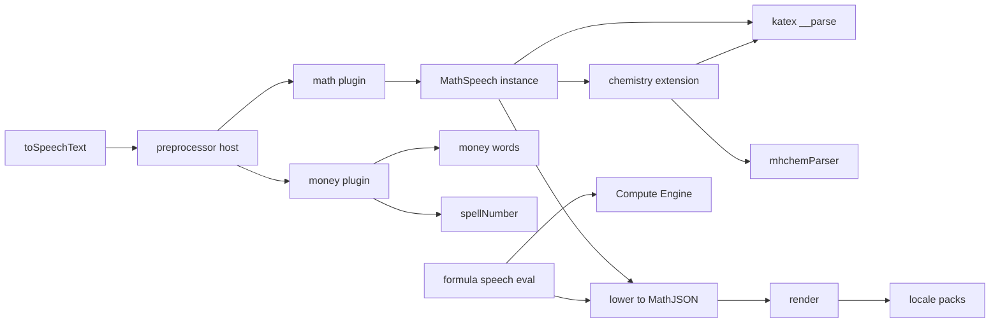
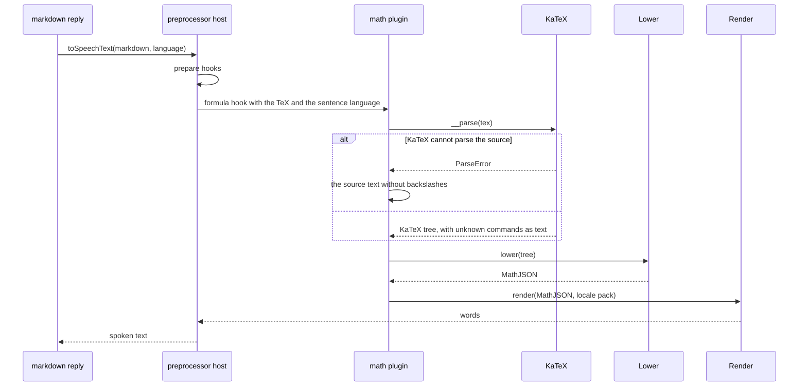

# Speech text preprocessor with a MathJSON layer

Status: accepted

## Context

`toSpeechText` in `@proj-airi/core-agent` turns a markdown reply into the text that a TTS provider reads. It reads
TeX formulas, chemistry, units, and prices as words in Chinese, English, Japanese, and Korean.

The formula reader has one hand-written pipeline:

```text
TeX ──parseTex──▶ TexNode (syntax) ──reader (guesses meaning and builds words) ──▶ speech
```

The reader mixes two jobs. It guesses what the notation means, for example that `\frac{d}{dx}` is a derivative or
that `0^{+}` is a side of a limit. It also builds the words of each language. A new language or a new reading touches
the same functions as a new rule of meaning. The chemistry reader parses a small part of mhchem by itself.

The formula speech eval (`evals/tts-speech-formula`) showed what goes wrong when a voice gets the text: a digit, a
letter, a unit, or a structure that the voice reads in another language or that the listener cannot parse. The fixes
of 2026-10-19 raised the rule engine from 89.5% to 98.5% without TTS, and from 70% to 94% with the official TTS. Each
fix added another guess to the reader.

Popular libraries already parse TeX and mhchem. KaTeX parses TeX for the renderer of the stage apps, about 17.8
million downloads each week. mhchemParser is the mhchem parser of KaTeX and MathJax. Compute Engine parses TeX into
MathJSON, but it is a computer algebra system. It changes what the writer wrote: `50\%` becomes `0.5`, `3\times10^8`
becomes one number, `AB` becomes a product, and `\overline{AB}` becomes a complex conjugate.

## Decision

### The goal is a reading for a person who listens

AIRI reads a reply aloud. A reading must keep the meaning of the formula and sound like a teacher who explains it. It
is not a dictation: it does not name details that only matter to a person who writes the formula down, such as the end
of a subscript or the case of a lone capital letter. A reading that changes the meaning, as silent brackets after a
minus sign do, is a defect. A reading that adds words only for a dictation is a defect too.

### Three layers for formulas

```text
TeX ──KaTeX parse + normalize──▶ syntax tree ──lower──▶ MathJSON (meaning) ──render + locale──▶ speech
```

- **Parse.** `katex.__parse` with `throwOnError: false` is the syntax parser. KaTeX is the parser of the formulas that
  the user sees, so speech and display agree: an override gives rehype-katex the catalog KaTeX. The catalog pins the
  exact version, because `__parse` is not a public API. KaTeX returns a command that it does not know as text, so `\foo{x}` still reads. Unbalanced braces are balanced
  first, and input that KaTeX still cannot parse falls back to the source text without backslashes.
- **Normalize.** The KaTeX tree is a layout tree. Normalization joins what KaTeX splits for display, for example the
  digits of `3.14` and of `10^{8}`, unwraps the groups around scripts and arguments, reads negations from the MathML
  branch, and pairs delimiters. The result is the small syntax tree of `tex.ts`.
- **Lower.** One module turns the syntax tree into MathJSON. It holds every rule of meaning, for example `d/dx` as
  `D`, a one-sided limit, an interval after `\in`, a product with a parenthesized sum, and a function signature.
  Lowering keeps what the writer wrote. It never simplifies or evaluates.
- **Render.** One module reads MathJSON. It chooses words only by the head of each expression and the locale. It has
  no rule of meaning.

### MathJSON, extended for speech

The tree uses the MathJSON format: a number, a string symbol, or an array whose first item is the head. Standard heads
keep their MathJSON meaning, so the eval can compare them with Compute Engine. Speech needs more than standard
MathJSON keeps, so the tree also has these heads:

| Head | Meaning | Why standard MathJSON is not enough |
| --- | --- | --- |
| `Percent` | `50\%` | Standard parsing turns it into `0.5`. |
| `Name` | `AB`, `ABC` of geometry | Standard parsing reads juxtaposition as a product. |
| `Segment`, `Arc` | `\overline{AB}`, `\overset{\frown}{AB}` | Standard parsing has a conjugate or no meaning. |
| `Unit` | `m`, `km/h`, `m/s^2` | The unit keeps its symbol, denominator, and power. Standard MathJSON has no unit reading. |
| `Celsius` | `25^\circ\mathrm{C}` | Standard parsing turns degrees into radians. |
| `Chemistry` | the content of `\ce{}` | MathJSON has no chemistry. |
| `Delimiter`, `Group` | parentheses that the writer wrote | Lowering decides whether they are read: `Group` is read as a quantity, `Delimiter` is silent. |
| `Mapping`, `Clauses` | `f: X \to Y, x \mapsto y` | A signature and comma-separated statements read as one sentence each. |
| `Apply` | `f(x)`, `H_k(M, N)` | Standard parsing calls only known functions. Other names and their parentheses become a product. |
| `Sequence` | `r, s \in \Sigma` | The items of a list read with a pause. Without it, `r, s` reads as the product `r s`. |
| `Arrow` | `H_k(M) \to H_k(M, N)` | `To` reads "approaches". An arrow between two structures is a map and reads "to". |
| `Superscript` | `\mathbb{N}^{+}`, `f^{(n)}` | A sign or a label in parentheses is a mark, not a power. |
| `Bracket`, `Placeholder` | `[M]`, `p(\cdot)` | Square brackets around one item and an empty argument slot are read. |
| `Expectation`, `Probability`, `Variance`, `Covariance` | `\mathbb{E}_{x \sim p}[f(x)]` | Standard parsing reads `\mathbb{E}` as a set, and its brackets as a factor. The subscript is the condition. |
| `Distributed` | `x \sim p_t` | Standard `\sim` is similarity. On the right of `\sim`, a calligraphic name or a density letter is a distribution. |
| `BigUnion`, `BigIntersection` | `\bigcup_{i=1}^{n} A_i` | Standard parsing has no bounds for them, so the upper bound reads as a power. |
| `Compose`, `Assign`, `GreaterApprox`, `LessApprox`, `NotDivides`, `Proves` | `f \circ g`, `x \coloneqq y`, `n \gtrsim 10` | Lowering keeps the meaning that the renderer needs. `Ceil` and `Floor` are standard heads. |
| `Inverse`, `Ordinal` | `f^{-1}(x)`, `\cos^{-1}`, `n^{\text{th}}` | Standard parsing reads them as powers, and the listener hears 1/f. |
| `Cases`, `Case`, `Matrix`, `Determinant`, `Row` | `\begin{cases}`, `\begin{pmatrix}` | Each case reads with its condition, and each row with its cells. Without them, the cells run together. |
| `Raw` | `\ce{H2O}` before its extension lowers it | The parser keeps the source of an extension command. |

TeX writes a call and a product the same way, as in `f(x)` and `n(n+1)`. Lowering reads parentheses after a name as a
call when they hold a comma, hold no operator, or follow a name with scripts, an accent, or a usual function letter.
Parentheses after a function command, as `\ln(x+1)`, or after upright text, as `\operatorname{tr}(A)`, are a call too.
Other parentheses after a letter multiply. A call reads "f of x" in English. In Chinese, Japanese, and Korean a simple
call keeps the reading of a product, and a call with more than one argument or with an operator says its parentheses.

`1e-3` written without spaces is scientific notation, and the parser rewrites it as `1\times 10^{-3}`. `2e - 1` with
spaces keeps Euler's number. Digits grouped as `1,000,000` or `1{,}000` join, but one plain group, as `[1,100]`, stays a
list.

`3\times10^{8}` stays `Multiply` and `Power`. Standard parsing folds it into one number, and the speech tree keeps
it as the writer wrote it.

A symbol keeps its letter case. The renderer says the case only when one formula uses both cases of a letter.

### Chemistry with mhchemParser

`\ce{}` and `\pu{}` go through `mhchemParser.toTex`. KaTeX parses its output, and lowering turns it into `Chemistry`
nodes: species, coefficients, charges, states, hydrate dots, and arrows. The hand-written mhchem grammar is removed.

### Streamed segments

A speech producer used to hold the whole reply until `end()`, so an answer started to speak only after the model
ended. Markdown cannot be parsed one token at a time: a formula, a code block, a link, or a table that is cut in two
reads as its source. The pipeline now has a segmenter before the transformation:

```text
model text ──MarkdownSegmenter──▶ segment ──toSpeechText──▶ spoken text ──TTS chunker──▶ TTS requests
```

- `MarkdownSegmenter` ends a segment after a sentence end or a line, only where nothing is open: fenced code,
  `$$...$$`, `\[...\]`, inline code, `$...$`, `\(...\)`, link brackets, emphasis, or a table. A `$` before a price does
  not open a formula.
- A line ends a segment only when the next line has started. An indented line can continue a list item, and parsed
  alone it would be a code block. A line of `=` makes a heading.
- `toSpeechText` reads each segment. `before` is the spoken text of the segment before it, so a display formula that
  starts a segment reads in the language of the text before it.
- A flush follows each segment, because the chunker reads one character past a sentence end.
- Constructs that refer to later text, as reference link definitions, read as text. Model replies rarely use them.

### A preprocessor for all spoken text

`toSpeechText` becomes a host for preprocessor plugins. A plugin owns one kind of content, for example formulas,
money, or numbers in prose. The words come from locale packs, so a contributor adds the reading of a language without
changing a plugin.

```text
markdown ──\( \[ to $──▶ prepare hooks ──remark──▶ mdast ──formula and prose hooks──▶ spoken text
                                                          │
                                                          ├─ money  (prepare: escape prices, prose: read prices)
                                                          ├─ math   (formula: KaTeX → MathJSON → render,
                                                          │          prose: bare TeX such as \ce{H2O})
                                                          └─ future: rewrites, special pronunciations, prose numbers
```

A plugin has three optional hooks:

| Hook | Input | Rule |
| --- | --- | --- |
| `prepare` | the markdown before parsing | Each plugin gets the output of the plugin before it. |
| `formula` | one TeX formula and its language | The first plugin that returns words wins. The source is kept when none does. |
| `prose` | a run of text or inline code, its language, and `readFormula` | Each plugin gets the output of the plugin before it. |

- A plugin is trusted in-process code, as voice input plugins are, see
  [voice plugins watch and finalize](2026-10-16-voice-plugins-watch-and-finalize.md).
- Installation order decides which plugin sees a node first. There is no dependency graph. The default order is
  money, then math, so a price reads before the math plugin looks for bare TeX.
- `options.preprocessors` replaces the default list. A caller adds a plugin by putting it in front of
  `defaultSpeechPreprocessors()` or after it.
- The rules of formulas are a rule system without the speech pipeline, so other projects can use them. They are in
  three packages:
  - `@proj-airi/mathjson`: the MathJSON types and helpers.
  - `@proj-airi/speech-transformer-math`: parse, lower, render, units, and the locale packs.
  - `@proj-airi/speech-transformer-chem`: mhchem chemistry, as an extension of the math reader.
- `MathSpeech` is a class. Each instance owns its locale packs and extensions, so two callers, or two tests, can read
  differently in one process. core-agent creates one instance, `mathSpeech`, with chemistry.
- An extension (`MathSpeechExtension`) names raw commands, for example `\ce`. KaTeX does not parse them. The parser keeps
  their source in a `Raw` node, the extension lowers it to its own heads, and its render handlers read those heads.
- Chemistry and units are not preprocessor plugins. They appear only inside formulas, and the formula hook already
  selects the first reader.
- A locale pack (`MathLocale`) holds the words of one language for formulas and units. A chemistry locale
  (`ChemLocale`) holds the words of chemistry for the same language. Money is not a formula rule, so its words are in
  the money plugin of core-agent. `mathSpeech.register`
  adds a pack or replaces one, and returns a function that restores the earlier pack. A language without a pack uses
  English. The math plugin uses the pack of its sentence.
- The tests of each language are next to its locale pack, for example `locales/ko.test.ts`.
- Unit packs name each SI prefix and unit once. `speakUnit` composes them, so a pack does not list each pair.

## Scope

- `packages/core-agent/src/voice/output/`: the preprocessor host, and the math and money plugins.
- `packages/mathjson`, `packages/speech-transformer-math`, and `packages/speech-transformer-chem`: the rules of
  formulas, units, and chemistry, and their locale packs for `zh`, `en`, `ja`, and `ko`.
- `evals/tts-speech-formula`: a structural comparison of the lowered MathJSON with Compute Engine, a speed benchmark,
  and an optional MathBridge dataset.

Non-goals:

- Compute Engine in `@proj-airi/core-agent`. It stays a dependency of the eval only.
- Evaluation, simplification, or type inference of formulas.
- Thai and other languages without a locale pack.
- Changes to the TTS providers or to the speech stream.

## Module dependencies



## Affected files

```text
packages/core-agent/src/voice/output/speech-transformation/
  index.ts                           `toSpeechText`, the host of the preprocessor plugins
  segmenter.ts                       `MarkdownSegmenter`, the safe ends of streamed markdown
  language.ts                        primary language subtags, and the language of the words around a formula
  markdown.ts                        code spans, and `\(...\)` and `\[...\]` delimiters
  preprocessor/types.ts              plugin contracts
  preprocessor/math/                 the mathSpeech instance, the math plugin, and bare TeX
  preprocessor/money/                the money plugin, prices, and money words
packages/mathjson/src/index.ts       types and helpers of the speech MathJSON
packages/speech-transformer-math/src/
  speech.ts                          MathSpeech: locale packs, extensions, and the call stack
  extension.ts                       the extension contract
  parse.ts                           KaTeX parse, raw commands, unknown commands, fallback
  lower.ts                           KaTeX tree to MathJSON
  render.ts                          MathJSON to words
  locales/{zh,en,ja,ko}.ts           locale packs, with their tests next to them
packages/speech-transformer-chem/src/
  chem.ts                            mhchemParser to Chemistry nodes, and their reading
  index.ts                           the chemistry extension
  locales/{zh,en,ja,ko}.ts           chemistry words and compound names, with their tests next to them
evals/tts-speech-formula/
  eval/test-objects/rule/src/        structural comparison with Compute Engine
  eval/cases/math-bridge/            optional MathBridge cases
```

## Sequence



## Measurements

Measured on 2026-10-20 with `vitest bench` on 14 formulas of the eval:

| Layer | Time for all formulas |
| --- | --- |
| Parse (KaTeX and normalize) | 0.25 ms |
| Lower | 0.06 ms |
| Render | 0.10 ms |
| Whole pipeline | 0.52 ms |
| The replaced hand-written parser and reader | 0.22 ms |

The pipeline is about 2.4 times slower than the replaced reader, about 37 µs for each formula. KaTeX parsing is the
largest layer. A reply has few formulas, so the cost is small next to TTS.

Lowering was first the slowest layer, because each symbol scanned all alias groups. An index of the spellings made it
eight times faster.

## Test plan

- Unit tests for each layer: parsing and fallback, lowering of each head, rendering of each head in each locale, and
  the host order of plugins.
- The 188 existing speech tests stay unchanged as a regression net. A change of their expected text needs a reason in
  the commit.
- The eval compares lowered MathJSON with Compute Engine on the standard heads, and lists the differences in a
  snapshot.
- A benchmark measures the old reader and the new pipeline on the formulas of the eval, and reports each layer.
- The full eval runs without TTS for every test object. Runs with TTS need account credit.
