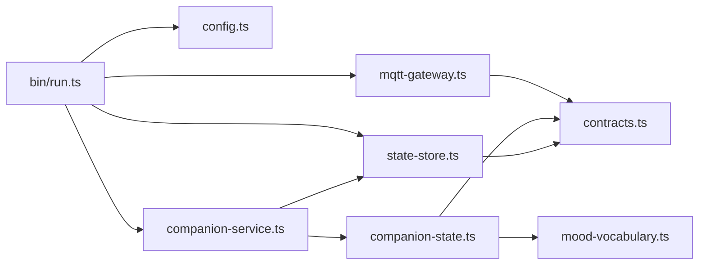
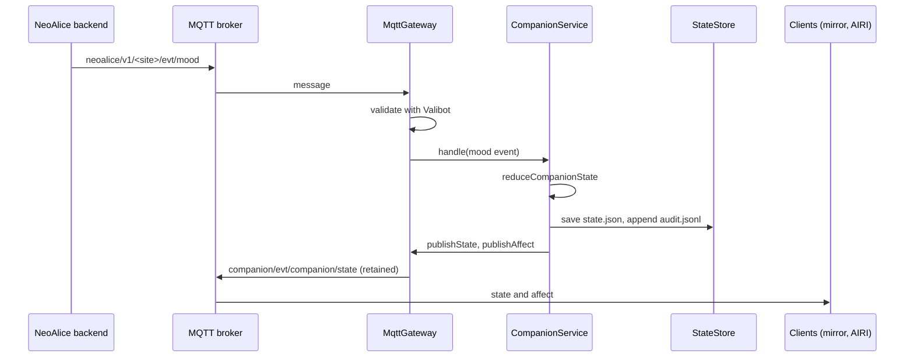

# Alice companion state service over MQTT

Status: accepted

## Context

Alice runs on two kinds of clients. The MagicMirror module shows a TalkingHead avatar. AIRI windows show VRM or MMD models. All clients receive commands from the NeoAlice backend over MQTT on `neoalice/v1/<site>/...`.

Plan 02 in `docs/alice-motion-engine/` adds a persistent companion state: mood, energy, five relationship metrics, and time together. AIRI memory lives in IndexedDB on each client. If each client keeps its own companion state, the clients disagree.

The NeoAlice mood system already exists. It sends `{"mood": "..."}` with no intensity, cause, or event ID. The MagicMirror module maps that mood with a table that drops `love`, `fear`, and `disgust`.

## Decision

- One Node service, `services/alice-companion`, is the only writer of the companion state. It runs next to the broker.
- Transport is MQTT with the `mqtt` package (MQTT.js 5). The MagicMirror module already uses it, and it works in Node and in a browser over WebSocket.
- The NeoAlice mood system stays the mood authority. The service copies the mood, and it never writes on `evt/mood`.
- The service publishes on its own site (`neoalice/v1/companion/...` by default). The running mirror does not read those topics, so it does not change.
- One vocabulary table maps NeoAlice moods to TalkingHead moods and AIRI emotions. Consumers read both names from the state.
- A pure reducer owns every rule: idempotency, caps, streaks, energy, consent. The service only queues events, saves, audits, and publishes.
- Metrics change only through a proposal that points to a counted turn. Chat alone never changes a metric.
- Storage is a JSON file with an atomic rename, a `.bak` copy, an append-only audit log, and a PID lock.

## Module graph



## Affected files

```text
pnpm-workspace.yaml              catalog entry for mqtt
services/alice-companion/
  package.json, tsconfig.json, vitest.config.ts, README.md
  src/contracts.ts               Valibot schemas of every MQTT message and of the state file
  src/mood-vocabulary.ts         NeoAlice -> TalkingHead and AIRI names
  src/companion-state.ts         pure reducer and published views
  src/state-store.ts             file storage, backup, audit, lock
  src/companion-service.ts       queue, save, publish
  src/mqtt-gateway.ts            topic routing, derived turns, output topics
  src/config.ts                  environment
  src/bin/run.ts                 injeca wiring and shutdown
```

## Sequence



## Scope

- Sprint S05 of Plan 03: the mood adapter (B1) and the reducer for metrics, energy, and time (B2).
- Derived turns from `evt/stt/final` and `cmd/tts/say`, until the backend publishes `evt/dialog/turn_end`. The backend does not change before the new avatar is validated (`docs/alice-motion-engine/JUSTIFICATIVA_ALTERACOES_NEOALICE.md`).
- `evt/dialog/turn_end` in the NeoAlice `v: 1` envelope. The NeoAlice inventory of 2026-11-03 found no end-of-turn event and proposed this shape. `evt/companion/interaction` stays for clients outside NeoAlice.
- The 14 states of the NeoAlice `MoodProfile`. Five of them (`reflective`, `cozy`, `melancholic`, `mischief`, `grouchy`) have no direct renderer name, so the table uses the nearest name.

## Non-goals

- Relationship stages and hysteresis (B4), events and milestones (B6), and the dashboard (B3).
- Time decay. Absence never removes points.
- A change to the MagicMirror module or to AIRI renderers.
- Authentication. The broker ACL protects the command topics.

## Test plan

- Unit tests for the reducer: idempotency, interrupted turns, 100 turns without metric change, streaks across UTC midnight, clock moved back, energy cost and recovery, reported energy, proposal evidence, per-proposal and daily caps, consent, mode rules, scoped reset, audit content.
- Unit tests for the store: backup, damaged file, audit lines, single owner, stale lock.
- Unit tests for the service: 50 concurrent events, duplicate events, restart, wrong persona, failed publish.
- Unit tests for the gateway with a real MQTT.js client that does not connect: payload shapes, invalid fields, own origin and site, repeat window, derived turns, site filter, output topics.
- Manual end-to-end run against a local Mosquitto broker before each release.
