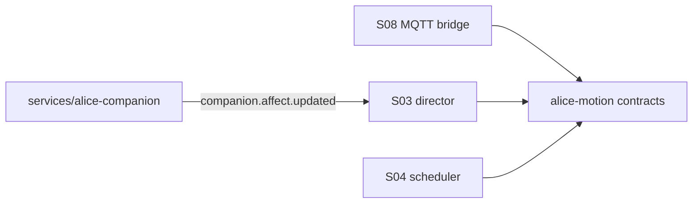
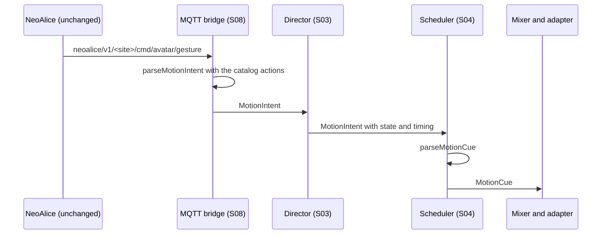

# Alice motion contracts, version 1

Status: proposed. It waits for the approval of the project owner, as the S02 exit criterion in Plan 03 requires.

## Context

Plan 01 (`docs/alice-motion-engine/PLANEJAMENTO_E_HISTORICO_CONVERSA.md`, section 5) proposes `MotionIntent` and `MotionCue`. Plan 03 (sprint S02) requires these contracts to be frozen before the director (S03), the scheduler (S04), and the MQTT bridge (S08) are written.

The NeoAlice backend already sends avatar commands over MQTT. Plan 03 forbids changes to NeoAlice before the new avatar is validated. So the bridge must translate the current NeoAlice messages, and NeoAlice does not learn the new contracts.

## Decision

- The contracts live in `packages/alice-motion/src/contracts.ts` as Valibot schemas. Types are inferred from the schemas.
- `MotionIntent` keeps the fields of Plan 01 and adds an optional `sessionId`. Plan 01 requires cancellation by session (sections 6 and 11), but its type had no field for it.
- `MotionCue` needs exactly one of `clipId` and `generatorId`.
- `parseMotionIntent` and `parseMotionCue` never throw. A message above 4096 bytes is refused before parsing.
- The semantic action whitelist comes from the motion catalog at runtime (`allowedActions`). The schema checks only the name format.
- Mood and relationship contracts stay in `services/alice-companion/src/contracts.ts`. The mood name table stays in `services/alice-companion/src/mood-vocabulary.ts`. This ADR does not copy them.

## NeoAlice messages and their intent (implemented in S08)

The bridge reads these existing topics. It never publishes on them.

| NeoAlice topic | Payload today | Intent |
| --- | --- | --- |
| `<site>/cmd/avatar/gesture` | `{"gesture":"wave","duration":3}` or `{"name":"wave"}` | `source: "vision"` for the door greeting or `"llm"` otherwise, `semanticAction` from the gesture name, `requestedDurationMs` from `duration` |
| `<site>/cmd/avatar/pose` | `{"pose":"straight"}` | `semanticAction: "pose_<name>"`, `requestedChannels: ["posture"]` |
| `<site>/cmd/avatar/animation` | `{"url":".../walking.fbx","duration":10}` | `semanticAction` from the catalog entry of the URL. An unknown URL is refused. |
| `<site>/cmd/avatar/emoji` | `{"emoji":"..."}` | `requestedChannels: ["facial"]`, short duration |
| `<site>/evt/mood`, `<site>/cmd/evt/mood` | `{"mood":"happy"}` | No intent. The mood goes through `services/alice-companion`, which publishes `companion.affect.updated` for the director. |
| `<site>/cmd/tts/say`, `<site>/cmd/tts/audio` | text or base64 WAV | `state: "speaking"` for the director. The speech start is the clock for `offsetFromSpeechMs`. |
| `<site>/evt/stt/final` | `{"text":"..."}` | `state: "listening"`, then `"thinking"` |

## Baseline recorded in S02

| Item | Value |
| --- | --- |
| Fork commit at S02 start | `319ecae` |
| Node | 22.23.4 |
| pnpm | 11.24.0 |
| three | 0.185.1 |
| `@moeru/three-mmd` | 0.2.0-beta.2 |
| `@pixiv/three-vrm` | 3.5.5 |

Observations:

- `vue-tsc` in `packages/stage-ui` runs out of memory with the default Node heap (about 2 GB). It passes with `NODE_OPTIONS=--max-old-space-size=8192`.
- `pnpm typecheck` with these settings: 67 of 67 tasks pass. The `dist` of `packages/electron-screen-capture` needed a new build after the full install, because an earlier partial install built it with `any` types.
- `turbo run test:run` (78 tasks) in the cloud container with Node 22.23.4: 73 tasks pass after the Playwright browser revision is linked. The other 5 fail for environment reasons, not for code:
  - `stage-web` and `stage-tamagotchi`: the network policy blocks `cubism.live2d.com`.
  - `auth-server`: 1 of 171 tests needs IPv6 on `::1`, which the container does not have.
  - `better-ws`: 12 of 94 tests need the global `CloseEvent` (Node 23 or later). With Node 26.13.0, the CI version, 94 of 94 pass.
  - `stage-ui`: 1 of 1998 tests fails with Node 22. With Node 26.13.0 it passes.
- `apps/stage-web` downloads the Live2D SDK and the preset models when the dev server starts. Without network access to `cubism.live2d.com` and `dist.ayaka.moe`, the dev server does not start.

## Module graph



## Affected files

```text
packages/alice-motion/
  package.json, tsconfig.json, vitest.config.ts, README.md
  src/contracts.ts        Valibot schemas and parse functions
  src/contracts.test.ts   tests with the reference event of Plan 01
  src/index.ts
docs/ai/adr/2026-11-04-alice-motion-contracts-v1.md
```

## Sequence



## Non-goals

- The director, the scheduler, the mixer, and the bridge. They are S03, S04, S07, and S08.
- Any change to NeoAlice topics or payloads.

## Test plan

- The reference event of Plan 01 is accepted.
- Wrong version, out-of-range values, unknown channels, repeated channels, bad action names, unknown sources, oversized messages, and non-object input are refused with a reason and without an exception.
- A cue with both or neither of `clipId` and `generatorId`, no channel, a weight above 1, or an expiry before the start is refused.
