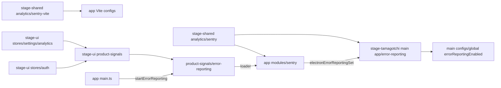
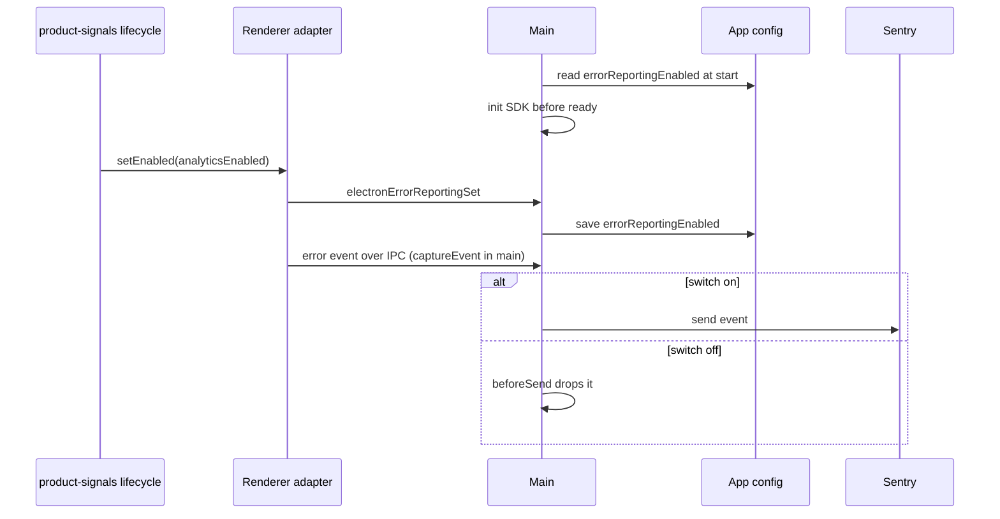

# Error reports on Sentry

Status: proposed

## Context

AIRI has no error reports from users' machines. Desktop crashes, mobile native crashes, and renderer exceptions are visible only when a user files an issue.

The product analytics provider keeps product events. Sentry gets errors, because it groups issues, detects regressions, and reads Electron minidumps and iOS and Android crashes. Both are parts of one data collection layer: one build switch, one user switch, one AIRI user identity.

## Decision

The desktop app, the web app, the mobile app, and the sign-in pages send errors to the Sentry organization `proj-airi`.

| App | Sentry project | SDK | Captures |
| --- | --- | --- | --- |
| `apps/stage-tamagotchi` | `stage-tamagotchi` | `@sentry/electron` | Main and renderer exceptions, Vue errors, native crash dumps of all Electron processes |
| `apps/stage-web` | `stage-web` | `@sentry/browser` | Browser exceptions, Vue errors |
| `apps/ui-server-auth` | `stage-web`, tag `app_surface: auth` | `@sentry/browser` | Browser exceptions, Vue errors |
| `apps/stage-pocket` | `stage-pocket` | `@sentry/capacitor` with its bundled `@sentry/browser` | JavaScript exceptions, Vue errors, native iOS and Android crashes |

Only errors are on. Tracing, Session Replay, logs, profiling, and user feedback stay off. Each one needs its own decision.

### One data collection layer

`stage-ui/libs/product-signals` owns the lifecycle of both product events and error reports.

| Concern | Product events | Error reports |
| --- | --- | --- |
| App wiring | `configureAnalyticsAdapter(loader)` | `startErrorReporting(app, isEnabled, loader)` |
| Provider contract | `AnalyticsAdapter` | `ErrorReportingAdapter`: the `captureException` and `setUser` of the SDK, and an optional `setEnabled` |
| Build switch | `VITE_ENABLE_ANALYTICS` | The same |
| User switch | `settings/analytics/enabled` | The same, read for each event by `beforeSend` |
| Identity | `identify` and `reset` from the auth lifecycle | `setUser({ id })` and `setUser(null)` from the same calls |
| Loading | Own chunk, bounded queue | Own chunk, bounded queue of Vue errors |

`stage-shared/analytics` owns the constants and the options, next to the product analytics configuration: `SENTRY_PROJECTS` (the DSN of each app) and `sharedSentryOptions` in `sentry.ts`, and the source map plugin `sentrySourceMaps` with the organization and project slugs in `sentry-vite.ts`. Node loads `sentry-vite.ts` from the Vite configs without a bundler, so it imports nothing relative.

The apps do not use `@sentry/vue`. `startErrorReporting` sets `app.config.errorHandler` and sends the component name and the Vue lifecycle hook. This removes the version coupling between `@sentry/vue` and the Electron and Capacitor SDKs, which require exact Sentry JS versions.

### Consent

| Path | How the switch applies |
| --- | --- |
| Web and mobile JavaScript | `beforeSend` reads the setting for each event. |
| Electron main, renderers, and crash dumps | The renderer SDK forwards each event to main. Main sends renderer events and crash dumps through `captureEvent`, so `beforeSend` in main sees all of them. The renderer adapter sends each change of the switch to main with `electronErrorReportingSet`. Main saves it as `errorReportingEnabled` in the app config, so a start that crashes before a renderer loads also follows it. |
| iOS and Android native crashes | The native SDKs send without the JavaScript `beforeSend`. They start only when the switch is on at app start (`enableNative`). |
| Sessions and client reports | Envelopes that are not events skip `beforeSend`. Session integrations, `enableAutoSessionTracking`, and `sendClientReports` are off. |

A native crash in a session where the user turned the switch off stays on the device. A later start sends it only when the switch is on again.

### Data

`sharedSentryOptions` turns off the data that the SDK collects by itself: inferred user identity, cookies, HTTP headers and bodies, URL query values, model inputs and outputs, and local variables. `beforeBreadcrumb` drops console breadcrumbs, because logs can hold chat text. Vue errors carry the component name, not its props.

A report carries the AIRI user id after login, the same id that product analytics uses. Errors and product events of one user can then be read together.

Electron crash dumps are process memory. Sentry processes them and does not store them by default.

### Source maps

`sentrySourceMaps` uploads source maps in CI when `SENTRY_AUTH_TOKEN` is set. Without the token, it does nothing.

- Web, sign-in, and mobile builds already ship source maps. The upload does not change that.
- Electron builds make hidden source maps only with the token. The plugin deletes them after the upload (`out/bundle/<build>` and `out/launcher`), so app.asar does not ship them. Builds without the token make no source maps, as before.

### Module dependency graph



### Affected files

```text
packages/stage-shared/src/analytics/sentry.ts                  (new: projects and shared options)
packages/stage-shared/src/analytics/sentry-vite.ts             (new: source map plugin)
packages/stage-ui/src/libs/product-signals/error-reporting.ts  (new: lifecycle and Vue error handler)
packages/stage-ui/src/libs/product-signals/index.ts            (drives both from one lifecycle)
apps/{stage-web,ui-server-auth,stage-pocket}/src/modules/sentry.ts
apps/stage-tamagotchi/src/renderer/modules/sentry.ts
apps/stage-tamagotchi/src/main/app/error-reporting.ts
apps/stage-tamagotchi/src/main/configs/global.ts               (errorReportingEnabled)
apps/stage-tamagotchi/src/shared/eventa/index.ts               (electronErrorReportingSet)
apps/stage-pocket/ios/App/CapApp-SPM/Package.swift, android/*.gradle (native plugin)
apps/*/vite.config.ts, apps/stage-tamagotchi/electron.vite.config.ts
.github/workflows/*                                            (SENTRY_AUTH_TOKEN)
```

### Desktop consent sequence



## Scope and non-goals

- Out of scope: the API server and the auth server. They have OpenTelemetry. A later decision can add Sentry there.
- Out of scope: a tunnel for networks that block `sentry.io`. Add one if reports from those networks are missing.
- Out of scope: source maps for the Docker and Hugging Face builds of stage-web. Their reports have minified stack traces.
- Out of scope: iOS dSYM upload and Android ProGuard mapping upload. Native stack traces of AIRI code stay unsymbolicated.
- Out of scope: a separate switch for error reports, and a link from a report to the product analytics session.

## Test plan

- `stage-shared/analytics/sentry.test.ts`: the session integrations and console breadcrumbs are removed.
- `stage-ui/libs/product-signals/error-reporting.browser.test.ts`: Vue errors, the user, and the switch that arrive before the adapter loads reach it. `beforeSend` follows the switch for each event.
- `stage-web/src/modules/sentry.browser.test.ts`: with the real SDK, no event while the switch is off, no session or client report envelope, no URL query value, no log line.
- Typecheck and build of each app with `VITE_ENABLE_ANALYTICS=true`. An Electron build with an invalid token leaves no `.map` file.
- Before the release: add the `SENTRY_AUTH_TOKEN` secret. Send a test error from each app and confirm it in Sentry with readable frames. Turn the switch off and confirm that no event arrives. Update the privacy notice.
