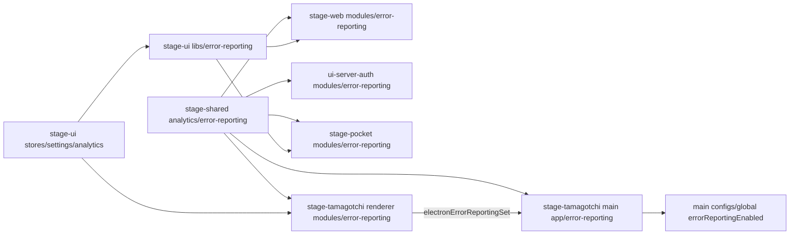
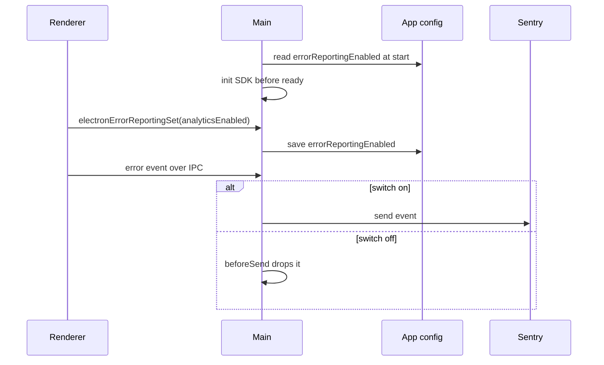

# Error reports on Sentry

Status: proposed

## Context

AIRI has no error reports from users' machines. Desktop crashes, mobile native crashes, and renderer exceptions are visible only when a user files an issue.

Product analytics and error reports have different owners and costs. PostHog keeps product events. Sentry gets errors, because it groups issues, detects regressions, and reads Electron minidumps and iOS and Android crashes.

## Decision

The desktop app, the web app, the mobile app, and the sign-in pages send errors to the Sentry organization `proj-airi`.

| App | Sentry project | SDK | Captures |
| --- | --- | --- | --- |
| `apps/stage-tamagotchi` | `stage-tamagotchi` | `@sentry/electron` with `@sentry/vue` | Main and renderer exceptions, native crash dumps of all Electron processes |
| `apps/stage-web` | `stage-web` | `@sentry/vue` | Browser exceptions |
| `apps/ui-server-auth` | `stage-web`, tag `app_surface: auth` | `@sentry/vue` | Browser exceptions |
| `apps/stage-pocket` | `stage-pocket` | `@sentry/capacitor` with `@sentry/vue` | JavaScript exceptions, native iOS and Android crashes |

Only errors are on. Tracing, Session Replay, logs, profiling, and user feedback stay off. Each one needs its own decision.

### Consent

The analytics switch in Settings > System > General also controls error reports. Builds without `VITE_ENABLE_ANALYTICS` do not start an SDK.

| Path | How the switch applies |
| --- | --- |
| Web and mobile JavaScript | `beforeSend` reads the setting for each event (`stage-ui/libs/error-reporting`). |
| Electron main, renderers, and crash dumps | The renderer SDK forwards each event to main. Main sends renderer events and crash dumps through `captureEvent`, so `beforeSend` in main sees all of them. The renderer sends the switch to main with `electronErrorReportingSet`. Main saves it as `errorReportingEnabled` in the app config, so a start that crashes before a renderer loads also follows it. |
| iOS and Android native crashes | The native SDKs send without the JavaScript `beforeSend`. They start only when the switch is on at app start (`enableNative`). |
| Sessions and client reports | Envelopes that are not events skip `beforeSend`. Session integrations, `enableAutoSessionTracking`, and `sendClientReports` are off. |

A native crash in a session where the user turned the switch off stays on the device. A later start sends it only when the switch is on again.

### Data

`stage-shared/analytics/error-reporting` gives every app the same `dataCollection` options. Reports do not carry user identity, cookies, HTTP headers or bodies, URL query values, model inputs and outputs, or local variables. `attachProps` is off, because component props can hold chats and character cards. Log lines are not recorded, because logs can hold chat text. Every app removes the `Console` integration, and the mobile app on Sentry JS 10 also turns off the console breadcrumbs of `Breadcrumbs`.

Electron crash dumps are process memory. Sentry processes them and does not store them by default.

### Source maps

The Sentry Vite plugin uploads source maps in CI when `SENTRY_AUTH_TOKEN` is set. Without the token, it does nothing.

- Web, sign-in, and mobile builds already ship source maps. The upload does not change that.
- Electron builds make hidden source maps only with the token. The plugin deletes them after the upload, so app.asar does not ship them. Builds without the token make no source maps, as before.

### SDK versions

`@sentry/electron` 8.3.0 forwards renderer init to `@sentry/vue`, so the main catalog pins `@sentry/vue` 11.8.0 to its core. `@sentry/capacitor` 4.5.0 requires exactly `@sentry/vue` 10.76.2, so the mobile app uses the named catalog `sentry-capacitor`. Shared modules therefore import no Sentry type.

### Module dependency graph



### Affected files

```text
packages/stage-shared/src/analytics/error-reporting.ts      (new)
packages/stage-ui/src/libs/error-reporting.ts                (new)
apps/stage-web/src/modules/error-reporting.ts                (new)
apps/ui-server-auth/src/modules/error-reporting.ts           (new)
apps/stage-pocket/src/modules/error-reporting.ts             (new)
apps/stage-pocket/ios/App/CapApp-SPM/Package.swift           (native plugin)
apps/stage-pocket/android/capacitor.settings.gradle          (native plugin)
apps/stage-pocket/android/app/capacitor.build.gradle         (native plugin)
apps/stage-tamagotchi/src/main/app/error-reporting.ts        (new)
apps/stage-tamagotchi/src/main/configs/global.ts             (errorReportingEnabled)
apps/stage-tamagotchi/src/renderer/modules/error-reporting.ts (new)
apps/stage-tamagotchi/src/shared/eventa/index.ts             (electronErrorReportingSet)
apps/*/vite.config.ts, apps/stage-tamagotchi/electron.vite.config.ts (source maps)
.github/workflows/*                                          (SENTRY_AUTH_TOKEN)
```

### Desktop consent sequence



## Scope and non-goals

- Out of scope: the API server and the auth server. They have OpenTelemetry. A later decision can add Sentry there.
- Out of scope: a tunnel for networks that block `sentry.io`. Add one if reports from those networks are missing.
- Out of scope: source maps for the Docker and Hugging Face builds of stage-web. Their reports have minified stack traces.
- Out of scope: iOS dSYM upload and Android ProGuard mapping upload. Native stack traces of AIRI code stay unsymbolicated.
- Out of scope: a separate switch for error reports.

## Test plan

- `stage-shared/analytics/error-reporting.test.ts`: the session and console integrations are removed, and an extra replaces its default.
- `stage-ui/libs/error-reporting.browser.test.ts`: the filter follows the switch for each event, also a stored opt-out before the store exists.
- Typecheck and build of each app with `VITE_ENABLE_ANALYTICS=true`.
- Before the release: add the `SENTRY_AUTH_TOKEN` secret. Send a test error from each app and confirm it in Sentry with readable frames. Turn the switch off and confirm that no event arrives. Update the privacy notice.
