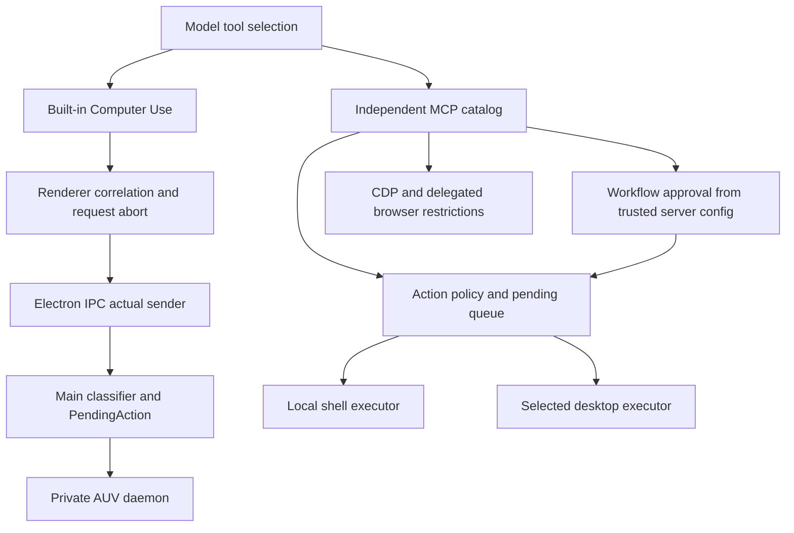

# Execution authorization boundary

Date: 2026-11-05. Audited production baseline: `daa6dfb3b7b3b3a506c82eff18daa9ab86f9303a`.
This Phase 2 report distinguishes source review, mock execution, real Electron reads, and future admission work.
No real GUI click, typing, activation, or browser mutation was executed.

## Result and threat model

An attached model can call advertised MCP tools and control their arguments. It does not thereby hold independent human consent.
A compromised Renderer can call IPC directly. Its session, turn, and tool-call strings are correlation, not authentication.
The Electron event supplies the actual WebContents identity. Trusted startup configuration is a separate operator decision.
This is a local execution boundary review, not an Internet-service or multi-tenant audit.

The accepted baseline had three confirmed approval bypass families:

1. The model could approve its own pending MCP action.
2. Workflow autoApprove and approved resume could override configured approval and claim an unexecuted step succeeded.
3. Raw CDP evaluation/navigation ran outside action approval.

A later source review identified the same conditional browser gap in browser_agent_run.
Its optional Python backend is absent by default. An available-backend mock reproduced dispatch without approval.
The final correction closes those public entry points in actions/all. It deliberately leaves them unavailable until trusted approval exists.
This is a bounded protection change, not a completed approval product.

## Actual authority topology



These are different execution surfaces. The built-in Main gate does not mediate an independently attached shell or browser service.
Authorization and resource serialization remain separate. No shared GUI mutex was added to the shell path.

| Surface | Model visibility | Permission owner and effect | actions/all after correction | Remaining boundary |
| --- | --- | --- | --- | --- |
| Built-in computer_use | Request tool selection | Main owns sender, classification and PendingAction | Reads allowed with correlation, input remains closed | Renderer can forge correlation for reads |
| Built-in image read/preview | Model tool or UI IPC | Main validates real path, file, format and size | Store-scoped access | Shared store, no session/artifact-owner ACL |
| MCP terminal_exec | Attached MCP catalog | MCP action policy, then host-user shell | Pending, zero shell dispatch before trusted approval | Arbitrary shell is high-risk and not semantically classified |
| MCP desktop click/type | Attached MCP catalog | Common policy and selected executor | Approval required, AUV desktop mutations denied | Other executors need their native target contracts |
| MCP public approve | Same agent-facing catalog | Same caller previously held approval authority | Denied before pending lookup/consumption | A trusted host adapter is absent |
| MCP workflow steps | Attached MCP catalog | Common action checks plus workflow options | autoApprove cannot weaken configured policy | Pending cancellation cleanup and actual settled resume remain incomplete |
| MCP PTY | Attached MCP catalog | Exact approvalSessionId, PTY id and active grant | New sessions queue, agent approval denied | Existing grant identity/TTL/session-end revocation needs host integration |
| MCP raw CDP evaluate/navigation | Attached MCP catalog | Browser debugger page authority | Denied before bridge access | Read-only CDP helpers use their separate handlers |
| MCP browser_agent_run | Attached MCP catalog | Optional Python backend and CDP authority | Denied before launch-context or backend access | Optional backend internals were not audited or installed |
| Extension DOM mutations | Names exist in catalog | Concrete extension bridge capability allowlist | Unsupported by current read-only bridge | Tool names do not prove executable writes |
| MCP VS Code CLI | Attached MCP catalog | Delegates to common terminal action path | Terminal policy applies | Authorized shell commands can affect other surfaces |

## Approval modes

| Mode | Action policy | Workflow flags | Direct CDP/delegated browser | Meaning |
| --- | --- | --- | --- | --- |
| actions, default | Mutation and sensitive-action approval | Cannot auto-approve server-required steps | Writes closed | No trusted human approver is installed yet |
| all | Every common action requires approval | Same restriction | Writes closed | This does not turn every independent read handler into an action |
| never | Approval flags deliberately cleared | Existing automatic execution remains possible | Existing direct execution remains possible | Explicit broad operator configuration, not one-time human approval |

Other denies, budgets and AUV read-only restrictions remain active in never mode.
Dry-run describes the desktop executor. It does not sandbox the local Terminal or CDP executor.
A permitted generic shell can launch applications, invoke AUV or other programs, access files, and make HTTP requests.
Simple command-string matching cannot reliably classify arbitrary PowerShell as read-only.
A task-specific GUI approval must not implicitly authorize a general Terminal escape route.

## Controlled reproductions and minimal corrections

Tests use the actual MCP server factory, registrations, SDK client and protocol transport.
Only OS, PTY, browser and optional Python boundaries are mocked. No mock result is labeled real Electron E2E.

| Negative case | Before | After | Evidence level |
| --- | --- | --- | --- |
| GUI denial followed by direct Terminal request | Terminal still pending, zero dispatch | Same | MCP protocol with mock executors |
| Agent self-approves pending Terminal action | One shell dispatch per actions/all run | Zero | MCP protocol with mock shell |
| Workflow true autoApprove | Two shell dispatches per run | Zero | MCP protocol with mock shell |
| Omitted workflow autoApprove | Source default true | Zero | Final parameterized MCP regression |
| Rejected workflow followed by approved=true resume | Two later shell dispatches per run | Zero | MCP protocol with mock shell |
| Cancelled workflow followed by public approval | No later mock mutation in the retained selected scenario | Zero | Does not prove pending-map cleanup |
| Raw CDP evaluate and navigation | Two browser dispatches per run | Zero bridge and browser dispatch | MCP protocol with mock debugger |
| Optional delegated browser, available-backend model | One backend dispatch per mode | Zero | Mock backend, no Python or live browser |
| PTY available, auto-approval false | Source queues the request | Queue retained, zero native creation | Existing acquisition callback, mocked availability |
| Explicit never Terminal/browser permission | Intentionally permitted | Retained | Mock execution only |
| Forged Renderer correlation plus GUI write | Main rejects absent/fake action | Same, three real IPC rejections | Real Electron Host, zero AUV writes |
| Host expired/cancelled/replayed/mismatched action | Existing fail-closed contract | Retained in Host suite | Mock boundary and manager tests |

The first strict MCP run failed eight of thirteen assertions. The retained log shows actual mock dispatch counts.
The optional-backend test separately failed twice before its guard. The final boundary file contains twenty passing tests.
Two inherited PTY/Chrome tests now assert refusal. They no longer treat an agent tool call as human consent.
The related MCP suite passes 79 tests. MCP typecheck passes. The built-in Host suite passes 142 tests with one skip.
The gateway's independent HTTP suite passes 18 tests. Its upstream is a fixture, not a real model.

Production changes stay in two registration modules. They reuse trusted server configuration and existing return contracts.
No new state store, policy engine, runtime, lease, planner, broker, UI or Notice was introduced.
The public approval route remains available under never only. That mode already represents broad operator authorization.

## Source anchors

- [MCP action and workflow registrations](../../../services/computer-use-mcp/src/server/register-tools.ts): public approval, five workflows, resume, and delegated browser dispatch.
- [MCP CDP registrations](../../../services/computer-use-mcp/src/server/register-cdp.ts): guards before debugger access.
- [MCP policy](../../../services/computer-use-mcp/src/policy.ts): AUV mutation denial, Terminal risk and approval modes.
- [MCP action executor](../../../services/computer-use-mcp/src/server/action-executor.ts): preflight, policy, pending queue, then local Terminal dispatch.
- [MCP session](../../../services/computer-use-mcp/src/session.ts): pending Map and createdAt, without expiry or authenticated Chat ownership.
- [Workflow engine](../../../services/computer-use-mcp/src/workflows/engine.ts): queue skip and the existing resume settlement assumption.
- [PTY registration](../../../services/computer-use-mcp/src/server/register-pty.ts): grant checks and native-available acquisition queue.
- [Main runtime](../../../apps/stage-tamagotchi/src/main/services/airi/computer-use/runtime.ts): classifier, exact action admission, request abort and private daemon.
- [Host action manager](../../../apps/stage-tamagotchi/src/main/services/airi/computer-use/action-manager.ts): immutable argv, TTL, identity equality and single consumption.
- [Host attribution](../../../apps/stage-tamagotchi/src/main/services/airi/computer-use/attribution.ts): explicitly states correlation is not authentication.
- [Boundary regression](../../../services/computer-use-mcp/src/server/execution-authorization.test.ts): actual MCP entry with mocked effects.

## A. Does vision reproduce outside the old private gateway copy?

Yes. A new gateway directory was made from the original external source and the delivered patch.
A separate replay of that patch produces identical normalized source. Tests do not depend on the old private directory.
A fresh Desktop profile and two real GLM-5.3-Flash Chat turns read unknown random nonces and both shape colors.
Actual Host inputs, AUV records, image tool results, upstream native image blocks and native window identity are retained locally.
The real malformed-image request fails with HTTP 400 and no upstream model request.
See [gateway instructions and patch](../../../scripts/gateway-tool-result/README.md).

## B. Can Terminal bypass GUI approval?

The accepted baseline had real production call paths that did so. Controlled MCP reproductions establish dispatch, without native writes.
The final correction blocks the reproduced self-approval and workflow routes in actions/all.
The built-in GUI gate still does not govern another independently authorized Terminal service.
Never-mode shell authority can invoke AUV or OS APIs. That is broad explicit startup permission, not a GUI-only grant.
No claim is made that arbitrary Terminal commands now receive reliable read-only classification.

## C. Is Host-owned PendingAction sufficient for one real approved GUI operation?

No. It supplies useful snapshots, exact argv/correlation/sender equality, TTL and one-time consumption.
It does not establish a real Chat turn's authority from Renderer-provided strings.
Its target is currently a parsed argument string, not a verified native window lifetime and owner.
Input is deliberately rejected even with a target. No production human-approval creator or adapter exists.
The runtime consumes an approved action before waiting for daemon connection.
Before enabling writes, move the final readiness/target/expiry/cancellation checks next to actual execution admission.
This ordering is a future admission concern. No input bypass was observed while input remains closed.
MCP pending actions are a different contract. They lack TTL, Chat ownership and complete cancellation cleanup.
Do not combine these stores merely because both contain pending actions.

## D. Which actual AUV operation is the best candidate?

The preferred candidate is one background click into an isolated Win32 harness, with an exact native window target:

```text
auv invoke input.clickPoint <window-x> <window-y>
  --target window:<native-window-id>
  --relative-to window
  --input-policy background-only
  --click-count 1
  --no-overlay
  --json
```

This is a candidate for later admission, not an enabled or natively validated operation in this round.
Use a harness button that commits its own random token once. A second harness window must remain unchanged.
Do not use global coordinates without a target, foreground fallback, delayed focus, or keyboard typing.

The installed AUV 0.0.40 help accepts window targets, window-relative coordinates and background-only policy for input.clickPoint.
Its binary SHA-256 is `590e629266202147876f92e28d6d01edd94522f4ed31b3d30f1e3bffeb5a9678`.
Source review uses AUV commit `ca443e9dd7330e026fa3e36335372ae244feef4b`:

- `crates/auv-cli-invoke/src/commands/input.rs:901` selects an exact Window id from the current enumeration.
- `crates/auv-cli-invoke/src/commands/input.rs:922` calls window().click with that Window and WindowPoint.
- `crates/auv-driver-windows/src/session.rs:278` routes background policy to window-targeted messages, without foreground fallback.
- `crates/auv-driver-windows/src/background_input.rs:203` resolves the selected Window's native handle and hit-tested child control.
- `crates/auv-driver-windows/src/background_input.rs:229` posts button messages. Queue submission does not establish application effect.
- `crates/auv-driver-windows/src/input.rs:266` rejects targeted keyboard delivery on Windows.

Window title/OCR selection through window.clickText is a weaker initial approval target.
Its CLI selector uses title containment and main-visible preference. It does not accept an exact Window target.
The separate AUV background-session lifetime gate is not proof that this direct CLI path uses that gate.

Actual measurements here cover installed CLI help, native handle identity and background capture, not native clicking or typing.
The source revision and installed binary are separately identified. The binary does not expose a verified source-build SHA here.
Handle reuse, target replacement during approval, movement during delivery and independent mutation counts still require the next controlled gate.
Keep input closed until those conditions are established.

## E. Minimum next-phase scope

1. Reuse the existing normal Chat request closure and actual Electron sender. Define the exact trusted request identity assumption.
2. Add one Main-owned request/confirm/execute flow for the single harness click. Reuse PendingAction rather than another authorization store.
3. Bind full immutable argv and native window owner/lifetime. Revalidate target, request cancellation and expiry immediately before consumption.
4. Keep generic Terminal, other browser writes and every other GUI mutation outside that test grant.
5. Use one minimal real host confirmation. Do not accept model or Renderer-approved booleans.
6. Record AUV delivery separately from the harness's exact token, click count and unchanged distractor Oracle.
7. Cover reject, timeout, cancellation, target loss and duplicate consumption before any native acceptance claim.

No unified policy rewrite is needed to close this round's reproduced paths.
A narrow adapter to the existing policy and Host contract is the next candidate, subject to admission review.
The current result does not admit Phase 3. No GUI writes, B0 Notice or complete approval UI follow automatically.
