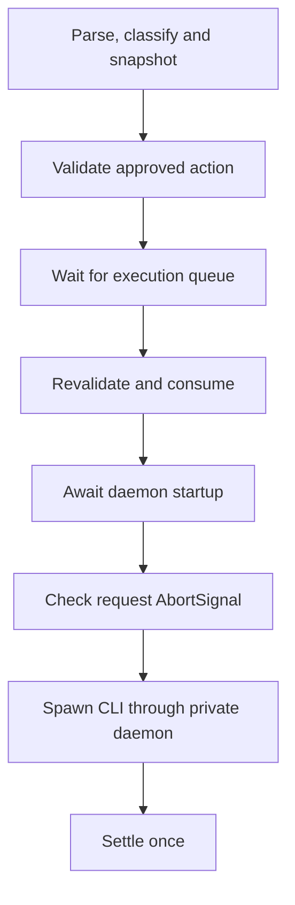

# Phase 3-A approval admission

Date: 2026-11-05. Audited AIRI baseline: `d3fc96c75e0390e8d235736b615574564d62680f`.

**Decision: NO-GO.** No real Harness click or model-driven write follows from this review.
The existing input deny remains active. The production authorization architecture stays unchanged.

## Existing PendingAction contract

| Requirement | Current behavior | Admission result |
| --- | --- | --- |
| Original Session, Turn, Tool Call | Stores and compares exact strings | Correlation only. Main does not authenticate a Chat turn from these Renderer fields. |
| Actual Electron sender | IPC derives the ID from `event.sender` | Existing matching and renderer-destruction cancellation are useful. |
| Immutable complete argv | Registration snapshots argv. Runtime snapshots before its queue. | Useful exact operation binding. |
| Exact native target | Stores a parsed `--target` string | No process instance, root/child generation, or control geometry binding. |
| Human authorization | `approve` is a Main method | No production creator or trusted confirmation adapter calls it. Tests call it directly. |
| Expiry | Checks pending/approved records at validation and consumption | No expiry recheck after the daemon startup await. |
| Cancellation | Cancels pending/approved matching actions | Already consumed actions do not change. Request AbortSignal is a separate check. |
| Single use | Synchronous validation and consumption | Replay fails. Failed settlement does not restore approval. |
| Input admission | All listed input commands fail execution preconditions | A matching target and a Main-approved test action still cannot enable clicks. |

The attribution comment in the action record does not authenticate Renderer correlation.
The actual guarantee is defined by [attribution.ts](../../../apps/stage-tamagotchi/src/main/services/airi/computer-use/attribution.ts).
Its sender comes from IPC. Its Session, Turn, and Tool Call remain caller-supplied correlation.

Production entry points expose run, image read, preview, and cancellation.
They do not expose a Main `approve` IPC handler.
The independent MCP public approval tool is not a trusted user interaction.

## Consumption ordering and reproduced gap

The [current runtime](../../../apps/stage-tamagotchi/src/main/services/airi/computer-use/runtime.ts) uses this order:

Input commands stop before this flow can dispatch them.
Tests use an already admitted `app.activate` mutation to inspect the shared startup ordering.
The process executor and Electron boundaries are Mock implementations. No app activation occurs.

Two controlled counterexamples reproduce the gap:

- The action expires during daemon startup. Startup completes and the Mock executor runs once.
- Host cancellation occurs during daemon startup. The action is already consumed, cancellation returns zero, and the Mock executor runs once.

The raw test log records `executorCalls: 1` for each counterexample.
Their passing assertions confirm the gap. They do not represent successful safety admission.

A request AbortSignal during the same startup wait stops dispatch.
The consumed action settles as failed and remains unavailable for replay.
This protects a different cancellation route. It does not replace action expiry or Host cancellation checks.

Moving consumption after readiness is the minimum ordering candidate.
All readiness awaits must finish before the final action, sender, expiry, cancellation, and target checks.
Consumption and CLI dispatch then need one synchronous commitment in Main.
AUV must still enforce the expected target at its later native delivery boundary.
This review does not apply that production change.

## Failure-path coverage

The [Host tests](../../../apps/stage-tamagotchi/src/main/services/airi/computer-use/chat-runtime.test.ts) retain real Chat/tool resolution and Eventa routing with Mock external boundaries.
The [delivery tests](../../../apps/stage-tamagotchi/scripts/phase3-harness/delivery-contract.test.ts) distinguish synthetic reuse from real native receipts.

| Required failure | Observed result | What it establishes |
| --- | --- | --- |
| Unapproved click | Missing action or pending state rejects. CLI/startup count zero. | Current Host gate |
| Fake ID, forged approval, other session/sender | Rejects. Forged `approved`, `status`, and `userConfirmed` fields do not approve. | Exact ID/correlation/sender matching, not authenticated Chat ownership |
| Target closes before approval | Native Dry-run cannot resolve the closed HWND. Host input remains closed. | No real click, not an implemented approval-time target check |
| Replacement or identity change | Native old-ID lookup fails when the HWND changes. Synthetic ABA has the same stock target string. | **Same-value replacement remains a blocker** |
| Expiry, cancellation, replay | Before consumption: rejects. During startup: late expiry and Host cancellation counterexamples dispatch Mock work. Replay still rejects. | **Startup commitment remains a blocker** |
| Approval wait and unrelated read | A pending click stays outside the execution queue. Another turn's `window.list` completes. | Existing store behavior. No native approval dialog was run. |
| Failure after consumption | Startup, spawn, timeout, abort, and failed CLI settlement do not restore the action. | Existing one-use contract |
| Other execution surfaces | Different target, typing, scroll, activation, Terminal and browser argv cannot use the exact click action. MCP restrictions retain their own tests. | No grant delegation between these services |

The Host has no Terminal/browser command bridge through an approved click.
An independently authorized generic shell remains a separate authority.
This review does not claim that GUI approval governs every external service or arbitrary local program.

## Minimum trusted confirmation interface, design only

`dialog.showMessageBox` is a Main API that returns a selected button index.
The installed Electron declarations also include cancellation via AbortSignal.
See [Electron dialog](https://www.electronjs.org/docs/latest/api/dialog#dialogshowmessageboxwindow-options).
No dialog is created in this phase.

The narrow candidate interface has these obligations:

1. Main captures the current invocation, actual WebContents, immutable argv, and executor-provided target binding.
   Main creates one record in the existing PendingAction manager.
2. Main displays a native confirmation for that exact record.
   It includes operation, point, count, background policy, native owner, fixture instance, window generation, and expiry.
   Cancel is both the default and cancellation choice.
3. Only the Main-owned dialog response closure can call `approve`.
   The model, Renderer payload, action ID, native fixture command, and MCP approval tool cannot supply that decision.
4. A late allow response cannot approve an expired, cancelled, rejected, replaced, or renderer-destroyed action.
   Confirmation waits outside the shared desktop execution queue.
5. After daemon readiness, Main rechecks the same request and target before one consumption.
   The executor then rechecks the same binding immediately before native delivery.
6. Main settles once. It never restores consumed approval after an error or uncertain delivery.
   The original tool request receives the actual result.

This design does not turn Renderer correlation into authenticated Chat ownership.
A later implementation must state the trusted original-request source and prove that source's relationship to the recorded IDs.
If it cannot establish that relationship, admission remains blocked.
The design adds neither another authorization store nor a public approval endpoint.

Required confirmation tests, before native admission:

- Hold the confirmation promise and complete an unrelated read.
- Return cancel, close, timeout, request abort, or renderer destruction and assert zero dispatch.
- Close or replace Target A before the allow response and assert zero dispatch.
- Return allow after expiry, cancellation, or a previous settlement and assert zero dispatch.
- Attempt changed argv, another sender, another Chat request, or Target B and assert zero dispatch.
- Reject provider/model approval fields without opening an execution route.
- Use the genuine native Host interaction in a separate authorized test.

These are interface acceptance tests for future work. They are not implemented approval behavior in this delivery.

## Phase 3-B admission table

| Required condition | Status |
| --- | --- |
| Host proves approval of the concrete operation and target | **Not met:** no trusted confirmation adapter or authenticated original-request proof |
| Executor rejects target loss or identity change at actual delivery | **Not met:** stock numeric HWND target has no approved lifetime/control binding |
| Target A and Target B have independent Oracle | **Prepared:** separate native processes and business counters. Positive click path remains untested. |
| Reject, cancel, expire, replay never start a write | **Not met:** early-consumption counterexamples require an ordering change |
| No general GUI input required | Input stays closed. No new input allowlist exists. |
| Research directory stays read-only | No command writes, cleans, resets, or changes its configuration. Local evidence records preservation limits. |
| Real trial stays inside isolated Harness | Candidate scope only. No real input trial occurs. |

The [target contract](./phase3-target-delivery-contract.md) records the independent minimum AUV proposal.
The [Harness guide](../../../apps/stage-tamagotchi/scripts/phase3-harness/README.md) gives reproducible commands.

Phase 3-A ends with NO-GO. Production fixes and a real single-click trial require separate admission.
B0 Notice, C3, approval cards, Planner, and a new Agent Runtime remain outside this delivery.
