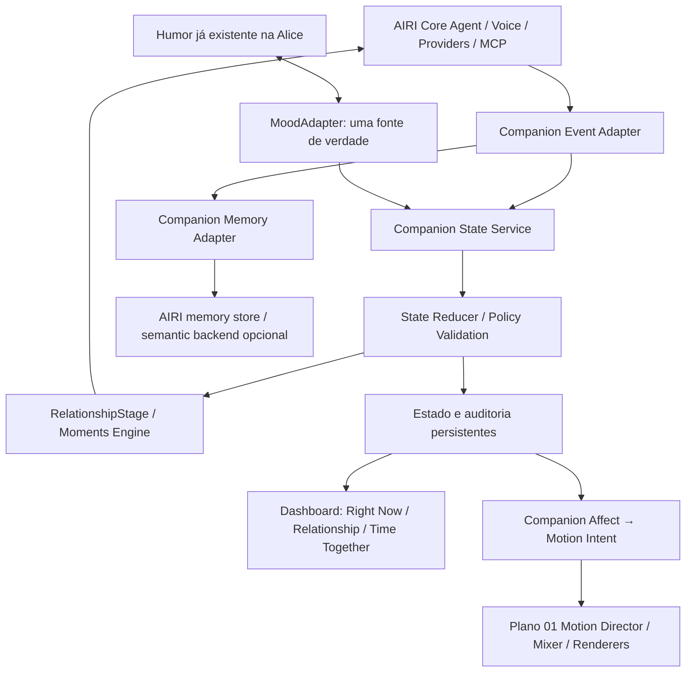

# Planejamento 02 — Alice Companion Intelligence
## Estado afetivo, relacionamento, memória experiencial e autonomia sobre o AIRI

**Projeto:** Alice / fork [overcyber/airi](https://github.com/overcyber/airi)  
**Data da pesquisa:** 03/11/2026  
**Natureza:** segundo planejamento de melhoria; somente documentação, sem implementação.  
**Preservação obrigatória:** este documento NÃO substitui, edita ou reordena `docs/alice-motion-engine/PLANEJAMENTO_E_HISTORICO_CONVERSA.md`. O plano anterior é o **Plano 01 — Motion Director e Motion Mixer**.  
**Condição fornecida pelo responsável:** a IA Alice **já possui sistema de humores**; integrar esse sistema, não criar outro mecanismo conflitante.  
**Condição de plataforma:** preservar AIRI e a diversidade de provedores, incluindo **NVIDIA NIM no AIRI Desktop**, OpenAI-compatible, vLLM, Ollama, LM Studio, áudio, ferramentas, MCP e automações.  
**Estado das afirmações:** identificação estática de recursos a partir de código e documentação, sem executar os aplicativos nem inferir que todo recurso do README está pronto. A ausência indicada abaixo quer dizer *não localizado como recurso equivalente nas partes inspecionadas do AIRI*; não prova inexistência absoluta.

---

# 1. RESUMO EXECUTIVO

**Decisão:** implementar uma **camada nova e independente de estado e experiência do personagem (Companion State & Relationship Engine)** sobre o agente e os renderizadores já presentes no AIRI. Priorizar as ideias funcionalmente verificadas no Utsuwa: humor causal, energia, cinco indicadores independentes de relacionamento, estágios, registro de tempo de convivência, marcos/eventos, memória semântica e um painel auditável.

O AIRI já é superior na amplitude de fornecedores/modelos. A arquitetura atual do AIRI tem memória própria, eventos, MCP, automações, provedores de inferência e expressões por renderer. **Não reconstruir nada disso em paralelo.** Criar interfaces e extensões para que uma única fonte de verdade defina o estado emocional e relacional de Alice.

Fontes complementares:
- **Utsuwa:** sistema de relacionamento, limites determinísticos sobre decisões do LLM, memória experiencial, eventos, variações afetivas e interface de estado.
- **xiaoke.ai:** estados conversacionais, cenas contextuais, interrupções/full-duplex, interação tátil, companhia proativa, desktop pet, registro de experiências, acompanhamento de atividades e memória Qdrant/mem0.
- **Open-LLM-VTuber:** capacidades de voz modular, percepção de tela/câmera, configuração de agentes, integração MCP; não copiar um novo pipeline que o AIRI já tenha.
- **Riko público:** simplicidade da separação entre entrada, voz, LLM e avatar, útil como contraste arquitetural, mas sem recurso de relacionamento único prioritário.
- **LLM-Live2D-Desktop-Assitant:** não adotar o código indisponível; apenas conceitos gerais de interface com autorização de mídia/tela.
- **Sistemas comerciais (Kindroid, Nomi, Replika/Character.AI):** referências de experiência do usuário, **não dependências locais** e sem código-fonte transferível.
- **Geração neural de gesto (StreamTalk, ARDY):** pertence ao Plano 01; somente consumir sinais afetivos da camada nova.

## 1.1. Resultado-alvo concreto

Durante conversas e períodos de ausência, Alice:
1. mantém **humor primário, secundário, intensidade, causas e energia** coerentes com eventos e com o sistema de humores pré-existente;
2. acompanha **afeto, confiança, intimidade, conforto e respeito**, sem condensá-los em uma única métrica;
3. conhece **início da convivência, dias juntos, interações, sequência diária e melhor sequência**;
4. tem **estágios opcionais** de relacionamento governados por regras versionadas, não pela livre decisão do LLM;
5. recorda fatos, experiências compartilhadas, episódios e contexto temporal **sem inventar eventos**;
6. gera reações contextuais e eventos como retorno, aniversário, mudança de humor, conversa importante, sem tornar o personagem dependente de gatilhos artificiais;
7. usa **estado emocional → intenção comportamental → renderizador** por contratos separados, preservando o Motion Mixer do Plano 01;
8. permite inspeção, correção, exportação, desativação e exclusão do estado e memórias;
9. roda localmente com os modelos e serviços já escolhidos no AIRI, sem exigir nuvem;
10. dispõe de testes de integração para voz, memória, provedores, concorrência entre janelas, idioma e comportamento.

# 2. ESTADO ATUAL VERIFICADO E MATRIZ DE LACUNAS

## 2.1. Não duplicar capacidades existentes no AIRI

| Capacidade AIRI | Evidência de código/documentação | Decisão |
|---|---|---|
| Diversos provedores de inferência | `packages/provider-inference/src/providers/index.ts`: 59 definições portáteis; registro desktop adicional | **Preservar**; nenhuma migração para Utsuwa/xiaoke |
| NVIDIA NIM | `packages/stage-ui/src/libs/providers/providers/nvidia/index.ts`; chat e validação, `isStageTamagotchi` | **Preservar**; documentar escopo desktop; não recriar |
| Provedores locais | `provider-inference/src/providers/local/` e `cloud/openai-compatible/` | Reutilizar |
| Memória de longo prazo | `packages/stage-ui/src/stores/memory.ts`, `src/database/repos/memory.repo.ts`, `src/tools/memory.ts` | **Estender** em vez de implementar memória paralela |
| MCP | `packages/stage-ui/src/stores/mcp.ts`, `src/tools/mcp.ts` | Reutilizar grants/segurança existentes |
| Skills/recipes/automations | `packages/core-agent/README.md`; runtime e recipes | Consumir motor de eventos já previsto, não criar segundo scheduler geral |
| Emoções e expressão do avatar | `packages/stage-ui/src/constants/emotions.ts`, `stage-ui-mmd/src/constants/emotions.ts` | Mapear humores existentes → expressões; não substituir |
| MMD, VRM, Live2D, outros renderizadores | `stage-ui-mmd`, `stage-ui-three`, `stage-ui-live2d` | Estado emocional deve ser renderer-agnostic |
| Orquestração de turnos, tools e voz | `packages/core-agent/README.md` | Utilizar eventos existentes; não acoplar à UI |
| Proposta de movimento em camadas | Plano 01, arquivo independente | Não alterar nem copiar integralmente para o Plano 02 |

**Atenção:** o AIRI usa o termo “emotions” para mapear ações/expressões, mas isso **não implica**, por si, um `CharacterRelationshipState` persistente com as cinco métricas, progressão temporal e eventos. O estado afetivo existente na Alice pode estar em serviços próprios que não são parte do fork; exigir descoberta de sua API antes de programar.

## 2.2. Inventário de diferenças e melhorias

Legenda: **E** = existe no AIRI; **P** = parcial ou equivalente diferente; **L** = lacuna identificada (não encontrada capacidade equivalente inspecionada); **V** = requer inventário adicional. Origem entre parênteses.

| ID | Recurso a avaliar | AIRI | Referência identificada | Prioridade |
|---|---|---|---|---|
| C01 | Humor persistente com intensidade e causas (últimos motivos) | P: emoções; humor do sistema da Alice existe fora do escopo verificado | Utsuwa `MoodState` | P0 |
| C02 | Estado de **energia** separado do humor | L | Utsuwa `CharacterState.energy` | P0 |
| C03 | Cinco eixos: affection/trust/intimacy/comfort/respect | L | Utsuwa character/stages | P0 |
| C04 | Estágios e requisitos verificáveis, sem depender de “vontade do LLM” | L | Utsuwa stages | P1 |
| C05 | Dois modos: companion (sem mecânica romântica) e relacionamento configurável | L | Utsuwa appMode | P0 |
| C06 | Histórico de primeiro contato, dias, interações, day streak/best streak | L | Utsuwa streak/character | P0 |
| C07 | Atualizações de estado: heurísticas + sugestão do LLM validada | L | Utsuwa state-updates/response-parser | P0 |
| C08 | Eventos por estágio, tempo, humor, marco, escolha, condições | P: automações gerais não são progressão relacional | Utsuwa `events` | P1 |
| C09 | Registros de marcos, achievements e histórico de eventos | L | Utsuwa StatsPanel/milestones | P1 |
| C10 | Histerese em mudança de estágio | L | Utsuwa `DEMOTION_HYSTERESIS` | P1 |
| C11 | Recuperação da energia após ausência | L | Utsuwa time decay | P1 |
| C12 | Políticas de decaimento temporal **opcionais** e auditáveis | L | Utsuwa time decay | P1 |
| C13 | Painel “Right now / Relationship / Time together” | L | Utsuwa StatsPanel | P0 |
| C14 | Memória semântica factual com busca por embedding | P: memória longa existe, sem evidência de mesmo retriever | Utsuwa memory/index | P1 |
| C15 | Memória categorizada: about user/relationship/shared experience | L | Utsuwa memory | P1 |
| C16 | Resumo de sessões anteriores e “last time” | V/P | Utsuwa session-summary | P1 |
| C17 | Deduplicação semântica, confiança e proveniência de fatos | V/P | Utsuwa fact-dedup | P1 |
| C18 | Grafo navegável de memórias por similaridade | L | Utsuwa MemoryGraph | P2 |
| C19 | Importar/exportar estado, sessões e fatos com merge/replace | P: AIRI tem persistência/export de outros dados | Utsuwa db/export | P1 |
| C20 | Eventos narrativos personalizados com resultado determinístico | L | Utsuwa moments | P2 |
| C21 | Sistema de conquistas e escolha com persistência | L | Utsuwa events/milestones | P2 |
| C22 | Poses expressivas temporárias, “flash” e mistura de morphs | P: expressões já existem | Utsuwa expression-compose | P1 |
| C23 | Reação tátil contextual e respeitando estado | V/P | Utsuwa body-motion e xiaoke touch | P2 |
| C24 | Álbum de imagens lembradas com observações e autorização | L | Utsuwa photoboard/keepsakes | P2 |
| C25 | Foto/pose/câmera/AR como experiências interativas | P: recursos variam por renderer | Utsuwa photo mode / WebXR | P3 |
| C26 | Lembretes/timers vinculados ao personagem e a eventos | P: AIRI já tem automations gerais | Utsuwa reminder-chat | P2 |
| C27 | Conversação proativa por silêncio com limites e interrupção | P: core-agent tem avisos automáticos/background | xiaoke proactive | P1 |
| C28 | Interrupção de fala full-duplex com políticas de barge-in | P/V: AIRI possui eventos voz, comparar comportamento real | xiaoke duplex | P1 |
| C29 | Cenas persistentes por contexto, localização ficcional, ambiente e humor | P/V: scenes em AIRI, mas sem equivalente confirmado | xiaoke scenes | P2 |
| C30 | Diretor emocional que condiciona câmera/ações/gestos | P: Plano 01, ainda não implementado | xiaoke PerformanceDirector | Integração |
| C31 | Mudança de clima/fundo e performance contextual | V/P | xiaoke stage e Utsuwa scene | P3 |
| C32 | Desktop pet transparente e reação ao usuário | E/P: AIRI stage desktop, comportamento comparativo a validar | xiaoke Electron | P3 |
| C33 | Acompanhamento autorizado de atividades no desktop | V | xiaoke codewatch/watch | P3 |
| C34 | Personalidade + contexto + papel temporário desacoplados | P: AIRI personas/recipes já existem | xiaoke persona-stack | P1 |
| C35 | Respostas que dependem do humor com recuperação após falha de JSON | L como política relacional | Utsuwa parse/fallback | P0 |
| C36 | Comportamento consistente em modelos pequenos e em português | V | Utsuwa dual-path + correção de heurísticas não latinas | P0 |
| C37 | Visualização de causalidade: por que humor/métrica mudou | L | Utsuwa causes/event state | P0 |
| C38 | Biblioteca de animações de gesto com descrições para LLM | P: AIRI importa VMD | Utsuwa catálogo VRMA / xiaoke repertoire | Plano 01 |
| C39 | Suporte ampliado a provedores de voz | E: AIRI já tem vários | Open-LLM-VTuber | Sem duplicação |
| C40 | Controle de relacionamento por personagem e múltiplos perfis | V: Utsuwa é single-companion; AIRI lida com personas | Extensão própria | P1 |

**Regra de auditoria:** antes de implementar cada linha `P`, `L` ou `V`, registrar evidência de funcionalidade equivalente no AIRI atual. Se já existir, construir um adapter. Não apagar ou refatorar recursos maduros por preferência estética.

# 3. SISTEMA AFETIVO E DE RELACIONAMENTO — INSPIRAÇÃO PRINCIPAL: UTSUWA

## 3.1. O estado “Right now” desejado

A interface de referência Utsuwa apresenta:

```text
RIGHT NOW
Mood: Neutral                Cause: Just normal
Energy: 100%
Mood intensity: 50%

RELATIONSHIP
Stage: Stranger
Affection: 0%
Trust: 0%
Intimacy: 0%
Comfort: 0%
Respect: 0%

TIME TOGETHER
Days together: 0
Interactions: 0
Day streak: 0
Best streak: 0
```

O objeto persistente **não deve armazenar apenas os percentuais da UI**. A referência Utsuwa mantém `affection` na escala 0–1000, enquanto as outras quatro métricas, `energy` e `mood.intensity` têm escala 0–100. A apresentação pode normalizar tudo para percentuais, documentando a conversão. O progresso não deve subir apenas por repetição mecânica de mensagens.

O estado efetivo possui 3 planos:
- **emocional transitório:** humor primário/secundário, intensidade, causas e energia;
- **relacional persistente:** cinco eixos, modo, estágio, histórico de alterações;
- **temporal:** primeiro contato, última interação, dias conhecidos, interações, streak e best streak.

## 3.2. O estado do personagem é da aplicação, não do LLM

Princípio central reproduzível do Utsuwa: **o aplicativo é a autoridade sobre números e eventos**. O modelo gera fala e sugere mudanças; a camada de validação limita ou rejeita sugestões. Mesmo que o modelo afirme ter “100% de confiança”, a persistência precisa seguir fatos observáveis, regras, consentimentos e limites.

**Mecanismo a construir:**
1. evento `interaction.completed` é emitido somente após finalização confirmada;
2. `MoodAdapter` lê o **sistema de humores já existente** da IA;
3. heurísticas leves propõem `StateProposal` com evidência;
4. extração estruturada do LLM é **opcional**; se falhar, usar heurísticas, jamais bloquear resposta;
5. validador normaliza escala, idioma, limites, IDs e motivos;
6. reducer determinístico aplica a proposta com limites e idempotência;
7. transação registra estado final e `StateChangeAudit`;
8. renderizador e Motion Director recebem apenas eventos de apresentação;
9. UI lê estado consolidado, sem controlar diretamente o número por prompt.

## 3.3. Reaproveitar o humor já implementado na Alice

**Não criar um segundo `mood` que disputa prioridade com o atual.**

Implementar um contrato de adapter bidirecional, mas com **uma autoridade configurável**, preferencialmente o sistema atual:

```ts
export interface MoodSnapshot {
  version: 1;
  primary: string;
  secondary?: string;
  intensity: number;                   // 0..100
  causes: Array<{ code: string; label: string; sourceEventId?: string; at: string }>;
  energy?: number;                    // 0..100, se o engine atual já mantiver
  updatedAt: string;
}
export interface ExistingMoodAdapter {
  getSnapshot(personaId: string): Promise<MoodSnapshot>;
  proposeChange(personaId: string, proposal: MoodProposal): Promise<void>;
  subscribe(personaId: string, handler: (snapshot: MoodSnapshot) => void): () => void;
}
```

O novo motor **não envia mudanças para si mesmo** (evitar loops), usa `sourceEventId`, `revision` e `origin`, e só escreve em um backend de humor caso essa opção esteja habilitada. A UI de relação é leitora do snapshot consolidado.

Usar mapeamento configurável `mood → behaviorIntent → expression/motion/TTS`; nenhum renderer decide o valor de carinho/confiança. A intensidade afeta expressão, cadência e *motion energy*, mas não deve superar os limites de segurança do rig.

## 3.4. Eixos relacionais independentes

| Métrica | Significado operacional proposto | Exemplo de evidência legítima |
|---|---|---|
| Affection / afeto | Apreço e familiaridade do personagem no contexto configurado | interações agradáveis e experiências positivas repetidas |
| Trust / confiança | Consistência e previsibilidade das interações | usuário corrige e IA respeita; promessas cumpridas |
| Intimacy / intimidade | Profundidade contextual das experiências voluntariamente partilhadas | diálogo pessoal explícito, com controle de privacidade |
| Comfort / conforto | Segurança conversacional e familiaridade | interação respeitosa e confortável ao longo do tempo |
| Respect / respeito | Respeito a preferências e limites do usuário | reconhecimento de limites, não insistência, correção aceita |

As dimensões **não** devem inferir estados psicológicos reais do usuário, nem ser usadas para induzir mais conversas, manipular sentimentos ou penalizar ausência. O modo de relacionamento é opt-in; há um modo Companion sem progressão romântica.

**Semântica de exemplo:** afeto elevado e confiança baixa não autorizam “aproximação”; respeito alto não significa consentimento para uma nova interação. A UI deve permitir desligar e zerar cada sistema.

## 3.5. Estágios inspirados no Utsuwa

Referência de oito estágios no Dating Sim Mode:
`Stranger → Acquaintance → Friend → Close Friend → Romantic Interest → Dating → Committed → Soulmate`.
Existe também um estágio técnico `companion` para modo não romântico.

Implementar políticas versionadas, **não copiar rigidamente como mecânica universal**:
- estágio deriva de condições sobre os cinco eixos, idade da relação, quantidade de interações e marcos;
- promoções somente quando **todas** as condições pertinentes passam;
- rebaixamentos com histerese (Utsuwa usa 85% do piso do estágio); a proposta deve ter opção de desligar regressão por ausência;
- eventos de avanço que dependem de escolha só produzem progresso com resposta voluntária e explícita;
- switches `companion`, `relationship` e `dating-sim` podem ser distintos na Alice; padrão não romântico;
- metadata `policyVersion`, `stageSince`, `lastTransitionReason` e `grantedMilestones`;
- manter histórico reversível de transições;
- não considerar IA ou o usuário obrigados a cumprir metas.

O modo `companion` mantém humor e energia ativos, memória disponível e relacionamento opcionalmente congelado, sem cenas românticas automáticas. Ao retornar a outro modo, preservar progressão anterior sem conceder estágio novo por suposição.

## 3.6. Regras temporais, sem penalização obrigatória

O Utsuwa implementa recuperação de energia após 6 horas, decaimento de afeto depois de 48 horas, confiança depois de 7 dias e variação de humor após 3 dias de ausência. Esses valores são úteis como referência de implementação **e não como defaults obrigatórios** da Alice.

Proposta:
- `EnergyPolicy` controla custo por interação, recuperação, pausa; configuração `simulation | disabled`;
- `AbsencePolicy` padrão `no-relationship-penalty`; saudação contextual sem insistência;
- `DecayPolicy` em `opt_in` para experiências de simulação; auditável e reversível;
- `lastDecayAt` + trava/compare-and-swap para não aplicar duas vezes entre abas;
- tempo com `America/Sao_Paulo` configurável para streak; contabilizar calendário local, não blocos fixos de 24h;
- relógio alterado para trás, viagens e horário de verão não podem duplicar punições nem inflar streak;
- gestos e fala de retorno podem refletir ausência sem acusar o usuário por não conversar.

## 3.7. Eventos e marcos pessoais

Criar **`CompanionEventEngine`** como **domínio sobre o scheduler/automations existente do AIRI**. Não implementar um scheduler de sistema separado.

Categorias de evento:
- marcos: primeira conversa, primeiro encontro com personagem, sessões sucessivas, aniversário, marco de confiança;
- temporal: bom dia, retorno após ausência, horário de descanso, semana/mês;
- contexto: conversa profunda, correção importante, realização pessoal explicitamente comunicada;
- condicional: combinação de humor, energia e história;
- opcional relacional: etapas afetivas, somente no modo explicitamente escolhido.

Contrato:
```ts
interface CompanionEventPolicy {
  id: string;
  version: number;
  type: 'milestone' | 'time' | 'conditional' | 'anniversary';
  enabled: boolean;
  conditions: Predicate[];
  priority: number;
  cooldownMs?: number;
  oncePerPersona?: boolean;
  effectPolicyId?: string;            // efeitos determinísticos, nunca ditados pelo texto gerado
  sceneTemplateId?: string;
}
```

Um evento leva estado e contexto verificados ao LLM para redigir o diálogo. O **texto** pode ser personalizado; efeitos sobre os indicadores, marcos, concessões e escolhas permanecem determinísticos.

Reusar IDs de automação/recipe e logs para rastreabilidade; `idempotencyKey` impede replay duplo. Durante recuperação de falha, não disparar o mesmo marco novamente.

## 3.8. Painel de transparência

Nova área no AIRI Desktop/Web, sem remover configurações atuais:

```text
Alice / Estado agora
  Humor: curioso (intensidade 63%)
  Causas: conversa técnica recente
  Energia: 82%
  Última alteração: ...

Relacionamento [desligável]
  Modo: Companion / Relationship / Dating Sim (opt-in)
  Estágio: ...
  Afeto / Confiança / Intimidade / Conforto / Respeito
  Como cada valor mudou? [ver eventos]
  Recalcular / corrigir / congelar / resetar

Convivência
  Dias juntos / interações / sequência atual / melhor sequência
  Marcos e eventos concluídos
  Exportar dados / apagar dados / perfil ativo
```

Exibir estado **real**; não animar medidores com valores falsos. Explicar que métricas são variáveis internas de simulação do personagem, não medidas da emoção de uma pessoa real.

# 4. MEMÓRIA EXPERIENCIAL E CONTEXTO — UTSUWA + AIRI + XIAOKE

## 4.1. O que preservar e o que acrescentar

AIRI já tem memória de longo prazo em IndexedDB, index por persona e ferramentas read/write/forget. O Utsuwa implementa recursos adicionais verificáveis:
- memória de trabalho recente;
- fatos semânticos indexados por embeddings locais;
- resumos de sessão e retomada contextual;
- categorias sobre usuário, relacionamento e experiência partilhada;
- deduplicação por texto e similaridade;
- grafo navegável de memórias;
- controle de importância, referência, inspeção, exclusão;
- backup com merge/replace, com limites documentados sobre assets;
- proteção contra fatos inventados e seleção de memórias com proveniência.

**Proposta:** criar `CompanionMemoryAdapter` que integra o backend AIRI e uma camada opcional de embeddings, **sem gravar a mesma memória duas vezes**.

Um possível serviço semântico externo usa Qdrant e um embedder já disponível (ex.: bge-m3 se estiver configurado), mas a escolha deve ser descoberta no ambiente real. Não instanciar outro Qdrant/modelo por conveniência.

## 4.2. Estrutura de fatos e episódios

```ts
interface CompanionMemory {
  id: string;
  personaId: string;
  category: 'user_fact' | 'preference' | 'shared_event' | 'relationship' | 'session_episode';
  text: string;
  sourceMessageIds: string[];
  provenance: 'explicit_user' | 'confirmed_event' | 'inferred_candidate' | 'manual';
  importance: number;                // 0..1
  confidence: number;                 // 0..1
  privacy: 'local_only' | 'share_approved';
  createdAt: string;
  updatedAt: string;
  lastAccessedAt?: string;
  tombstone?: boolean;
  embeddingRef?: string;
}
```

Regra: somente fatos fornecidos ou confirmados podem ser exibidos como lembranças certas. O LLM pode sugerir uma lembrança; `MemoryValidator` verifica suporte em mensagens/fatos e grava a origem. Incerteza implica linguagem condicional ou revisão do usuário.

Separar **fatos do usuário** de **estado do personagem**: afeto e humor pertencem ao `CharacterState`, não são evidência de experiências reais.

## 4.3. Busca, grafo e orçamento de contexto

- `retrieve`: busca por embedding, reranking por relevância/importance/recência conforme categoria;
- `dedup`: distância textual/semântica e normalização, com undo e auditoria;
- `sessionSummary`: resumo por sessão com proveniência e versionamento;
- `semanticGraph`: nós = memórias, arestas = similaridade acima de limiar e/ou vínculos explícitos, editor de exclusão;
- `budget`: orçamento explícito de tokens (modelo pequeno vs modelo grande), sem sacrificar mensagem atual ou instruções superiores;
- `portuguese`: testar expressões em português; não transplantar heurísticas baseadas exclusivamente em keywords em inglês do Utsuwa;
- `offline`: embeddings locais quando disponível; fallback seguro a fatos importantes/keywords quando não;
- `conflicts`: memórias contraditórias não devem ser mescladas silenciosamente.

Grafo é recurso de inspeção, **não autoridade para criar fatos**.

## 4.4. Álbum de experiências e recordações visuais

Utsuwa possui `Photoboard` e referências a fotos apresentadas. xiaoke inclui registros `keepsake`.

Fase opcional:
- anexar mídia por ação explícita, com armazenamento local, título, data, vínculo de sessão e evento;
- extrair uma descrição com modelo de visão escolhido no AIRI **somente quando autorizado**;
- permitir excluir arquivo, embeddings, resumo e referências;
- registrar se foi “mostrado pelo usuário”, “capturado pelo programa”, “gerado” ou “descrito”;
- não inferir fatos biográficos a partir de fotos sem confirmação;
- nenhum upload automático para provedor externo.

# 5. COMPORTAMENTO, DIÁLOGO E INICIATIVA — XIAOKE / UTSUWA / AIRI

## 5.1. Reações a contexto e prosódia

O Planejamento 01 responde pela composição dos movimentos. O Plano 02 emite sinais:
```json
{
  "eventType": "companion.affect.updated",
  "personaId": "alice",
  "emotion": "curious",
  "intensity": 63,
  "energy": 82,
  "relationshipMode": "companion",
  "sceneHint": "technical_explanation",
  "speechStyleHint": "attentive",
  "motionIntentHint": "subtle_explain",
  "sourceEventId": "evt-123"
}
```

O adaptador de movimento interpreta `motionIntentHint`, mas **não tem permissão para modificar `relationshipState`**.

Variações compatíveis com xiaoke: estado idle/listening/thinking/speaking; mudança de olhar; ênfase vocal; pequenas respostas a toque; escolha de câmera; movimento de espera e silêncio natural. Dados de humor são sinais semânticos, não trajetórias de ossos.

## 5.2. Voz e full duplex

AIRI já oferece subsistema de voz e hooks/streams. Comparar com xiaoke antes de desenvolver:
- falas em segmentos e interrupção por nova fala;
- políticas configuráveis de `barge-in` (`interrupt`, `queue`, `finish`);
- detecção de eco/VAD;
- sincronização áudio, mensagem e cue;
- cancelamento de episódio/cue por `sessionId`;
- continuidade do estado após interrupção sem aplicar dois delta de relacionamento.

O sistema de relação **só recebe evento de turno concluído**. Tentativas, geração parcial e TTS cancelado não devem automaticamente virar interação válida.

## 5.3. Proatividade não intrusiva

AIRI já possui automações e avisos; xiaoke oferece comportamento de retomada do diálogo após silêncio com limites.

Adicionar política de **presença** distinta de tarefas agendadas:
- `proactive.enabled = false` por padrão;
- intervalos máximos diários, horário de silêncio, foco de trabalho e `do_not_disturb`;
- canal e contexto explícitos (`desktop`, `chat`, `notification`);
- priorizar eventos relevantes confirmados (ex.: lembrete pedido), não mensagens para aumentar engajamento;
- sem culpa pela ausência, recompensas afetivas condicionadas a retorno nem mensagens possessivas;
- respeitar conversas já em andamento, áudio tocando ou LLM indisponível.

## 5.4. Cenas e experiências contextuais

Utsuwa tem eventos com cenas determinísticas e palavras personalizadas; xiaoke dispõe de cenas, enquadramentos e estados cênicos.

Proposta `SceneContext`:
- local ficcional/sala/ambiente selecionado, sem geolocalização silenciosa;
- clima/iluminação/música por evento ou seleção explícita;
- associação de cena à memória de episódio e aos gestos (Plano 01);
- seleção de fundo e efeitos independente de relacionamento;
- restauração da cena após interrupção e troca de avatar.

Cenas são independentes de relação romântica, por exemplo uma conversa técnica, sessão de estudo, leitura ou interação cotidiana.

## 5.5. Interações físicas, câmera e desktop

Recursos encontrados fora do AIRI que merecem avaliação posterior:
- toque localizado sobre avatar com feedback contextual (Utsuwa e xiaoke);
- modo foto/pose e álbum de lembranças (Utsuwa);
- câmera em cenas, gravação curta e desktop pet (xiaoke);
- acompanhamento consentido de tela/atividade/código (xiaoke, Open-LLM-VTuber);
- VRM/AR/WebXR (Utsuwa).

Esses recursos não devem receber prioridade sobre o estado afetivo. Confirmação de suporte no renderer AIRI em uso é obrigatória.

# 6. ARQUITETURA DE SOFTWARE PROPOSTA

## 6.1. Desenho lógico



## 6.2. Estrutura nova sugerida (não criada nesta etapa)

```text
packages/alice-companion/
  package.json
  src/
    contracts/
      mood.ts
      relationship.ts
      events.ts
      memory.ts
    adapters/
      existing-mood-adapter.ts
      airi-memory-adapter.ts
      airi-automation-adapter.ts
      renderer-affect-adapter.ts
    core/
      companion-state.ts
      state-reducer.ts
      stage-policy.ts
      energy-policy.ts
      streak-policy.ts
      absence-policy.ts
      event-conditions.ts
      moment-policy.ts
      state-audit.ts
    memory/
      semantic-memory-adapter.ts
      fact-dedup.ts
      session-episodic.ts
      memory-graph.ts
    policy/
      consent.ts
      privacy.ts
      rate-limits.ts
      mode-policy.ts
    tests/
      mood-adapter.test.ts
      state-reducer.test.ts
      stage-policy.test.ts
      streak-policy.test.ts
      idempotency.test.ts
      multi-window.test.ts
      multilingual.test.ts
      consent.test.ts

packages/stage-ui/
  src/components/... (nova tela de estado; seguir estrutura real após P0)
```

Mudar nomes/paths se o monorepo exigir. O pacote não deve importar diretamente `stage-ui-mmd`, `three`, `pixiv/three-vrm` nem SDK do provedor LLM.

## 6.3. Estado persistente proposto

```ts
type CompanionMode = 'companion' | 'relationship' | 'dating_sim';

interface RelationshipMetrics {
  affection: number;       // 0..1000 interno, 0..100% na UI
  trust: number;           // 0..100
  intimacy: number;        // 0..100
  comfort: number;         // 0..100
  respect: number;         // 0..100
}

interface CompanionProfileState {
  schemaVersion: 2;
  personaId: string;
  ownerProfileId: string;
  mode: CompanionMode;
  moodSource: 'existing_ia' | 'local_policy';
  moodSnapshot: MoodSnapshot; // somente snapshot/cache quando autoridade externa
  metrics: RelationshipMetrics;
  stage: string;
  stageSince?: string;
  energy: number;
  firstMetAt: string;
  lastInteractionAt?: string;
  lastDecayAt?: string;
  totalInteractions: number;
  daysTogether: number;
  currentStreak: number;
  bestStreak: number;
  lastStreakLocalDate?: string;
  completedEvents: string[];
  consent: {
    relationshipTracking: boolean;
    romanticProgression: boolean;
    proactiveSpeech: boolean;
    screenObservation: boolean;
    photoRetention: boolean;
    timeDecay: boolean;
  };
  revision: number;
  updatedAt: string;
}
```

Preferir armazenar `moodSnapshot` como **cache de leitura** se o humor da IA já possui persistência própria. Se houver energia no sistema atual, usar a mesma fonte e não replicar.

## 6.4. Isolamento dos modelos e provedores

Exemplo de contrato de sugestão, sem depender de provider:
```ts
interface StateProposal {
  schemaVersion: 1;
  eventId: string;
  personaId: string;
  suggestedMood?: { primary: string; intensityDelta?: number; cause?: string };
  suggestedDeltas?: Partial<RelationshipMetrics>;
  memoryCandidates?: Array<{ text: string; sourceIds: string[] }>;
  confidence?: number;
}
```

O validador aplica limites de delta por interação e checa evidências. O LLM pode produzir em JSON via schema/tool calling quando suportado, ou uma segunda chamada para extração quando necessário. Nunca confiar em texto de pensamento do modelo como alteração de estado.

Para NVIDIA NIM, vLLM e outros endpoints, reutilizar as APIs já expostas pelo AIRI. **Não forçar suporte a `response_format` ou tool calling em modelos que não o implementam**: negociar capacidades e usar fallback sem bloquear chat.

# 7. FLUXOS END-TO-END

## 7.1. Uma conversa comum

```text
Usuário → AIRI recebe mensagem
       → ASR, se voz
       → contexto + memória já disponível
       → LLM gera resposta
       → TTS e apresentação
       → evento de conclusão persistido uma vez
       → MoodAdapter consulta humor existente
       → heurísticas + extração opcional geram proposta
       → PolicyValidator e StateReducer
       → registrar snapshot + auditoria
       → atualização de painel
       → emitir affect/motion event
       → Plano 01 expressa gesto/face/voz
```

Se LLM falhar, nenhuma métrica precisa mudar por acaso. Se a resposta for interrompida, registrar evento adequado e não duplicar contadores.

## 7.2. Retorno após ausência

```text
login/sessionResume → relógio local + lastInteractionAt
  → aplica recuperação de energia, uma vez
  → verifica políticas de ausência opt-in
  → recupera sessão anterior / fatos relevantes
  → evento de retorno contextual, se não estiver em cooldown
  → apresentação conforme humor atual, sem acusações
```

## 7.3. Marco pessoal

```text
events → condition evaluator → milestone candidate
  → idempotency/consent/mode gate
  → opcional geração de texto para cena, com fatos autorizados
  → usuário pode ignorar/aceitar
  → efeitos determinísticos e histórico
```

## 7.4. Convivência multi-janela e vários perfis

O Utsuwa é orientado a um companion único; o AIRI pode trabalhar com múltiplas personas. Não colapsar `ownerProfileId` e `personaId`. Eventos devem ter `profileId/personaId/sessionId/revision`, locks de atualização e transações idempotentes. Sincronização entre abas não deve reaplicar decrementos ou marcos.

# 8. FASES DE IMPLEMENTAÇÃO (NOVO BACKLOG)

| Fase | Objetivo | Entregável | Critério de aceite |
|---|---|---|---|
| B0 | Auditoria de humor e capacidades AIRI | Mapa dos stores/APIs reais da Alice, estados, provedores, versão do fork | Nenhum serviço duplicado; baseline e contratos registrados |
| B1 | Contrato de estado / MoodAdapter | Tipo de estado, migração versionada, leitura do humor existente | Uma única fonte de humor; eventos causais; testes de loops |
| B2 | Métricas, tempo e reducer | Cinco métricas, energia, dias/interações/streak, audit log | Clamp, idempotência, timezone, 2 abas, rollback |
| B3 | Dashboard | Right Now / Relationship / Time Together com modos e controle | Todos os dados exibidos batem com banco; correção/reset |
| B4 | Progressão e modos | Stages configuráveis, companion/relationship/opt-in dating-sim | Promoção por regras, histerese, consentimento |
| B5 | Fatos e sessões | Categorias, dedup, episódios, semantic retrieval via adapter | Busca em PT/EN; nenhuma escrita duplicada |
| B6 | Eventos, marcos e moments | Condições, cooldown, memórias, texto personalizado | Efeitos determinísticos; nenhum marco duplicado |
| B7 | Comportamento e proatividade | Presença, retorno, silêncio, interrupções e coordenação com automations | Opt-in; quiet hours; não interfere no áudio |
| B8 | Integração audiovisual | Affect → Motion Director (Plano 01), faces, voz | Sem alterar o mixer no Plano 01; comportamento em renderizadores diferentes |
| B9 | Recursos experienciáveis | Grafo de memória, photoboard, foto/pose, toque, cenas | Export/forget, mídia local, testes de UX |
| B10 | Hardening e avaliação | Testes de carga, segurança, licença, recovery e documentação | Testes passam, métricas e regressões medidas |

**Ordem recomendada:** B0 → B1 → B2 → B3; B4/B5 em paralelo após B2; B6 depois de B4; B7/B8/B9 dependem de integração e consentimentos. B10 é contínua.

Não iniciar com a cópia de código AGPL do Utsuwa. Primeiro escrever contratos e testes de comportamento próprios, e fazer implementação independente.

# 9. TESTES E INVARIANTES QUE BLOQUEIAM MERGE

## 9.1. Consistência de humor
- [ ] Humor da IA existente muda → painel e avatar refletem a mudança sem escrita circular.
- [ ] Exposição de mudança com `cause` e `eventId`; nenhuma causa inventada.
- [ ] `intensity` limitado a 0..100, `energy` a 0..100 e ausência de NaN.
- [ ] Mudança de renderer não altera humor ou confiança.

## 9.2. Relacionamento
- [ ] `affection` 0..1000 e demais eixos 0..100; UI normaliza corretamente.
- [ ] Fala repetida não inflaciona automaticamente afeto/confiança.
- [ ] Modo Companion não dispara evento romântico.
- [ ] Alteração de modo com dados antigos preservados; reset explícito apaga apenas escopo selecionado.
- [ ] Nenhum texto do LLM modifica contadores sem passar pelo reducer.
- [ ] Proposta de delta em português, inglês e outros idiomas tem resultado verificável e sem viés por keywords em inglês.
- [ ] Rebaixamento não oscila em fronteiras; histerese com testes de limiar.

## 9.3. Tempo e concorrência
- [ ] Duas janelas ao mesmo tempo não incrementam contador duas vezes.
- [ ] Ausência de 7 dias aplica recuperação/decay **uma vez**, conforme consentimento.
- [ ] Mudança de fuso e relógio para trás não cria dias artificiais.
- [ ] Evento de marco já consumido não toca novamente após reload.
- [ ] Retomada de fala interrompida não duplica sentimento/episódio.

## 9.4. Memória e privacidade
- [ ] Exclusão de memória remove registro e índice semântico.
- [ ] Usuário corrige fato: o resumo e o retrieval não continuam afirmando versão errada.
- [ ] Grafo não cria fatos sem fontes; imagens não enviadas a terceiros sem ação autorizada.
- [ ] Backup/restore mantém schema e escopo de persona, sem chaves API.
- [ ] Modo offline completo funciona com provedores locais configurados, após disponibilização dos pesos requeridos.

## 9.5. Infraestrutura e UX
- [ ] NVIDIA NIM existente não sofre regressão no Desktop.
- [ ] Endpoint OpenAI-compatible permanece funcional com vLLM e outros provedores.
- [ ] TTS/ASR existentes não mudam quando recurso de relacionamento está desabilitado.
- [ ] Motion Director recebe eventos com `schemaVersion`, `eventId`, `personaId`.
- [ ] Painel de estado funciona mesmo sem avatar carregado.
- [ ] Em caso de falha do serviço afetivo, chat/voz continuam operacionais.

# 10. MÉTRICAS E CRITÉRIOS DE QUALIDADE

Métricas de engenharia (metas a calibrar; **nenhuma foi medida**):
- p95 de `StateReducer` local ≤ 20 ms em fixture controlada;
- update idempotente em 100% dos testes de repetição;
- zero mudanças de estado originadas por resposta de LLM não validada;
- taxa de falsos duplicados e falsos positivos da memória por avaliação manual estratificada;
- precisão de recuperação de fatos e sessões em PT-BR, inglês e outros idiomas;
- zero chamadas externas quando modo offline está habilitado e os modelos já estão em cache;
- consistência entre 2+ janelas desktop/browser;
- observabilidade: `state_revision`, `mood_source`, `relationship_transition_reason`, `event_dedup`, `proactive_suppressed_reason`, `memory_provenance`;
- latência de UI, memória/CPU e uso de rede com backend local;
- análise qualitativa de coerência de humor, sem confundir resposta carinhosa com aumento automático de afeto.

Registrar logs sem conteúdo sensível sempre que possível. Telemetria de sentimento e relacionamento é **local e desabilitável**.

# 11. LICENÇAS, RISCOS E CONTROLES

1. **Utsuwa é AGPL-3.0**: estudar a arquitetura é distinto de incorporar código. Qualquer reutilização literal deve passar por revisão jurídica de obrigações, avisos e distribuição/rede. Priorizar implementação original por contrato.
2. **xiaoke é Apache-2.0**, AIRI é MIT: reutilização pontual permitida conforme licença e notices; verificar assets separadamente.
3. **Live2D, VRM, PMX e VMD**: licenças dos modelos, animações e SDKs podem divergir do repositório.
4. **Não antropomorfizar dados como diagnóstico**: afeto, confiança, respeito, energia e humor são estados simulados da personagem, não dados clínicos nem avaliação da pessoa.
5. **Não usar métricas para manipular permanência**: evitar culpa pela ausência, ansiedade gerada deliberadamente e recompensa emocional condicionada a streak.
6. **Não incentivar intimidade sem autorização**: modo não romântico padrão, progressão romântica opt-in e reversível.
7. **Separação de papéis**: decisão do LLM não é equivalente a evento validado, e comando de ferramenta não deve alterar state diretamente.
8. **Persistência e concorrência**: gravação transacional e versões; backup criptografável e exclusão verificável.
9. **Compatibilidade de provedores**: NVIDIA NIM é nativo no AIRI Desktop, mas recursos específicos variam por backend/modelo; não assumir function-calling nem JSON schema universais.
10. **Mudanças no AIRI upstream**: isolação por pacote e tests de contrato minimizam conflitos ao atualizar o fork.

# 12. REFERÊNCIAS EVIDENCIAIS

### Utsuwa (fonte principal do Plano 02)
- [Companion System: arquitetura de relacionamentos, humor, memória e eventos](https://github.com/JuiceBoxxGames/utsuwa/blob/main/src/content/docs/technology/companion-system.md)
- [Estados de personagem e tipos](https://github.com/JuiceBoxxGames/utsuwa/blob/main/src/lib/types/character.ts)
- [Estágios e thresholds](https://github.com/JuiceBoxxGames/utsuwa/blob/main/src/lib/engine/stages.ts)
- [Heurísticas, merging, ausência e limits](https://github.com/JuiceBoxxGames/utsuwa/blob/main/src/lib/engine/state-updates.ts)
- [Streak e datas locais](https://github.com/JuiceBoxxGames/utsuwa/blob/main/src/lib/engine/streak.ts)
- [Marcos](https://github.com/JuiceBoxxGames/utsuwa/blob/main/src/lib/data/events/milestones.ts)
- [Eventos temporais](https://github.com/JuiceBoxxGames/utsuwa/blob/main/src/lib/data/events/time-based.ts)
- [Momentos personalizados](https://github.com/JuiceBoxxGames/utsuwa/blob/main/src/lib/engine/moments.ts)
- [Painel de métricas](https://github.com/JuiceBoxxGames/utsuwa/blob/main/src/routes/app/settings/persona/StatsPanel.svelte)
- [Memory Guide: fatos, episódios, graph e backup](https://docs.utsuwa.ai/docs/guides/memory)
- [Memory Graph](https://github.com/JuiceBoxxGames/utsuwa/blob/main/src/content/docs/technology/memory-graph.md)
- [Expressões e eventos personalizados](https://github.com/JuiceBoxxGames/utsuwa/blob/main/src/content/docs/guides/expressions-and-moments.md)
- [Web Guide: foto, AR, reminders, voice](https://github.com/JuiceBoxxGames/utsuwa/blob/main/src/content/docs/guides/web-guide.md)
- [Companion System Settings](https://docs.utsuwa.ai/guides/settings-reference)

### AIRI (preservar e reutilizar)
- [Fork](https://github.com/overcyber/airi)
- [Registro de provedores portáteis](https://github.com/moeru-ai/airi/blob/main/packages/provider-inference/src/providers/index.ts)
- [NVIDIA NIM Desktop](https://github.com/moeru-ai/airi/blob/main/packages/stage-ui/src/libs/providers/providers/nvidia/index.ts)
- [Core Agent: events, recipes, automations, voice e tools](https://github.com/moeru-ai/airi/blob/main/packages/core-agent/README.md)
- [Long-term memory store](https://github.com/moeru-ai/airi/blob/main/packages/stage-ui/src/stores/memory.ts)
- [Memory tools](https://github.com/moeru-ai/airi/blob/main/packages/stage-ui/src/tools/memory.ts)
- [MCP Store](https://github.com/moeru-ai/airi/blob/main/packages/stage-ui/src/stores/mcp.ts)
- [MMD renderer](https://github.com/moeru-ai/airi/blob/main/packages/stage-ui-mmd/README.md)

### xiaoke.ai e Open-LLM-VTuber
- [xiaoke: recursos detalhados](https://github.com/liupig/xiaokeai/blob/master/companion/docs/features.md)
- [xiaoke: director](https://github.com/liupig/xiaokeai/blob/master/companion/frontend/src/engine/director.ts)
- [xiaoke: duplex](https://github.com/liupig/xiaokeai/blob/master/companion/frontend/src/features/voice/duplex.ts)
- [xiaoke: performance](https://github.com/liupig/xiaokeai/blob/master/companion/frontend/src/features/performance/orchestrator.ts)
- [xiaoke: persona stack](https://github.com/liupig/xiaokeai/blob/master/companion/docs/persona-stack.md)
- [Open-LLM-VTuber: README](https://github.com/Open-LLM-VTuber/Open-LLM-VTuber)
- [Open-LLM-VTuber: agent factory](https://github.com/Open-LLM-VTuber/Open-LLM-VTuber/blob/master/src/open_llm_vtuber/agent/agent_factory.py)

# 13. CONTRATO COM O PLANEJAMENTO ANTERIOR

**Plano 01: `PLANEJAMENTO_E_HISTORICO_CONVERSA.md`**
- Dono: geração, seleção, temporização e composição de movimento 3D;
- Entrada: `MotionIntent` e eventos de fala/estado;
- Não decide se um relacionamento avança, não grava memórias.

**Plano 02: este documento**
- Dono: estado afetivo-relacional persistente, causa, evolução, memórias experienciáveis, eventos e painel;
- Entrada: eventos de interação e snapshots do motor de humor existente;
- Saída: eventos `companion.affect.updated`, `companion.event.triggered`, `companion.memory.retrieved` e `companion.scene.suggested`;
- Não escreve diretamente em ossos, morphs, arquivo VMD/VRMA nem no código do Motion Mixer.

**Critério de conclusão do planejamento:** o segundo arquivo está salvo isoladamente no GitHub; o documento anterior permanece byte-a-byte inalterado; a implementação fica para fase posterior, com baseline e testes antes de qualquer refatoração.

---

**Status:** PLANO 02 DOCUMENTADO. Nenhum componente funcional da aplicação foi criado, alterado ou testado nesta etapa.
