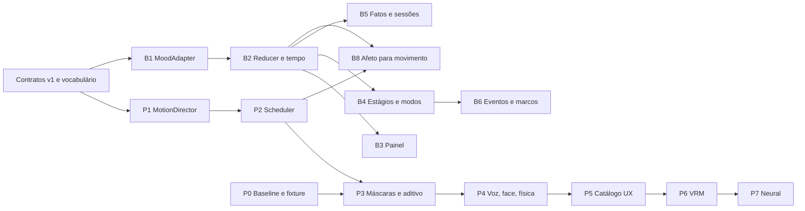

# Planejamento 03 — Análise dos Planos 01 e 02 e roteiro de sprints

**Projeto:** Alice / fork [overcyber/airi](https://github.com/overcyber/airi)
**Data:** 03/11/2026
**Natureza:** análise e ordenação. Este documento não altera o Plano 01 nem o Plano 02.
**Entradas analisadas:**

- Plano 01: `PLANEJAMENTO_E_HISTORICO_CONVERSA.md` (Motion Director e Motion Mixer, fases P0 a P7).
- Plano 02: `PLANEJAMENTO_02_ESTADO_AFETIVO_RELACIONAMENTO_E_COMPANION.md` (Companion State, fases B0 a B10).
- Sistema em produção hoje: `overcyber/MMM-avatar-3d` (módulo MagicMirror `MMM-AvatarMQTT`) e `overcyber/talkinghead-neoalice` (servidor TalkingHead, avatares GLB, animações FBX).

**Método:** leitura estática de código e documentação. Nenhum aplicativo foi executado. Nenhum teste foi executado. Nenhum valor de FPS ou latência foi medido.

**Convenção de privacidade:** este arquivo não contém endereços, hosts nem caminhos reais. Use os marcadores abaixo:

| Marcador | Significado |
| --- | --- |
| `<BROKER>` | Host do broker MQTT |
| `<MM_DIR>` | Diretório de instalação do MagicMirror |
| `<TH_DIR>` | Diretório do servidor TalkingHead |
| `<SITE>` | `siteId` em produção (hoje o espelho usa um `siteId` próprio) |
| `<SITE_AIRI>` | `siteId` novo e exclusivo para o AIRI em paralelo, por exemplo `airi-lab` |

---

## PARTE A — ANÁLISE

### A1. Verificação das referências de código dos planos

Todos os caminhos do AIRI citados nos dois planos existem no fork atual.

| Caminho citado | Existe | Observação verificada |
| --- | --- | --- |
| `packages/stage-ui-mmd/src/composables/mmd/animation-manager.ts` | Sim | Mantém uma `idleAction` e uma `currentAction`. `playAction` faz crossfade. Não há camadas nem máscaras. Confirma a lacuna do Plano 01. |
| `packages/stage-ui-mmd/src/components/scenes/MMD.vue` | Sim | `renderLoop` chama `animation.update(delta)` uma vez, depois `emote`, `blink`, `lipSync`, `gaze`. O comentário confirma a ordem mixer, IK, grant, física. |
| `packages/stage-ui-mmd/src/stores/mmd.ts` | Sim | Usa `useBroadcastChannel` com o evento `mmd-play-one-shot` e `localforage`. |
| `packages/stage-ui/src/components/scenarios/settings/model-settings/mmd.vue` | Sim | Tela de configuração MMD. |
| `packages/stage-ui-three/src/components/Model/VRMModel.vue` | Sim | Renderer VRM. |
| `packages/motion-driver-magic` | Sim | Pacote presente. |
| `packages/stage-ui/src/stores/memory.ts`, `database/repos/memory.repo.ts`, `tools/memory.ts` | Sim | Memória longa existe. Plano 02 manda estender, não duplicar. Correto. |
| `packages/stage-ui/src/stores/mcp.ts`, `tools/mcp.ts` | Sim | |
| `packages/provider-inference/src/providers/index.ts` | Sim | |
| `packages/stage-ui/src/libs/providers/providers/nvidia/index.ts` | Sim | |
| `packages/core-agent/README.md` | Sim | |
| `packages/stage-ui/src/constants/emotions.ts`, `stage-ui-mmd/src/constants/emotions.ts` | Sim | Vocabulário AIRI de 9 emoções. Ver A4. |

Conclusão: os planos descrevem o AIRI corretamente. As lacunas estão na relação com o sistema que roda hoje.

### A2. O sistema atual da Alice (o que os planos não descrevem)

| Componente | Estado verificado |
| --- | --- |
| Renderer | TalkingHead 1.7 (`modules/talkinghead.mjs`), Three.js, avatar GLB com rig Mixamo/ReadyPlayerMe e blendshapes ARKit. |
| Avatares | `avatars/*.glb`, por exemplo `eva-ruiva-arkit.glb`. Nenhum PMX e nenhum VRM. |
| Movimentos | 21 animações FBX Mixamo (`animations/`, `animations_arkit/`), gestos e poses por rotação de osso em `custom_moves.json`, despachante `neoalice_moves.mjs`. |
| Humor no renderer | TalkingHead tem 8 humores: `neutral`, `happy`, `angry`, `sad`, `fear`, `disgust`, `love`, `sleep`. Cada humor altera pose, respiração, cabeça, face e voz. |
| Transporte | MQTT, tópicos `neoalice/v1/{siteId}/...`. Comandos `cmd/tts/say`, `cmd/tts/audio`, `cmd/tts/stop`, `cmd/avatar/gesture`, `cmd/avatar/emoji`, `cmd/avatar/pose`, `cmd/avatar/animation`. Eventos `evt/mood`, `cmd/evt/mood`, `evt/stt/final`. Heartbeat em `evt/state`. Também tópicos Hermes (Rhasspy). |
| Exibição | Módulo MagicMirror `MMM-AvatarMQTT` (frontend + `node_helper.js`) e uma página independente (`index.html`) com a mesma lógica. |
| TTS | Google Cloud TTS (decisão registrada em `decisoes_usuario.md`). |
| Fonte do humor | Um serviço externo da NeoAlice publica `{"mood": "..."}` ou `{"state": {"mood": "..."}}`. Esse serviço não está em nenhum dos repositórios analisados. |

Observação sobre a sessão: o repositório `overcyber/TalkingHead-1KH` é o dataset de vídeos da NVIDIA (face-vid2vid). Ele não tem relação com o avatar. O repositório do avatar é `overcyber/talkinghead-neoalice`.

Limitação do TalkingHead que confirma a motivação do Plano 01: `playAnimation` recria o `AnimationMixer` a cada chamada. Um gesto (`playGesture`) sobrepõe rotações de braço sobre a pose. Então há um clipe por vez mais um gesto por vez. Não há máscara por osso nem mistura aditiva.

### A3. Pontos fortes dos planos

1. Plano 01 não substitui o AIRI. Ele adiciona pacotes novos (`alice-motion`) e preserva a API atual do `animation-manager`. Isso reduz o risco de regressão e de conflito com o upstream.
2. Plano 01 separa intenção (`MotionIntent`) de execução (`MotionCue`). O LLM não controla ossos por frame.
3. Plano 01 respeita a ordem mixer, IK, grant, física. O código atual confirma essa ordem.
4. Plano 02 define uma fonte única de humor e manda reutilizar o humor existente. O sistema atual confirma que esse humor existe e chega por MQTT.
5. Plano 02 coloca a autoridade dos números na aplicação, não no LLM. Usa reducer determinístico, idempotência e auditoria.
6. Plano 02 define o contrato com o Plano 01 (seção 13): afeto gera sinais, o movimento não escreve no relacionamento.
7. Os dois planos tratam licenças (Utsuwa AGPL-3.0, xiaoke Apache-2.0, assets PMX/VMD).

### A4. Lacunas e riscos encontrados

| ID | Lacuna | Evidência | Impacto | Ação proposta |
| --- | --- | --- | --- | --- |
| L1 | Plano 01 começa em PMX/MMD. A Alice hoje é GLB (Mixamo/ARKit) com FBX. | Plano 01 seção 4. Avatares e animações em `talkinghead-neoalice`. | P0 exige um modelo PMX novo. A biblioteca FBX e `custom_moves.json` não rodam no MMD sem retargeting. | Decisão D1 na sprint S02. O núcleo (director, scheduler) fica agnóstico de renderer. |
| L2 | Nenhum plano integra MQTT nem MagicMirror. | O AIRI não tem dependência `mqtt`. O espelho e o NeoAlice usam só MQTT. | Sem ponte, o AIRI não recebe fala, humor nem gestos do NeoAlice. | Sprint S08: ponte MQTT com `siteId` próprio, em modo sombra. |
| L3 | Três vocabulários de humor diferentes. | NeoAlice: `happy`, `playful`, `excited`, `sad`, `annoyed`, `angry`, `tired`, `sleep`, `calm`, `neutral`. TalkingHead: 8 humores. AIRI: `happy`, `sad`, `angry`, `think`, `surprised`, `awkward`, `question`, `curious`, `neutral`. | O cenário de aceite do Plano 01 usa `mood=curious`, que o TalkingHead não tem. | Sprint S02: tabela única de vocabulário, versionada. |
| L4 | Falha no mapeamento atual de humor. | `MMM-AvatarMQTT.js` e `js/avatar-controller.js`, função `mapMood`: não mapeia `love`, `fear` nem `disgust`. Esses valores viram `neutral`. `HUMORES_E_MOVIMENTOS.md` documenta `love` como funcional. | O humor `love` enviado pelo NeoAlice não aparece no espelho. | Sprint S01: correção pequena e isolada, com backup e teste. |
| L5 | O humor existente não tem intensidade, causa nem energia no payload. | Payload `{mood}` ou `{state:{mood}}`. | O `MoodSnapshot` do Plano 02 exige `intensity` e `causes`. | O adapter usa valores padrão marcados como `unknown`. Ele não inventa causas (regra do próprio Plano 02). |
| L6 | Estado do companion em vários dispositivos. | Memória do AIRI usa IndexedDB por cliente. O espelho é outro cliente. | Dois clientes geram dois estados divergentes. O Plano 02 trata várias janelas, não vários dispositivos. | Decisão D2 na sprint S05: a autoridade do estado fica num serviço único (por exemplo, junto ao NeoAlice) e publica por MQTT. |
| L7 | Dois barramentos de evento propostos. | Plano 01 "Motion Event Bus". Plano 02 "Companion Event Adapter". | Duplicação e ordem de eventos inconsistente. | Um barramento: `@moeru/eventa` dentro do AIRI (regra do `AGENTS.md`) e MQTT fora dele, ligados pela ponte. |
| L8 | TTS diferente do plano. | Plano 01 seção 9 cita Qwen3-TTS e GPT-SoVITS. O inventário de 03/11/2026 mostra Kokoro v1.0 como TTS ativo (o `decisoes_usuario.md` antigo citava Google TTS). | P4 (sincronia de prosódia) depende de timestamps do TTS. A rota usada não tem timestamps. | Ver E2, item 8. |
| L9 | Os planos não definem backup, rollback nem teste de fumaça do sistema em produção. | Os critérios de aceite falam só do AIRI. | Uma mudança pode quebrar o espelho sem detecção. | Protocolo por sprint (Parte B) e teste de fumaça MQTT (B3). |
| L10 | Regras do monorepo AIRI não citadas. | `AGENTS.md`: Valibot para schema, `injeca` para DI, `eventa` para IPC, `README.md` por pacote, kebab-case, `// NOTICE:` para workaround, perguntar antes de nova dependência. | Revisão de PR e lint podem falhar. | Aplicar em todas as sprints de código. |
| L11 | O fork recebe merges do upstream. | Último commit de `main`: merge de `moeru-ai:main`. | Mudanças no `animation-manager` ou em `MMD.vue` podem gerar conflitos. | Manter alterações em pacotes novos. Fazer cada mudança em arquivo existente pequena e com teste de contrato. |
| L12 | Lip-sync em português ausente no avatar atual. | Encontrado no teste da S01 em 04/11/2026: `modules/lipsync-pt-br.mjs` e `modules/lipsync-pt.mjs` do `talkinghead-neoalice` são cópias idênticas de `lipsync-en.mjs` (mesmo MD5) e exportam `LipsyncEn`. O TalkingHead não carrega esses módulos (`module[className] is not a constructor`). | A boca do avatar não segue regras do português. A cópia em produção pode ser diferente. | Sprint S01b: conferir o arquivo em produção. Se for igual, corrigir só no `talkinghead-neoalice`, sem tocar a NeoAlice. |
| L13 | O movimento do AIRI foi superestimado. | Revisão de 04/11/2026 (`PLANEJAMENTO_04_REVISAO_UTSUWA_AIRI_AVATAR3D.md`): o renderer VRM tem 1 animação (`idle_loop.vrma`) e o MMD não traz nenhuma. O Utsuwa tem 13 VRMA e o avatar3d tem 13 gestos, 13 poses, ~20 FBX e 72 expressões faciais. | O plano começava pelo MMD/PMX e deixava a Eva e os movimentos atuais para o fim. | Base passa a ser o renderer VRM. S06, S07 e S15 substituídas pelas sprints V1 a V6 do Planejamento 04. |

### A5. Dependências entre os planos



Regra principal: o Plano 02 só emite sinais para o Plano 01 depois que o contrato `MotionIntent` estiver congelado (S02) e o scheduler existir (P2).

---

## PARTE B — PROTOCOLO OBRIGATÓRIO POR SPRINT

Cada sprint segue os mesmos 6 passos. Não pule passos. Se um passo falhar, execute o rollback e pare.

### B1. Os 6 passos

1. **Backup.** Crie um ponto de restauração antes de qualquer alteração (comandos em B2).
2. **Teste antes.** Execute os testes e o teste de fumaça antes da mudança. Salve a saída. Ela é a referência.
3. **Alteração.** Faça a mudança no branch da sprint. Um commit por assunto. Use Conventional Commits.
4. **Teste depois.** Execute os mesmos testes e o mesmo teste de fumaça. Compare com a referência.
5. **Validação.** Confira cada critério de aceite da sprint. Grave evidência: log, captura ou vídeo.
6. **Fechamento.** Se tudo passou, crie a tag `sprint/<ID>-ok`. Se algo falhou, execute o rollback (B4).

### B2. Backup

Em cada repositório que a sprint altera, crie uma tag de restauração:

```bash
git tag -a backup/<ID>-pre -m "Backup antes da sprint <ID>"
```

```bash
git push origin backup/<ID>-pre
```

Para arquivos fora do git (configuração do MagicMirror, módulo instalado), crie um arquivo compactado:

```bash
tar czf backup-<ID>-$(date +%Y%m%d-%H%M).tar.gz <MM_DIR>/config/config.js <MM_DIR>/modules/MMM-AvatarMQTT --exclude=node_modules
```

Para a imagem Docker do TalkingHead, crie uma tag de imagem:

```bash
docker image tag talkinghead:latest talkinghead:backup-<ID>
```

Para o tráfego MQTT, grave uma amostra de referência. Ela serve para reproduzir o mesmo cenário depois:

```bash
timeout 300 mosquitto_sub -h <BROKER> -v -t 'neoalice/v1/#' > mqtt-ref-<ID>.log
```

Para dados do AIRI no navegador (IndexedDB), use a exportação do próprio AIRI quando ela existir para o dado alterado. Se não existir, a sprint deve criar a exportação antes de alterar o schema.

### B3. Testes padrão

AIRI, por pacote alterado:

```bash
pnpm -F <nome do pacote> typecheck
```

```bash
pnpm -F <nome do pacote> exec vitest run
```

```bash
pnpm lint
```

AIRI, todos os pacotes afetados pelo branch:

```bash
base=$(git merge-base origin/main HEAD) && TURBO_SCM_BASE="$base" pnpm exec turbo run test:run --affected
```

Se a sprint alterar um pacote compartilhado ou um tipo exportado, execute também:

```bash
pnpm typecheck
```

Teste de fumaça do sistema em produção (espelho). Execute cada comando e confira o efeito no avatar:

```bash
mosquitto_pub -h <BROKER> -t "neoalice/v1/<SITE>/cmd/tts/say" -m '{"text":"Teste de fumaca","lang":"pt-br"}'
```

```bash
mosquitto_pub -h <BROKER> -t "neoalice/v1/<SITE>/cmd/evt/mood" -m '{"mood":"happy"}'
```

```bash
mosquitto_pub -h <BROKER> -t "neoalice/v1/<SITE>/cmd/avatar/gesture" -m '{"gesture":"thumbup","duration":3}'
```

```bash
mosquitto_pub -h <BROKER> -t "neoalice/v1/<SITE>/cmd/avatar/pose" -m '{"pose":"straight"}'
```

```bash
mosquitto_pub -h <BROKER> -t "neoalice/v1/<SITE>/cmd/avatar/animation" -m '{"url":"./animations/walking.fbx","duration":5}'
```

```bash
timeout 30 mosquitto_sub -h <BROKER> -v -t "neoalice/v1/<SITE>/evt/state"
```

Resultado esperado: o avatar fala, muda de humor, faz o gesto, muda a pose, anda e o heartbeat aparece em `evt/state`.

### B4. Rollback

```bash
git checkout backup/<ID>-pre
```

```bash
tar xzf backup-<ID>-<data>.tar.gz -C /
```

```bash
docker image tag talkinghead:backup-<ID> talkinghead:latest && docker compose up -d
```

Depois do rollback, execute o teste de fumaça (B3) e confirme que o espelho voltou ao estado anterior.

### B5. Regras gerais

- O espelho em produção continua com o TalkingHead até a sprint S16. Até lá, o AIRI roda em paralelo com `<SITE_AIRI>`.
- **Regra de bloqueio da NeoAlice (04/11/2026):** a NeoAlice (backend, MoodSystem, orchestrator, satélites, visão, broker e seus containers) não é alterada antes de o novo avatar estar validado. Até lá, toda integração com ela é somente leitura. As condições de liberação estão em `JUSTIFICATIVA_ALTERACOES_NEOALICE.md`, seção 5.
- Toda função nova no AIRI fica atrás de uma opção desligada por padrão.
- Nenhuma sprint mistura alteração em produção com alteração no AIRI.
- Nenhuma sprint de código começa sem os contratos da S02. Exceção decidida em 03/11/2026: a S05 foi antecipada a pedido do responsável. Os contratos dela (mensagens MQTT e estado) estão em `services/alice-companion/README.md` e `src/contracts.ts`. A S02 passa a referenciar esses contratos e não os redefine.

---

## PARTE C — ROTEIRO DE SPRINTS EM ORDEM

Legenda de risco para produção: **Nenhum** (não toca o espelho), **Baixo** (altera o espelho com mudança pequena e reversível), **Médio** (altera fluxo de dados do espelho).

### Resumo

| Ordem | Sprint | Origem | Toca produção | Risco |
| --- | --- | --- | --- | --- |
| 1 | S00 Backup geral e baseline de produção | Novo (L9) | Só leitura | Nenhum |
| 2 | S01 Inventário do humor e correção do `mapMood` (código no `main` e validado no navegador. Falta instalar no espelho) | B0 + L4 | Sim | Baixo |
| 2b | S01b Lip-sync em português do avatar atual | L12 | Sim | Baixo |
| 3 | S02 Baseline AIRI, contratos v1 e decisões D1/D2 (em andamento, ver S02) | P0 parte 1 + B0 + L3 | Não | Nenhum |
| 4 | S03 MotionDirector isolado | P1 | Não | Nenhum |
| 5 | S04 MotionScheduler isolado | P2 | Não | Nenhum |
| 6 | S05 MoodAdapter e reducer do companion (implementada, ver S05) | B1 + B2 | Não | Nenhum |
| 7 | S06 Fixture, telemetria e vídeo de referência (**substituída por V1–V6**, ver Planejamento 04) | P0 parte 2 | Não | Nenhum |
| 8 | S07 Máscaras por osso e mistura aditiva (**substituída pela V6, no VRM**, ver Planejamento 04) | P3 | Não | Nenhum |
| 9 | S08 Ponte MQTT para o AIRI em modo sombra | Novo (L2) | Só leitura | Nenhum |
| 10 | S09 Voz, face, prosódia e física | P4 | Não | Nenhum |
| 11 | S10 Painel de estado | B3 | Não | Nenhum |
| 12 | S11 Estágios, modos e memória factual | B4 + B5 | Não | Nenhum |
| 13 | S12 Eventos e marcos | B6 | Não | Nenhum |
| 14 | S13 Afeto para movimento e proatividade | B8 + B7 | Não | Nenhum |
| 15 | S14 Catálogo semântico e editor de camadas | P5 | Não | Nenhum |
| 16 | S15 Adaptador VRM e avatar Eva (**substituída pela V4**, ver Planejamento 04) | P6 | Não | Nenhum |
| 17 | S16 Transição do espelho | Novo | Sim | Médio |
| 18 | S17 Laboratório neural e recursos experienciáveis | P7 + B9 | Não | Nenhum |
| Contínua | S-H Hardening | B10 | Não | Nenhum |

S03 e S04 podem rodar em paralelo com S05. As três são pacotes novos sem renderer.

---

### S00 — Backup geral e baseline de produção

**Objetivo:** ter um ponto de restauração completo e uma referência do comportamento atual.
**Repositórios:** `MMM-avatar-3d`, `talkinghead-neoalice`, `airi`. Ambiente do MagicMirror e do broker.

| Passo | Conteúdo |
| --- | --- |
| Backup | Tag `backup/S00-pre` nos 3 repositórios. `tar` da configuração do MagicMirror e do módulo instalado. Tag de imagem Docker do TalkingHead. Cópia da configuração do Mosquitto. |
| Alteração | Nenhuma no código. Criar o roteiro do teste de fumaça (B3) como script no repositório `MMM-avatar-3d`. |
| Teste | Executar o teste de fumaça. Gravar `mqtt-ref-S00.log` por 5 minutos com uma conversa real. |
| Validação | Gravar vídeo de 2 minutos do espelho: fala, 8 humores, 3 gestos, 2 poses, 1 animação. Anotar versões: TalkingHead, Three.js, MagicMirror, Node, `mqtt`. |
| Saída | Tag `sprint/S00-ok`. Restauração testada uma vez numa cópia. |

### S01 — Inventário do humor e correção do `mapMood`

**Objetivo:** cumprir o B0 do Plano 02 e corrigir a perda dos humores `love`, `fear` e `disgust` (L4).
**Repositórios:** `MMM-avatar-3d`. Leitura do serviço NeoAlice que publica o humor.

| Passo | Conteúdo |
| --- | --- |
| Backup | Tag `backup/S01-pre` em `MMM-avatar-3d`. `tar` do módulo instalado. |
| Alteração | 1) Documentar onde o humor nasce no NeoAlice: serviço, vocabulário completo, frequência, se existe intensidade. 2) Adicionar `love`, `fear` e `disgust` ao `mapMood` em `MMM-AvatarMQTT/MMM-AvatarMQTT.js` e em `js/avatar-controller.js`. Os dois arquivos têm o mesmo mapa com a mesma falha. Um commit só para isso. |
| Teste | Teste de fumaça (B3). Publicar cada um dos 8 humores do TalkingHead e cada humor do vocabulário NeoAlice. |
| Validação | `love` mostra suspiros e cabeça inclinada. `fear` mostra varredura ampla de cabeça. `disgust` mostra nariz franzido. Os humores antigos continuam iguais ao vídeo da S00. Valor desconhecido continua virando `neutral`. |
| Saída | Documento de inventário do humor. Tag `sprint/S01-ok`. |

**Estado em 04/11/2026:**

| Passo | Resultado |
| --- | --- |
| Inventário do humor | Feito pelo agente local em 03/11/2026 (Parte E). |
| Alteração | `mapMood` corrigido nos 3 arquivos do `MMM-avatar-3d` (commit `85c7807`, no `main`). |
| Teste automático | `node --test tests/mood-map.test.mjs`: 9 falhas antes, 12 de 12 depois. |
| Teste no navegador | TalkingHead real, avatar `eva-ruiva-arkit.glb`, Three.js 0.161.0, MQTT local. 20 humores enviados em `evt/mood`. Antes: 9 de 20 errados. Depois: 20 de 20 corretos. Gesto e animação funcionam antes e depois. Evidências em `evidencias/S01/` do `MMM-avatar-3d` (commit `7eb3fd0`). |
| Falta | Instalar no espelho com `scripts/backup-producao.sh` e `scripts/smoke-test-mqtt.sh` (roteiro em `SPRINTS_S00_S01.md`). Esta sessão não tem acesso à máquina do espelho. |

### S01b — Lip-sync em português do avatar atual

**Repositório:** `talkinghead-neoalice`. Não toca a NeoAlice.

| Passo | Conteúdo |
| --- | --- |
| Backup | `scripts/backup-producao.sh` com a imagem Docker do TalkingHead. Cópia dos três `lipsync-*.mjs` em produção. |
| Alteração | Conferir se a cópia em produção é igual à do repositório. Se for, criar `lipsync-pt-br.mjs` com regras do português e o nome de classe que o TalkingHead procura. |
| Teste | Teste no navegador da S01 com fala (`cmd/tts/audio`) e leitura dos visemas. Antes e depois. |
| Validação | O módulo carrega sem `module[className] is not a constructor`. A boca segue palavras em português. |
| Saída | Tag `sprint/S01b-ok`. |

### S02 — Baseline AIRI, contratos v1 e decisões

**Objetivo:** P0 parte 1 do Plano 01. Congelar os contratos que os dois planos compartilham.
**Repositório:** `airi`.

| Passo | Conteúdo |
| --- | --- |
| Backup | Tag `backup/S02-pre`. |
| Alteração | 1) `pnpm install`, typecheck e testes de todo o monorepo. Registrar commit, versão do Three.js e de `@moeru/three-mmd`. 2) Criar ADR em `docs/ai/adr/` com os contratos v1: `MotionIntent`, `MotionCue`, `MoodSnapshot`, `companion.affect.updated`, e o mapeamento de tópicos MQTT. 3) Criar a tabela única de vocabulário de humor: NeoAlice, TalkingHead, AIRI e intenção de movimento. Os schemas usam Valibot. 4) Registrar as decisões D1 e D2. |
| Teste | Typecheck e testes do monorepo inteiro antes e depois. A saída deve ser igual, porque só há documentação e tipos. |
| Validação | Os dois planos citam os mesmos nomes de campo. Cada humor dos 3 vocabulários tem destino definido. |
| Saída | Contratos v1 aprovados por você. Tag `sprint/S02-ok`. |

**Estado em 04/11/2026:**

| Item | Resultado |
| --- | --- |
| Instalação | `pnpm install` feito. |
| Versões | Commit `319ecae`, Node 22.23.4, pnpm 11.24.0, three 0.185.1, `@moeru/three-mmd` 0.2.0-beta.2, `@pixiv/three-vrm` 3.5.5. |
| Typecheck | Monorepo inteiro (mesmos filtros do `pnpm typecheck`): 67 de 67 tarefas passaram. Duas condições do ambiente: o `vue-tsc` do `stage-ui` precisa de `NODE_OPTIONS=--max-old-space-size=8192`, e o `dist` do `electron-screen-capture` precisou de um novo build depois da instalação completa. |
| Testes | `turbo run test:run`: 73 de 78 tarefas passam no container. As 5 restantes falham por ambiente, sem relação com código: rede bloqueada (`stage-web`, `stage-tamagotchi`), IPv6 ausente (`auth-server`) e Node 22 no lugar do Node 26 do CI (`better-ws` e 1 teste do `stage-ui`, que passam com Node 26.13.0). Detalhes no ADR. |
| Contratos v1 | `packages/alice-motion` com `MotionIntent` e `MotionCue` em Valibot. 15 testes. ADR `docs/ai/adr/2026-11-04-alice-motion-contracts-v1.md`, **aprovado pelo responsável em 05/11/2026**. A aprovação inclui o limite de 4096 bytes por mensagem de movimento (seção "Message size limit" do ADR). A S02 está concluída, e a S03, a S04 e a S08 estão liberadas. |
| Vocabulário único | `packages/alice-motion/src/mood-vocabulary.ts` (14 humores da NeoAlice, TalkingHead e AIRI). Estava em `services/alice-companion` e foi movido em 05/11/2026, para a ponte da S08 usar a mesma tabela. |
| Subir o AIRI com o modelo original | **Bloqueado pela rede do ambiente de nuvem.** O `stage-web` baixa o SDK do Live2D (`cubism.live2d.com`) e os modelos originais (`dist.ayaka.moe`) ao iniciar, e o proxy do ambiente recusa os dois hosts (HTTP 403). |

**Decisão D1 — formato do avatar no AIRI.** Opções:

| Opção | Vantagem | Custo |
| --- | --- | --- |
| A. PMX novo (Plano 01 original) | MMD já tem VMD, IK, grant e física no AIRI. Caminho mais curto para o mixer. | Avatar diferente da Eva. FBX e `custom_moves.json` não servem sem retargeting. Licença do PMX. |
| B. Eva em VRM (antecipar parte do P6) | Preserva a identidade visual. VRM é glTF, próximo do GLB atual. | O renderer VRM do AIRI tem menos recursos de movimento. O mixer teria de nascer no VRM. |
| C. A para desenvolver o mixer, B a partir da S15 | Mantém a ordem do Plano 01 e garante a Eva no fim. | Dois avatares durante o desenvolvimento. |

**D1 decidida em 03/11/2026:**

- Os modelos originais do AIRI ficam como estão: Hiyori (Live2D) e AvatarSample A/B (VRM). Nenhuma sprint altera, remove ou substitui esses presets.
- O responsável tem vários modelos VRM. Eles são os modelos de teste das sprints de renderer. Ficam fora do repositório (licença e privacidade) e são importados pela tela de modelos do AIRI.
- O arquivo GLB da Eva é convertido para VRM na S15.
- **Revisão de 04/11/2026:** o renderer VRM do AIRI é a base do avatar novo. A ordem passa a ser V1 a V6 do Planejamento 04.
- Consequência para a S06 e a S07 (texto anterior à revisão): o AIRI não tem PMX de fábrica. Se nenhum PMX com licença for escolhido (D4), o mixer por camadas começa no renderer VRM. O núcleo (S03, S04) não muda, porque é agnóstico de renderer.

**Decisão D2 — onde fica a autoridade do estado do companion.** Decidida em 03/11/2026: serviço único publicado por MQTT, porque o espelho e o AIRI são clientes diferentes (L6). Implementado em `services/alice-companion`. ADR: `docs/ai/adr/2026-11-03-alice-companion-state-service.md`.

**Decisão D3 — biblioteca MQTT.** Decidida em 03/11/2026: `mqtt` (MQTT.js 5), adicionada ao catálogo do `pnpm-workspace.yaml`. O módulo do MagicMirror já usa a mesma biblioteca. Ela funciona em Node e no navegador por WebSocket, então a ponte da S08 usa a mesma dependência.

### S03 — MotionDirector isolado (P1)

**Repositório:** `airi`, pacote novo `packages/alice-motion`.

| Passo | Conteúdo |
| --- | --- |
| Backup | Tag `backup/S03-pre`. |
| Alteração | Pacote novo com `README.md`. Máquina de estados `idle`, `listening`, `thinking`, `speaking`, `walking`, `acting`, `interrupted`. Política de idle com gerador aleatório com semente. Saída: lista de `MotionIntent`. Sem Three.js, sem Vue. |
| Teste | Testes com relógio simulado e semente fixa. Interrupção e retomada. Testes do monorepo afetado antes e depois. |
| Validação | Mesma semente gera a mesma sequência. Interrupção não duplica gesto. Nenhuma chamada a LLM no loop. Nenhum pacote existente mudou de comportamento. |
| Saída | Tag `sprint/S03-ok`. |

### S04 — MotionScheduler isolado (P2)

**Repositório:** `airi`, `packages/alice-motion`.

| Passo | Conteúdo |
| --- | --- |
| Backup | Tag `backup/S04-pre`. |
| Alteração | Arbitragem por prioridade, reserva de canais, TTL, idempotência por `id`, cancelamento por `sessionId`, conversão `MotionIntent` para `MotionCue`. |
| Teste | Casos `walk + wave`, `walk + sit`, dois gestos no mesmo braço, um gesto em cada braço, reconexão com sessão antiga. |
| Validação | Locomoção não é bloqueada por gesto de braço. Ação de corpo inteiro libera os canais ao terminar. Mesmo empate gera sempre o mesmo vencedor. |
| Saída | Tag `sprint/S04-ok`. |

### S05 — MoodAdapter e reducer do companion (B1 + B2)

**Repositório:** `airi`, serviço novo `services/alice-companion` (D2).

**Estado: implementada em 03/11/2026.** Resumo do que foi feito:

| Passo | Resultado |
| --- | --- |
| Backup | O espelho não foi tocado. O ponto de volta no AIRI é o commit anterior do branch. O serviço é um diretório novo, então remover o diretório desfaz a sprint. O próprio serviço grava `state.json.bak` antes de cada escrita. |
| Alteração | Serviço Node com MQTT: lê `evt/mood` e `cmd/evt/mood` sem alterar o humor, conta turnos (explícitos em `evt/companion/interaction` ou derivados de `evt/stt/final` + `cmd/tts/say`), aplica propostas de métrica com limites, publica o estado retido em `neoalice/v1/companion/evt/companion/state`, o afeto em `.../evt/companion/affect` e o status em `.../evt/companion/status`. |
| Teste | 57 testes de unidade (typecheck e lint sem erro). Teste de ponta a ponta com Mosquitto local: humor `love` preservado, turno derivado contado, proposta limitada, proposta repetida recusada, segunda instância recusada, estado mantido após reinício, trava liberada na parada, status `online` e `offline`. |
| Validação pendente no seu ambiente | Rodar o serviço apontando para o broker real por 1 dia, sem mudar o espelho. Conferir em `audit.jsonl` se os turnos derivados batem com as conversas reais. |

Diferenças em relação ao texto original da S05:

- Intensidade e causa ausentes ficam `null` e lista vazia, não `unknown`. O efeito é o mesmo: nada é inventado.
- Decaimento por ausência não foi implementado. O consentimento `timeDecay` fica desligado.
- Horário de verão: não há teste específico. A data local vem do banco de fusos IANA do Node, então segue a regra de horário de verão que esse banco tiver. Os testes cobrem a virada de data UTC em `America/Sao_Paulo`.

Texto original da sprint:

| Passo | Conteúdo |
| --- | --- |
| Backup | Tag `backup/S05-pre`. Exportação de dados se algum store existente for lido. |
| Alteração | `ExistingMoodAdapter` que lê o humor do NeoAlice (formato da S01). Reducer determinístico: 5 métricas, energia, dias, interações, sequência diária, auditoria. Políticas de ausência e decaimento desligadas por padrão. Fuso configurável. |
| Teste | Limites (`affection` 0..1000, outros 0..100), sem NaN, idempotência, duas janelas, relógio para trás, horário de verão, ausência de 7 dias aplicada uma vez. |
| Validação | Uma só fonte de humor. Nenhuma escrita circular. Campos sem dado ficam `unknown`, sem causa inventada. |
| Saída | Tag `sprint/S05-ok`. |

### S06 — Fixture, telemetria e vídeo de referência (P0 parte 2)

> Substituída na revisão de 04/11/2026. Ver `PLANEJAMENTO_04_REVISAO_UTSUWA_AIRI_AVATAR3D.md`. O texto abaixo fica como registro.

**Repositório:** `airi`.

| Passo | Conteúdo |
| --- | --- |
| Backup | Tag `backup/S06-pre`. |
| Alteração | Fixture com modelo escolhido em D1 e clipes idle, walk, wave com licença verificada. Harness de reprodução determinística. Telemetria por frame (`frame_time_ms`, `mixer_ms`, `physics_ms`, contagem de `AnimationAction`). Saída `motion_trace.jsonl`. Telemetria desligada por padrão. |
| Teste | Testes existentes do `stage-ui-mmd` antes e depois. Abrir o modelo no stage-web e no stage-tamagotchi. |
| Validação | Os 3 clipes tocam sem regressão. Vídeo "antes" gravado. FPS e tempos medidos e registrados. Esses números substituem as metas não medidas dos planos. |
| Saída | Tag `sprint/S06-ok`. |

### S07 — Máscaras por osso e mistura aditiva (P3)

> Substituída na revisão de 04/11/2026. Ver `PLANEJAMENTO_04_REVISAO_UTSUWA_AIRI_AVATAR3D.md`. O texto abaixo fica como registro.

**Repositório:** `airi`, `animation-manager.ts` e `packages/alice-motion/src/mixer`.

| Passo | Conteúdo |
| --- | --- |
| Backup | Tag `backup/S07-pre`. |
| Alteração | Tabela de alias de ossos, `maskClip`, API de ações por camada no `animation-manager` sem remover `playAction`, `playIdle` nem `setIdleMotion`. Mistura normal e aditiva. Ainda uma só chamada a `mixer.update` por frame. |
| Teste | Testes de máscara, quaternion dentro da tolerância, ordem por frame, VMD com ossos ausentes. Todos os testes antigos do `stage-ui-mmd`. |
| Validação | `walk + left_arm_wave + gaze` ao mesmo tempo. Quadril e pernas não se movem pelo gesto. A API antiga funciona igual. Comparar FPS com a S06. |
| Saída | Tag `sprint/S07-ok`. |

### S08 — Ponte MQTT para o AIRI em modo sombra

**Repositório:** `airi`. Lado do broker só recebe um cliente novo.

| Passo | Conteúdo |
| --- | --- |
| Backup | Tag `backup/S08-pre`. Cópia da configuração do Mosquitto (ACL, usuários). |
| Alteração | Cliente MQTT por WebSocket que assina só `neoalice/v1/<SITE_AIRI>/#` e, em modo leitura, `neoalice/v1/<SITE>/evt/mood`. Converte tópicos NeoAlice em eventos `eventa` e em `MotionIntent`. Lê também o estado retido do serviço de companion (`neoalice/v1/companion/evt/companion/state`). Não publica em `<SITE>`. Usa a biblioteca `mqtt` (D3). |
| Teste | Reproduzir `mqtt-ref-S00.log` contra `<SITE_AIRI>`. Teste de fumaça do espelho antes e depois. |
| Validação | O espelho não muda de comportamento. O AIRI reage ao mesmo tráfego. Mensagem inválida não derruba a ponte. Reconexão descarta cues de sessão antiga. |
| Saída | Tag `sprint/S08-ok`. |

### S09 — Voz, face, prosódia e física (P4)

**Repositório:** `airi`.

| Passo | Conteúdo |
| --- | --- |
| Backup | Tag `backup/S09-pre`. |
| Alteração | Medir os timestamps que o TTS em uso fornece (L8). Microbeats vocais. Prioridade de morphs: visemas têm dono exclusivo durante a fala. Gaze final com limites. Foot lock inicial. |
| Teste | 100 interrupções seguidas. Variação de `dt` em 30, 60 e 120 FPS. Testes antigos de lip-sync e blink. |
| Validação | Boca segue a voz. Física estável depois de 100 interrupções. Silêncio mantém idle. Gesto alinhado ao áudio tocado, não ao texto. |
| Saída | Tag `sprint/S09-ok`. |

### S10 — Painel de estado (B3)

**Repositórios:** `airi` (`packages/stage-ui`, `packages/i18n`).

| Passo | Conteúdo |
| --- | --- |
| Backup | Tag `backup/S10-pre`. |
| Alteração | Página de configurações nova: Estado agora, Relacionamento (desligável), Convivência. Textos em `packages/i18n` (inglês e português). Registrar rota e ícone no layout de configurações. |
| Teste | Testes de componente. Testes de navegador afetados. Lint. |
| Validação | Os valores na tela batem com o banco. Reset apaga só o escopo escolhido. O painel funciona sem avatar carregado. |
| Saída | Tag `sprint/S10-ok`. |

### S11 — Estágios, modos e memória factual (B4 + B5)

| Passo | Conteúdo |
| --- | --- |
| Backup | Tag `backup/S11-pre`. Exportação da memória longa do AIRI antes de qualquer mudança de schema. |
| Alteração | Estágios versionados com histerese. Modo `companion` como padrão, modos românticos só com consentimento. `CompanionMemoryAdapter` que estende `memory.ts`, sem segunda gravação. Categorias, proveniência, deduplicação. |
| Teste | Limiares e histerese. Busca em português e inglês. Exclusão remove registro e índice. |
| Validação | Modo `companion` não dispara evento romântico. Nenhuma memória gravada duas vezes. Memória antiga continua legível. |
| Saída | Tag `sprint/S11-ok`. |

### S12 — Eventos e marcos (B6)

| Passo | Conteúdo |
| --- | --- |
| Backup | Tag `backup/S12-pre`. |
| Alteração | `CompanionEventEngine` sobre as automações existentes do `core-agent`. Condições, cooldown, `idempotencyKey`. |
| Teste | Reload não repete marco. Falha e recuperação não repetem marco. |
| Validação | Efeitos nos indicadores são determinísticos. O texto do LLM não altera números. |
| Saída | Tag `sprint/S12-ok`. |

### S13 — Afeto para movimento e proatividade (B8 + B7)

| Passo | Conteúdo |
| --- | --- |
| Backup | Tag `backup/S13-pre`. |
| Alteração | `companion.affect.updated` vira entrada do MotionDirector. Proatividade desligada por padrão, com horário de silêncio e limite diário. |
| Teste | Mudança de humor muda o comportamento do director sem mexer no mixer. Proatividade não fala durante áudio ativo. |
| Validação | O movimento não escreve no estado do relacionamento. Com a função desligada, voz e chat ficam iguais à S12. |
| Saída | Tag `sprint/S13-ok`. |

### S14 — Catálogo semântico e editor de camadas (P5)

| Passo | Conteúdo |
| --- | --- |
| Backup | Tag `backup/S14-pre`. Exportação dos VMD salvos no IndexedDB. |
| Alteração | Catálogo com metadados (licença, canais, máscara, emoção, ação semântica). Prévia por camada. Visualização de conflitos. Tela `mmd.vue` estendida sem remover funções. |
| Teste | Importar VMD válido e inválido. Testes de navegador da tela MMD. |
| Validação | Um VMD novo é importado, descrito e ligado a um evento sem mudar código. Asset inválido mostra mensagem específica. |
| Saída | Tag `sprint/S14-ok`. |

### S15 — Adaptador VRM e avatar Eva (P6)

> Substituída na revisão de 04/11/2026. Ver `PLANEJAMENTO_04_REVISAO_UTSUWA_AIRI_AVATAR3D.md`. O texto abaixo fica como registro.

| Passo | Conteúdo |
| --- | --- |
| Backup | Tag `backup/S15-pre`. Cópia dos GLB originais da Eva. |
| Alteração | Converter a Eva GLB para VRM (mapear blendshapes ARKit para expressões VRM). Adaptador VRM do mixer. Mapeamento humanoide. Avaliar retargeting das FBX Mixamo para VRMA. |
| Teste | Cenário andar, gesticular, olhar e falar em dois rigs. Testes do `stage-ui-three`. |
| Validação | O director não muda entre PMX e VRM. A Eva mantém aparência e lip-sync. |
| Saída | Tag `sprint/S15-ok`. |

### S16 — Transição do espelho

**Objetivo:** levar o resultado ao MagicMirror com caminho de volta garantido.
**Repositórios:** `MMM-avatar-3d` e, se necessário, `talkinghead-neoalice`.

| Passo | Conteúdo |
| --- | --- |
| Backup | Backup completo como na S00. Tag `backup/S16-pre` nos 3 repositórios. |
| Alteração | Escolher uma de duas rotas: 1) o módulo exibe o stage-web do AIRI com `<SITE>`, ou 2) o TalkingHead continua no espelho e recebe os comandos do director pelos tópicos MQTT atuais. Opção de configuração para voltar ao modo antigo sem reinstalar. |
| Teste | Teste de fumaça completo. Sessão de 30 minutos. 100 trocas de humor. Teste de memória e CPU do hardware do espelho. |
| Validação | Tudo do vídeo da S00 continua funcionando. Os ganhos dos Planos 01 e 02 aparecem. Rollback testado uma vez. |
| Saída | Tag `sprint/S16-ok`. |

### S17 — Laboratório neural e recursos experienciáveis (P7 + B9)

Experimental. Só começa depois da S16 estável.

| Passo | Conteúdo |
| --- | --- |
| Backup | Tag `backup/S17-pre`. |
| Alteração | Interface `MotionStreamProvider`. Protótipos StreamTalk e ARDY num serviço separado com GPU. Grafo de memória, álbum, toque e cenas, cada um atrás de opção própria. |
| Teste | Medição de VRAM e tempo. Fallback determinístico quando o serviço cai. |
| Validação | Sem o serviço neural, o avatar funciona como na S16. |
| Saída | Tag `sprint/S17-ok`. |

### S-H — Hardening contínuo (B10)

Em toda sprint: revisar licenças de assets e código, procurar dados privados no diff, atualizar `README.md` dos pacotes, registrar métricas medidas e manter o rebase com o upstream.

---

## PARTE D — DECISÕES

| ID | Pergunta | Sprint que bloqueia | Recomendação |
| --- | --- | --- | --- |
| D1 | Formato do avatar no AIRI | V1 | **Decidida:** renderer VRM como base, presets do AIRI intactos, VRMs do responsável como modelos de teste, Eva convertida na V4 (Planejamento 04) |
| D2 | Onde fica a autoridade do estado do companion? | S05 | **Decidida e implementada:** `services/alice-companion` |
| D3 | Qual biblioteca MQTT usar no AIRI? | S08 | **Decidida:** `mqtt` (MQTT.js 5) |
| D4 | Qual modelo PMX e quais VMD têm licença para a fixture? | S06 | Escolher antes da S06 |
| D5 | Rota final do espelho: AIRI no espelho ou TalkingHead comandado pelo director? | S16 | Decidir com medições da S06 e da S09 |
| D6 | Quem é a autoridade do afeto: o `affinity_score` do MoodSystem ou a métrica `affection` do serviço de companion? | Depois da liberação da NeoAlice | **Adiada**, porque exige que a NeoAlice publique um campo novo. Até lá, a métrica `affection` do serviço fica parada, porque nada envia propostas. |
| D7 | Onde estão as GPUs RTX citadas no Plano 01? O host principal é RK3588 sem GPU NVIDIA. | S17 | Confirmar antes de planejar a S17 |
| D8 | Política de retenção dos snapshots da câmera e do modo VLM em nuvem | S-H | Retenção curta e opt-in para envio externo (Plano 02, consentimentos) |

---

## PARTE E — INVENTÁRIO DO AMBIENTE REAL E IMPACTO NOS PLANOS

Fonte: inventário somente leitura feito pelo agente local em 03/11/2026, com o prompt `PROMPT_INVENTARIO_SERVICOS_LOCAIS.md`. Este resumo não contém hosts, IPs, caminhos nem IDs de usuário. O inventário completo fica fora do repositório.

### E1. O que roda hoje

| Área | Estado verificado |
| --- | --- |
| Host principal | Placa Rockchip RK3588 (aarch64, 8 núcleos, NPU). Sem GPU NVIDIA neste host. |
| TTS ativo | Kokoro v1.0 na CPU, voz mista em português, velocidade 0.8. A rota usada (`/v1/audio/speech`) devolve WAV sem marcações de tempo. A rota experimental `/dev/captioned_speech` tem marcações por palavra e não é usada. |
| TTS alternativos | Kokoro ONNX (CPU, o modo NPU falhou na inicialização) e Piper na NPU. Coqui, Silero e eSpeak existem como fallback no código. |
| STT | Whisper medium (Transformers) na CPU, português. O fim de fala é detectado no satélite (openwakeword, 1200 ms de silêncio). |
| Fluxo de voz | Satélite publica `evt/audio`. O gateway chama o Whisper e publica `evt/stt/final` no site do satélite e `hermes/asr/textCaptured`. O LLM responde. O Kokoro gera o áudio. O gateway publica `cmd/tts/audio` (WAV em base64) para o satélite e para o espelho. |
| Lip-sync | No navegador do espelho, com `lipsync-pt-br.mjs`. O backend não envia visemas. |
| Visão | YOLOv10n na NPU local, reconhecimento facial (Haar e encodings), controlador dual-NPU e nós remotos (Hailo-8L com SCRFD, ArcFace e YOLOv11n. Axera AX650 com Qwen3.5-2B VLM, Depth Anything V2 e MobileCLIP2). Disparo por eventos: porta, presença e movimento da câmera. Sem detecção de emoção facial. |
| Visão para o avatar | A saudação na porta publica `cmd/avatar/gesture` (wave, handup) e `cmd/avatar/emoji`. |
| Humor | `MoodSystem`, `Personality` e `RedQueen` dentro do `neoalice-api`. 14 estados. Intensidade (`affinity_score`, `interaction_quality`), causa e fadiga existem dentro do processo, mas o payload MQTT só leva `mood`. Publica `evt/mood`, `cmd/evt/mood`, `cmd/avatar/emoji` e `cmd/avatar/pose`. |
| Fim de turno | Não existe evento. O ciclo termina no `cmd/tts/audio` e no `DIALOG_TURN_SAVED` interno. |
| LLM | Principal na nuvem (OpenRouter), NVIDIA NIM dedicado e fallback local Ollama (phi4-mini na CPU). |
| Broker | Mosquitto 2, TCP 1883 e WebSocket 1884, acesso anônimo, sem ACL. |

### E2. Impacto nos planos

| # | Achado | Sprint | Ação |
| --- | --- | --- | --- |
| 1 | 14 estados de humor. Cinco não estavam na tabela (`reflective`, `cozy`, `melancholic`, `mischief`, `grouchy`). | S01, S05 | Feito no serviço de companion. A S01 copia a mesma tabela para o espelho. |
| 2 | Intensidade, causa e fadiga existem, mas não são publicadas. | Depois da liberação da NeoAlice | **Adiado.** Até a liberação, o serviço trabalha só com o nome do humor. O pedido ao backend está em `PROMPT_BACKEND_FIM_DE_TURNO_E_HUMOR.md`, bloqueado. O serviço já aceita esses campos se um dia vierem. |
| 3 | `affinity_score` já existe no MoodSystem. | S11 | Conflito de autoridade com a métrica `affection`. Decisão D6. |
| 4 | Sem evento de fim de turno. | S05 | O serviço deriva o turno de `evt/stt/final` seguido de `cmd/tts/audio` no mesmo site, sem mudar a NeoAlice. A leitura de `evt/dialog/turn_end` fica parada até a NeoAlice publicar esse tópico, o que só pode acontecer depois da liberação. |
| 5 | O STT sai no site do satélite e o áudio vai para o satélite e para o espelho. | S05 | O pareamento por site funciona no site do satélite. Conferir no `audit.jsonl` durante a validação de 1 dia. |
| 6 | O TTS não devolve marcações de tempo. O Kokoro tem uma rota com marcações por palavra. | S09 | Usar `/dev/captioned_speech` para alinhar ênfase e gestos ao áudio. O lip-sync continua no navegador. Medir o custo na CPU antes. |
| 7 | O backend já envia gestos, poses e emoji (humor e porta). | S08, S13 | O director trata esses comandos como intenções e não compete com eles. Até a S16 eles continuam indo direto ao espelho. |
| 8 | Sem GPU NVIDIA no host principal. | S06, S17 | O Plano 01 seção 9 cita RTX 3090 e 4060 Ti. Decisão D7. Sem essas GPUs, a S17 usa as NPUs ou é adiada. |
| 9 | O espelho roda em outro host. O AIRI precisa de WebGL com física. | S06 | Medir FPS no hardware real do espelho. A meta de 60 FPS do Plano 01 pode ser inviável. |
| 10 | O LLM principal é de nuvem. | S11, S13 | Os Planos 01 e 02 pedem modo offline. O fallback local é um modelo pequeno na CPU. Propostas de métrica precisam de um caminho heurístico que funcione sem o LLM. |
| 11 | Broker anônimo e sem ACL. | Depois da liberação da NeoAlice | Qualquer cliente da rede local pode enviar `cmd/companion/reset`. O broker é um container da NeoAlice, então a ACL fica **adiada**. Até lá, o risco fica registrado e o serviço pode rodar contra um broker de teste. |
| 12 | Snapshots da câmera ficam em disco. O modo VLM em nuvem pode enviar quadros para fora. | S-H | Decisão D8. O Plano 02 exige consentimento (`screenObservation`, `photoRetention`). |

**Status:** análise e roteiro documentados. D1, D2 e D3 decididas. S05 implementada em `services/alice-companion`. O espelho em produção não foi alterado. Os Planos 01 e 02 permanecem sem alteração.
