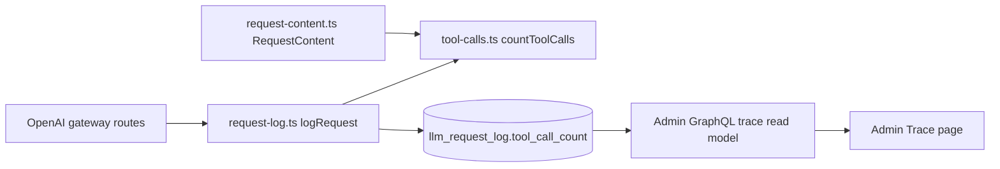
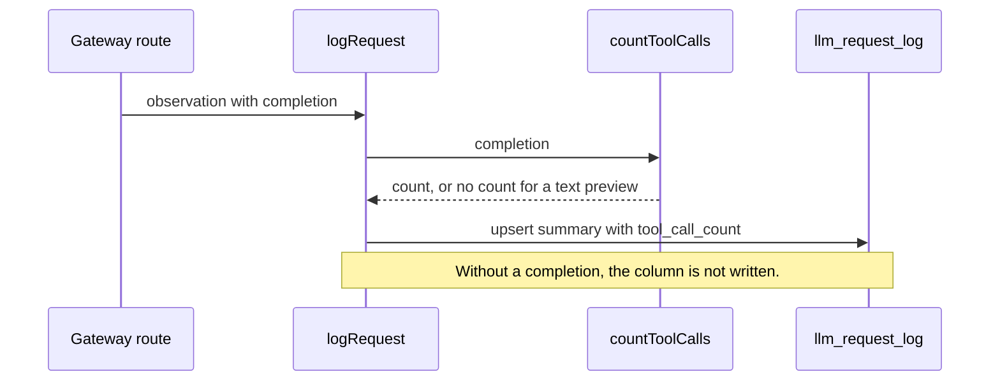

# Tool call count on the request log

Status: proposed

## Decision

`llm_request_log.tool_call_count` stores the number of tool calls that the model requested in the stored completion.
The request log service derives the count from `completion` when it finalizes a row.
No caller supplies the count.

The count follows the two wire protocols that the gateway forwards.
A streamed Chat Completions call is one `tool_calls` index inside one choice.
A streamed Responses call is one function call ID.
A body is read from `choices[].message.tool_calls` or from `output[]`.

The column is nullable.
Null means that the row has no completion that can be read as JSON.
Historical rows stay null.

## Reason

The admin Trace list shows the tool calls of each turn and sorts by them.
The admin API computes this number from stored completions today.
It reads every completion of the page, and it refuses a sort across all users.
A stored integer lets the admin API sort and filter with SQL.

## Scope

- Add the nullable `tool_call_count` column to `llm_request_log`.
- Add `countToolCalls` to the request log domain.
- Set the column in `logRequest` when the observation has a completion.

## Non-goals

- Do not record tool names, arguments, results, duration, or success.
- Do not backfill historical rows.
- Do not add an index. The admin API aggregates by `interaction_id`, which already limits the rows.
- Do not change the stored completion, billing, or routing.
- Do not add a client event.

## Module graph



## Affected files

```text
server/apps/api/
  drizzle/0033_llm_tool_call_count.sql
  drizzle/meta/0033_snapshot.json
  drizzle/meta/_journal.json
  src/schemas/llm-request-log.ts
  src/services/domain/tool-calls.ts
  src/services/domain/tool-calls.test.ts
  src/services/domain/request-log.ts
  src/services/domain/request-log.test.ts
server/docs/ai/adr/2026-10-12-request-tool-call-count.md

proj-airi/backend/
  schema/llm_request_log.go
  internal/models/llmlog/
```

## Write sequence



## Failure behavior

`countToolCalls` does not throw.
An event that is not JSON is skipped.
A stream that stops inside an event counts the complete events.
A completion that was stored as a truncated text preview has no count.

The count is written in the same statement as the completion.
A failed write loses the diagnostic row, as it does today.
It does not affect the response or the billing records.

## Rollout

1. Deploy this change. Drizzle applies migration 0033 at startup. The migration adds one nullable column and rewrites no rows.
2. Deploy the admin API change that reads the column. Before step 1, that admin API fails its column probe.
3. The dashboard needs no change.

Rollback the AIRI API to stop new counts. The column can stay.
The admin API continues to compute a count from the stored completion when the column is null.

## Verification

- Test both protocols, streamed and not streamed.
- Test argument deltas, a stream that stops inside an event, invalid JSON, and a text preview.
- Test that `logRequest` stores the count, stores zero for an answer without a tool call, and stores null without a completion.
- Test the migration on PostgreSQL after the existing migrations.
