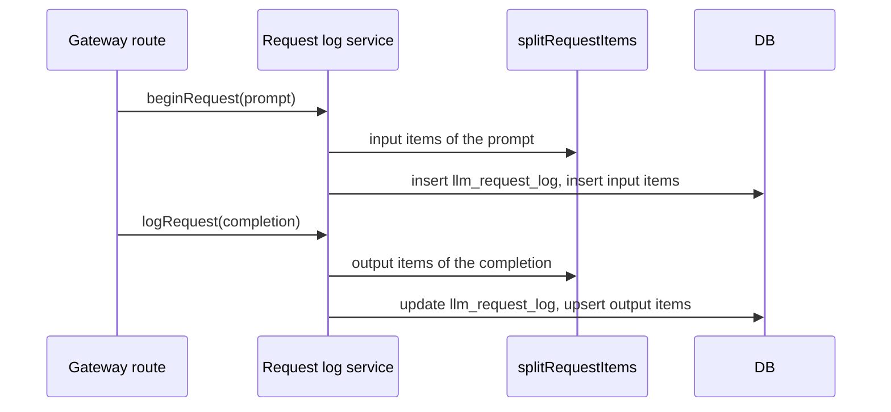

# Request items: one row for each message and tool call

Status: proposed

## Decision

A new table, `llm_request_item`, stores one row for each message, tool call, and tool result of a request.
The request log service writes these rows when it writes the request log row.
The rows are derived from the stored `prompt` and `completion`.
`llm_request_log` remains the source of the raw content, and the item rows can be built again from it.

This changes one line of [the admin trace ADR](./2026-10-05-admin-agent-traces.md).
That ADR added no table and no second write path.
This ADR adds one derived table, written by the same service.

## Reason

`llm_request_log` stores the request body and the response as received.
A streamed response is the list of SSE events.
A reader must parse a row to learn what the user said, what the model answered, and which tools the model called.

This has three effects today.

- The admin API cannot sort or filter by tool calls with SQL. It parses each completion of a page.
- A content search must scan the complete JSON text of each row. Each request repeats the conversation history, so one sentence matches many rows.
- The admin dashboard, the admin API, and this API each have a parser for tool calls. The rules can drift.

One parser at write time removes these effects.
A count column on the request log answers only the first one.

## Table

```text
llm_request_item
  id            text primary key
  user_id       text not null        no foreign key, same as llm_request_log
  request_id    text not null        the request that first carried the item
  session_id    text
  interaction_id text
  direction     text not null        input | output
  position      integer not null     order inside the direction, from 0
  kind          text not null        user_message | assistant_message | tool_call | tool_result
  text          text                 message text, tool arguments, or tool result
  tool_name     text                 tool_call only
  tool_call_id  text                 tool_call and tool_result
  truncated     boolean not null     the text was cut at the item limit
  created_at    timestamp not null   the start time of the request
```

Indexes:

- Unique `(user_id, request_id, direction, position)`. This is the idempotency key.
- `(user_id, created_at)` for the timeline of one user.
- `(interaction_id)` for one trace.
- `(created_at) where kind = 'tool_call'` for tool call counts across users.

The item limit is 256 KiB of text for each row.
Inline media is already replaced in the stored content, so an item never holds media bytes.

## New input rule

Each request repeats the earlier conversation.
An item must be stored one time, by the request that first carried it.

The new input of a request is the list of prompt items after the last item that the model wrote.

- Chat Completions: the messages after the last `assistant` message.
- Responses: the `input` items after the last assistant message, `function_call`, or `reasoning` item. A string `input` is one user message.

The rule reads one request only. It does not compare a request with earlier rows.
`system` and `developer` messages are not stored as items.

Known results of this rule:

- If a client sends the same user message again, each request stores it. This is correct, because the user sent it two times.
- If a client edits the history, the items show what each request carried at that time.

## Output rule

The output items come from `completion`.

- Chat Completions: the text of each choice is one `assistant_message`. Each `tool_calls` index inside one choice is one `tool_call`.
- Responses: each output message is one `assistant_message`. Each function call ID is one `tool_call`. The terminal `response.completed` or `response.incomplete` event names the same calls, and a call ID is stored one time.

Reasoning content is not stored as an item.

## Write sequence



`splitRequestItems` is a pure function of the protocol, the prompt, and the completion.
A request without a request ID gets no items.
Content that is truncated, partial, or not JSON gives the items that can be read, and no error.
A failed item write is logged and does not fail the request, because the items are derived.
Each write replaces the items of one direction of the request, so a second write adds no rows.

## Search index

This ADR adds no content index.
A search inside one user or one trace reads the `text` column through the indexes above.
That column is much smaller than the raw content, and it has no repeated history.

A search across all users needs an index.
`pg_trgm` cannot index Chinese or Japanese text when the database `lc_ctype` is `C`.
The production value is not known yet.
A later ADR selects `pg_trgm`, `pg_bigm`, or PGroonga after that value is known.

## Scope

1. Add the `llm_request_item` table and its migration.
2. Add `splitRequestItems` to the request log domain, with tests for both protocols, streamed and not streamed.
3. Write input items in `beginRequest` and output items in `logRequest`.
4. Add a script that builds items for historical request log rows with the same function.
5. Change the admin API to read tool calls, trace sort, and content search from items.
6. Remove the tool call parsers from the admin API and the admin dashboard.

Steps 1 to 3 are one PR in this repository. Each later step is a separate PR.

## Non-goals

- Do not change the stored `prompt` or `completion`.
- Do not store system prompts, reasoning, or media.
- Do not record tool duration or tool success. The client runs the tools, and the gateway does not see them.
- Do not change billing or routing.
- Do not send content to an external service.

## Open questions

- Retention. No code in `server/apps/api/src` deletes request log rows, by age or when a user is deleted. Item rows make user text easier to find. A retention rule for both tables needs a decision before step 5.
- Access. Only the admin API reads items. The admin audit log does not record content reads today.

## Rollout

Deploy the migration and the write path first. No reader depends on the new rows.
Run the historical script after the write path is correct in production.
Change the admin API after the historical rows exist, so one read path serves all dates.

Rollback of the write path stops new items. The request log is not affected.
The table can be dropped, because it holds no original data.

## Verification

- Test the new input rule with a first request, a later round, a tool result round, and a string `input`.
- Test the output rule with streamed and not streamed bodies of both protocols, with more than one choice, and with a terminal Responses event.
- Test that a second `logRequest` for the same request does not add rows.
- Test truncated and partial content.
- Compare item tool call counts with the admin API counts on a copy of production rows before step 5.
