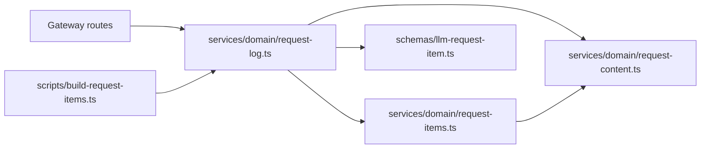
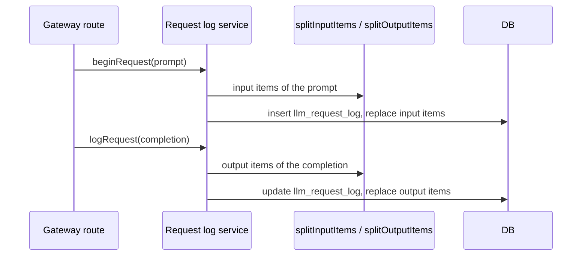

# Request items: one row for each message part and tool call

Status: proposed

## Decision

A new table, `llm_request_item`, stores one row for each message part, tool call, and tool result of a request.
The request log service writes these rows when it writes the request log row.
The rows are derived from the stored `prompt` and `completion`.
`llm_request_log` remains the source of the raw content, and the item rows can be built again from it.

Each row has a `role` and a `part_type`.
The part types follow the message parts of the OpenTelemetry GenAI semantic conventions (`gen_ai.input.messages`).
A new protocol needs a new parser and no table change.

This changes one line of [the admin trace ADR](./2026-10-05-admin-agent-traces.md).
That ADR added no table and no second write path.
This ADR adds one derived table, written by the same service.

## Reason

`llm_request_log` stores the request body and the response as received.
A streamed response is the list of SSE events.
A reader must parse a row to learn what the user said, what the model answered, and which tools the model called.

This has three effects today.

- The admin API cannot sort or filter by tool calls with SQL. It parses each completion of a page.
- A content search must scan the complete JSON text of each row. Each request repeats the conversation history, so one sentence matches many rows.
- The admin dashboard, the admin API, and this API each have a parser for tool calls. The rules can drift.

One parser at write time removes these effects.
A count column on the request log answers only the first one.

## Table

```text
llm_request_item
  id              text primary key
  user_id         text not null        no foreign key, same as llm_request_log
  request_id      text not null        the request that first carried the item
  session_id      text
  interaction_id  text
  direction       text not null        input | output
  position        integer not null     order inside the direction, from 0
  role            text not null        user | assistant | tool
  part_type       text not null        see below
  text            text                 searchable text only
  tool_name       text                 call parts only
  tool_call_id    text                 call and response parts
  arguments       jsonb                the arguments of a call part
  attributes      jsonb                protocol details that no column holds
  truncated       boolean not null     text or arguments were cut at the item limit
  parser_version  integer not null     the parser that wrote the row
  created_at      timestamp not null   the start time of the request
```

Part types:

| `part_type` | Role | Source | `text` |
|---|---|---|---|
| `text` | user, assistant | A message text part | The text |
| `refusal` | assistant | A refusal of the model | The refusal text |
| `tool_call` | assistant | A call that the client runs, such as a function call | Empty |
| `tool_call_response` | tool | The result of a `tool_call`, sent in a later request | The result |
| `server_tool_call` | assistant | A built-in tool that the provider runs, such as `web_search` | Empty |

`refusal` is not an OpenTelemetry part type. It is a separate type because a refusal is not an answer, and a reader must be able to count refusals.

`tool_call` and `server_tool_call` are different types because the client runs only the first one.
A trace waits for a client result of a `tool_call`. It must not wait for a `server_tool_call`.
The provider puts the result of a built-in call in the same output item, so no `server_tool_call_response` row is written.

`role` and `part_type` are text columns without a database constraint.
A new part type, such as `reasoning` or `file`, changes the parser and the TypeScript type, and needs no migration.

`text` holds only text that a person reads, so a content index does not index tool arguments.
`arguments` holds the parsed arguments of a call part.
Arguments that are not valid JSON, for example from a stream that stopped, are stored as one JSON string.

`attributes` holds details of one protocol that a reader can need, but that do not need an index.
The first parser writes `choice` for Chat Completions output with more than one choice.
A detail that a reader must filter on gets its own column and a migration.

`parser_version` starts at 1.
A parser change that changes the rows increases the version.
The historical script can then build again only the requests with older rows.

Indexes:

- Unique `(user_id, request_id, direction, position)`. This is the idempotency key.
- `(user_id, created_at)` for the timeline of one user.
- `(interaction_id)` for one trace.
- `(created_at) where part_type = 'tool_call'` for tool call counts across users.

The item limit is 256 KiB for each of `text` and `arguments`.
Inline media is already replaced in the stored content, so an item never holds media bytes.

## New input rule

Each request repeats the earlier conversation.
An item must be stored one time, by the request that first carried it.

The new input of a request is the list of prompt items after the last item that the model wrote.

- Chat Completions: the messages after the last `assistant` message.
- Responses: the `input` items after the last assistant message, call item, or `reasoning` item. A string `input` is one user message.

The rule reads one request only. It does not compare a request with earlier rows.
`system` and `developer` messages are not stored as items.

Known results of this rule:

- If a client sends the same user message again, each request stores it. This is correct, because the user sent it two times.
- If a client edits an item before the last item that the model wrote, no row records the edit.
  The rows keep the content of the request that first carried the item.
  The raw prompt of the later request in `llm_request_log` keeps the edited content.
  A content search on items does not find text that exists only in such an edit.
  To find these edits, a request must be compared with earlier rows. This ADR does not do that, because AIRI clients do not edit earlier items today.

## Output rule

The output items come from `completion`.

- Chat Completions: the text of each choice is one `text` part, and its `refusal` is one `refusal` part. Each `tool_calls` index inside one choice is one `tool_call`. Each choice numbers its calls from 0.
- Responses: each output text part of a message is one `text` part, and each refusal part is one `refusal` part. The terminal `response.completed` or `response.incomplete` event names the same calls, and a call ID is stored one time.
- Responses calls that the client runs are `tool_call` parts: `function_call`, `custom_tool_call`, `computer_call`, and `local_shell_call`. The client returns each result as a `<type>_output` input item, which is a `tool_call_response`.
- Every other item type that ends with `_call` is a `server_tool_call`, for example `web_search_call`, `file_search_call`, `code_interpreter_call`, `image_generation_call`, and `mcp_call` (a remote MCP server that the provider calls). The gateway accepts `web_search` (`operations/responses/request.ts`). The tool name comes from the item type. The fields that say what the model asked for, such as `action` and `queries`, are the arguments.
- A new item type that ends with `_call` is a `server_tool_call` until the parser lists it as a client call. This is the safer error: a trace does not wait for a client result that never comes.

Reasoning content is not stored as an item.

The gateway forwards Chat Completions and Responses only.
An Anthropic Messages route needs a new parser and no table change:

| Messages block | Row |
|---|---|
| `text` | `text` part |
| `tool_use` | `tool_call`, with `input` as the arguments |
| `tool_result` | `tool_call_response`, with `tool_use_id` as the tool call ID |
| `server_tool_use` | `server_tool_call` |

## Modules



`request-items.ts` is pure. It reads stored content and returns items. It does not import the database.

## Affected files

```text
server/apps/api/
├── drizzle/
│   ├── 0033_llm_request_item.sql        new table and indexes
│   └── meta/                            snapshot and journal
└── src/
    ├── schemas/
    │   ├── index.ts                     export the table
    │   └── llm-request-item.ts          new
    ├── scripts/
    │   └── build-request-items.ts       new, historical rows
    └── services/domain/
        ├── request-items.ts             new, the parser
        ├── request-items.test.ts        new
        ├── request-log.ts               write items, build items
        └── request-log.test.ts          write path tests
```

## Write sequence



The split functions are pure functions of the stored content.
A request without a request ID gets no items.
Content that is truncated, partial, or not JSON gives the items that can be read, and no error.
A failed item write is logged and does not fail the request, because the items are derived.
Each write replaces the items of one direction of the request, so a second write adds no rows.

## Search index

This ADR adds no content index.
A search inside one user or one trace reads the `text` column through the indexes above.
That column is much smaller than the raw content, and it has no repeated history.

A search across all users needs an index.
`pg_trgm` cannot index Chinese or Japanese text when the database `lc_ctype` is `C`.
The production value is not known yet.
A later ADR selects `pg_trgm`, `pg_bigm`, or PGroonga after that value is known.

## Scope

1. Add the `llm_request_item` table and its migration.
2. Add the split functions to the request log domain, with tests for both protocols, streamed and not streamed.
3. Write input items in `beginRequest` and output items in `logRequest`.
4. Add a script that builds items for historical request log rows with the same functions.
5. Change the admin API to read tool calls, trace sort, and content search from items.
6. Remove the tool call parsers from the admin API and the admin dashboard.

Steps 1 to 4 are one PR in this repository. Each later step is a separate PR.
The script prints a cursor, and a later run can start from that cursor.

## Non-goals

- Do not change the stored `prompt` or `completion`.
- Do not store system prompts, reasoning, or media.
- Do not record tool duration or tool success. The client runs the tools, and the gateway does not see them. [The agent trace ADR](./2026-10-14-agent-trace.md) adds client spans for this.
- Do not change billing or routing.
- Do not send content to an external service.

## Open questions

- Retention. No code in `server/apps/api/src` deletes request log rows, by age or when a user is deleted. Item rows make user text easier to find. A retention rule for both tables needs a decision before step 5.
- Access. Only the admin API reads items. The admin audit log does not record content reads today.

## Rollout

Deploy the migration and the write path first. No reader depends on the new rows.
Run the historical script after the write path is correct in production.
Change the admin API after the historical rows exist, so one read path serves all dates.

Rollback of the write path stops new items. The request log is not affected.
The table can be dropped, because it holds no original data.

## Verification

- Test the new input rule with a first request, a later round, a tool result round, and a string `input`.
- Test the output rule with streamed and not streamed bodies of both protocols, with more than one choice, with a refusal, with a built-in call, and with a terminal Responses event.
- Test that call arguments go to `arguments` and not to `text`, and that invalid arguments are stored as a JSON string.
- Test that a second `logRequest` for the same request does not add rows.
- Test truncated and partial content.
- Compare item tool call counts with the admin API counts on a copy of production rows before step 5.
