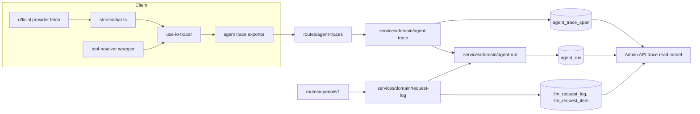
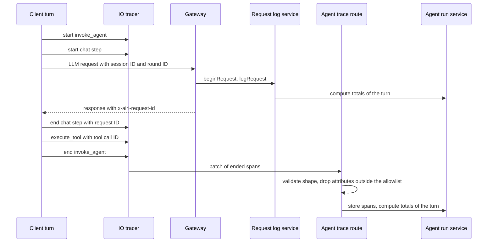

# Agent trace from client spans and request logs

Status: proposed

## Decision

The client uploads the spans of each agent turn to the API.
The API stores them in a new table, `agent_trace_span`, and keeps one summary row for each turn in a new table, `agent_run`.
The admin Trace page shows one timeline for each turn. It joins three sources:

| Fact | Source |
|---|---|
| What the model received and wrote, tokens, cost | `llm_request_log` and `llm_request_item` (gateway) |
| The steps of a turn, tool runtime and result status | `agent_trace_span` (client) |
| ASR, TTS, playback, and VAD timing | `agent_trace_span` (client) |
| Turn totals, status, and tool call count | `agent_run` (API, derived) |

Each fact has one owner. The client does not upload content that the gateway already stores.

This ADR changes two points of [the admin trace ADR](./2026-10-05-admin-agent-traces.md):

- That ADR added no trace table and no second write path. This ADR adds two tables and one client write path.
- That ADR had the non-goal "Do not add client IOTrace upload". This ADR adds that upload.

The rule that OpenTelemetry spans do not hold prompt or completion content does not change.
The uploaded spans hold no content either.

## Reason

The agent loop runs in the client (`packages/core-agent`). The tools run in the client.
The gateway sees only the LLM requests of a turn.
It cannot know how long a tool ran, whether it failed, or how long ASR and TTS took.
The admin Trace page cannot show these facts today.

The client already records most of them with the IO tracer (`packages/stage-ui/src/composables/use-io-tracer.ts`), an OpenTelemetry tracer that every app runs.
Today the spans stay in memory, or in a local file on desktop.

Langfuse and similar tools receive spans from a client SDK.
LobeHub runs its agent loop on the server and records each run in an operations table, with the steps in a trace file.
AIRI needs the client part of the first and the run table of the second.

## Join keys

| Key | Meaning | Where it exists |
|---|---|---|
| `interaction_id` | One turn. The client round ID. | `x-airi-round-id` header, `llm_request_log`, `llm_request_item`, every uploaded span |
| `session_id` | One conversation | `x-airi-session-id` header, the same tables, every uploaded span |
| `request_id` | One gateway request | `llm_request_log`. New: the `x-airi-request-id` response header and the LLM step span |
| `tool_call_id` | One client tool call | `llm_request_item`, the tool span |

The server does not return its request ID today (`routes/openai/v1/http/response.ts`).
The gateway adds the `x-airi-request-id` response header, and CORS exposes it.
The client reads it in the official provider fetch and puts it on the LLM step span.

The timeline does not compare client and server clocks to order the steps.
A tool call is in the output items of one request, and its response is in the input items of the next request.
The request IDs and tool call IDs give the order.
Client times give only the duration of each span and the order of spans from the same client.

## Uploaded span

The upload uses the shape that the IO tracer already serializes (`SerializedIOSpan`), with an allowlist of attributes.

```text
POST /api/v1/agent-traces
{
  "resource": { "appSurface": "web" | "electron" | "mobile", "appVersion": "..." },
  "spans": [
    {
      "traceId", "spanId", "parentSpanId",
      "name",
      "startTimeUnixMs", "endTimeUnixMs",
      "status": "ok" | "error" | "cancelled",
      "attributes": { allowlisted keys only }
    }
  ]
}
```

Span names and their attributes:

| Span | Attributes |
|---|---|
| `invoke_agent` (one turn, the root) | `gen_ai.conversation.id`, `ai.moeru.airi.interaction_id`, `ai.moeru.airi.turn.status` |
| `chat` (one LLM step) | `gen_ai.request.model`, `ai.moeru.airi.request_id`, `ai.moeru.airi.step.index`, `ai.moeru.airi.ttft_ms` |
| `execute_tool` (one tool call) | `gen_ai.tool.name`, `gen_ai.tool.call.id`, `error.type` |
| `asr`, `tts`, `playback`, `vad` | Durations, counts, and flags that the IO tracer records today, without text |

The names follow the OpenTelemetry GenAI conventions where they exist.
The API drops each attribute outside the allowlist before it stores the span, and counts the dropped keys in a metric.
A client change cannot store text by mistake, and a newer client does not lose its spans on an older API.
ASR text, TTS text, tool arguments, and tool results are not uploaded.

## Tables

```text
agent_trace_span
  id               text primary key
  user_id          text not null        no foreign key, same as llm_request_log
  session_id       text
  interaction_id   text not null
  trace_id         text not null
  span_id          text not null
  parent_span_id   text
  name             text not null        invoke_agent | chat | execute_tool | asr | tts | playback | vad
  request_id       text                 chat spans
  tool_name        text                 execute_tool spans
  tool_call_id     text                 execute_tool spans
  status           text not null        ok | error | cancelled
  error_type       text
  started_at       timestamp not null   client clock
  duration_ms      integer
  attributes       jsonb                the other allowlisted attributes
  app_surface      text
  app_version      text
  received_at      timestamp not null   server clock

agent_run
  user_id          text not null
  interaction_id   text not null
  session_id       text
  status           text not null        running | finished | cancelled | failed
  started_at       timestamp not null
  ended_at         timestamp
  llm_calls        integer not null
  tool_calls       integer not null     client tool calls in output items
  server_tool_calls integer not null
  failed_tools     integer not null     from client spans
  flux_consumed    integer not null
  input_tokens     integer
  output_tokens    integer
  has_client_trace boolean not null
  updated_at       timestamp not null
  primary key (user_id, interaction_id)
```

Indexes:

- `agent_trace_span`: unique `(user_id, trace_id, span_id)` as the idempotency key, and `(user_id, interaction_id)`.
- `agent_run`: `(started_at)`, `(user_id, started_at)`, and `(tool_calls, started_at)` for the sort across users.
- `llm_request_log`: new `(user_id, interaction_id)`. The table has no index on `interaction_id` today.

`agent_run` is derived. It can be built again from the other tables.
Each write computes the totals of the turn again from `llm_request_log`, `llm_request_item`, and `agent_trace_span`. It does not add to the earlier totals, so a repeated or late write gives the same row.
The request log service writes it after each request. The ingest service writes it after each upload.
A turn without client spans still gets a row, with `has_client_trace = false`.

Status:

- The client `invoke_agent` span sets `finished`, `cancelled`, or `failed`.
- Without that span, the state of the last request sets the status. A turn with a request still in flight is `running`.

## Client changes

- Put `interaction_id` and `session_id` on every span, the root included. Today the root span has no attributes, and no span has the session ID.
- Set the parent of each span from the OpenTelemetry context of its turn, not from the global `activeTurnSpan`. Today two turns at the same time can get the wrong parent, and VAD spans have no parent.
- Start one `chat` span for each LLM step. Today one span covers all the steps of a turn, because the xsAI `step.start` and `step.done` events are dropped (`packages/core-agent/src/runtime/xsai-events.ts`).
- Start one `execute_tool` span in a wrapper around `Tool.execute`, where `resolveLlmTools` already wraps tools (`packages/stage-ui/src/stores/ai/chat-llm/tool-resolver.ts`).
- Add a batch exporter that sends ended spans every few seconds and when the page is hidden. A failed upload drops the batch. It does not retry and does not block the turn.
- Fix `withCredentials` in the official provider, which writes the active session ID over the session ID of a background turn (`packages/stage-ui/src/libs/providers/providers/official/shared.ts`).

The upload runs only when the turn uses the official provider and analytics is enabled.
A turn with another provider has no gateway rows to join, and its data goes to a provider that AIRI does not run.

## Modules



## Affected files

```text
server/apps/api/
├── drizzle/                                   two tables, one llm_request_log index
└── src/
    ├── app.ts                                 mount the route, expose the response header, account deletion
    ├── schemas/
    │   ├── agent-trace-span.ts                new
    │   └── agent-run.ts                       new
    ├── routes/
    │   ├── agent-traces/index.ts              new, auth, rate limit, Valibot
    │   ├── agent-traces/schema.ts             new, the upload contract and allowlist
    │   └── openai/v1/http/response.ts         x-airi-request-id
    └── services/domain/
        ├── agent-trace.ts                     new, ingest
        ├── agent-run.ts                       new, totals of one turn
        └── request-log.ts                     write agent_run after each request
packages/stage-shared/src/
├── perf/io-trace.ts                           span and attribute names
└── types/io-trace.ts                          upload shape
packages/stage-ui/src/
├── composables/use-io-tracer.ts               context parents, exporter
├── libs/agent-trace/exporter.ts               new, batch upload
├── stores/chat.ts                             IDs on every span, chat step spans
├── stores/ai/chat-llm/tool-resolver.ts        execute_tool spans
└── libs/providers/providers/official/shared.ts  request ID, session ID fix
packages/core-agent/src/runtime/xsai-events.ts   forward step events
```

## Sequence



## Scope

1. Gateway: return `x-airi-request-id`, expose it in CORS, and add the `(user_id, interaction_id)` index on `llm_request_log`.
2. API: add the two tables, the ingest route, the run service, and account deletion for both tables.
3. Client: IDs and parents on spans, `chat` and `execute_tool` spans, the exporter, and the session ID fix.
4. Admin API (`proj-airi/backend`): read runs, spans, and items for one turn, and sort runs across users.
5. Admin dashboard: one timeline for each turn.

Each step is a separate PR. Step 2 can deploy before step 3, because a turn without spans still gets a run row.
Step 4 copies the new tables only after they are on `main` of this repository, as the admin API rules require.

## Non-goals

- Do not upload content: no ASR or TTS text, no tool arguments, and no tool results.
- Do not upload traces of turns that use a provider other than the official one.
- Do not use spans for billing. Billing reads only gateway data.
- Do not order steps by comparing client and server clocks.
- Do not send these spans to an external OpenTelemetry backend.
- Do not add scores, user feedback, prompt management, datasets, or evaluations.
- Do not build runs for turns before the request log had `interaction_id`.

## Open questions

- Consent. This ADR uses the analytics setting, which is on by default. A separate setting for traces is possible.
- Retention. No rule deletes request log rows today. The same rule must apply to `agent_trace_span` and `agent_run`.
- Volume. One turn adds about 3 to 15 spans. The size of the table under production load is not measured.
- A tool result that never reaches the gateway, for example when the user closes the app after the tool runs, has a span but no item. The timeline shows the span without a result.

## Rollout

Deploy steps 1 and 2 first. No client sends spans yet, and the run rows come from request logs.
Release the client of step 3. Old clients send no spans, and their turns keep `has_client_trace = false`.
Ship steps 4 and 5 after the tables are on `main`.

Rollback of the client stops new spans. Rollback of the API drops nothing that another table needs, because both tables are derived or optional.

## Verification

- Route tests: a valid batch is stored, an attribute outside the allowlist is not stored and is counted, a repeated batch adds no rows, and a user cannot write spans of another user.
- Run service tests: the totals of a turn are the same after requests and spans arrive in any order, and after a repeated write.
- Gateway test: the response has `x-airi-request-id`, and it equals `llm_request_log.request_id`.
- Client tests: two turns at the same time give spans with the correct parents and IDs, a tool error gives an `execute_tool` span with status `error`, and no span holds ASR or TTS text.
- End to end on a local API and Postgres: one turn with two tool calls gives one run row, three `chat` spans with request IDs that exist, and two `execute_tool` spans that match the tool call items.
