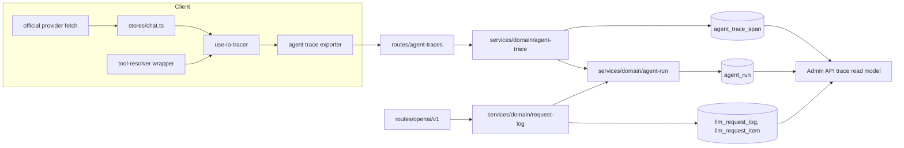
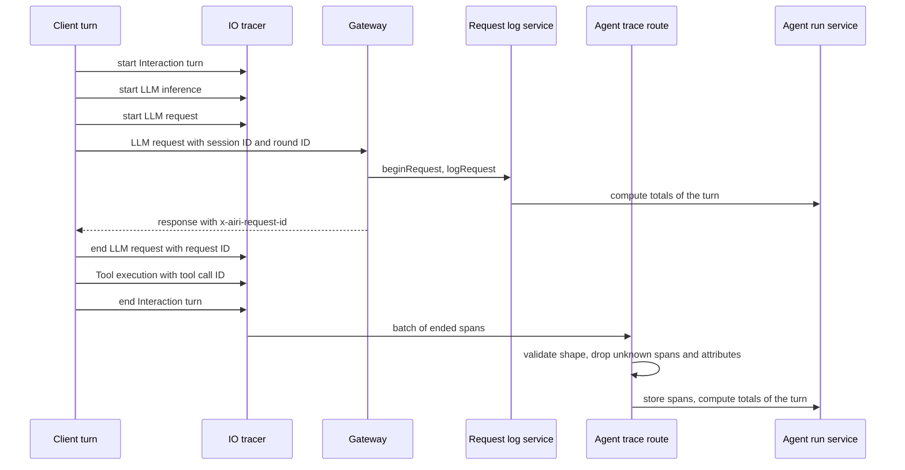

# Agent trace from client spans and request logs

Status: proposed

## Decision

The client uploads the spans of each agent turn to the API.
The API stores them in a new table, `agent_trace_span`, and keeps one summary row for each turn in a new table, `agent_run`.
The admin Trace page shows one timeline for each turn. It joins three sources:

| Fact | Source |
|---|---|
| What the model received and wrote, tokens | `llm_request_log` and `llm_request_item` (gateway) |
| Cost | `flux_usage`, with `source_type = 'llm'` and the request ID (billing) |
| The steps of a turn, tool runtime and result status | `agent_trace_span` (client) |
| ASR, TTS, playback, and VAD timing | `agent_trace_span` (client) |
| Turn totals, status, and tool call count | `agent_run` (API, derived) |

Each fact has one owner. The client does not upload content that the gateway already stores.

This ADR changes two points of [the admin trace ADR](./2026-10-05-admin-agent-traces.md):

- That ADR added no trace table and no second write path. This ADR adds two tables and one client write path.
- That ADR had the non-goal "Do not add client IOTrace upload". This ADR adds that upload.

The rule that OpenTelemetry spans do not hold prompt or completion content does not change.
The uploaded spans hold no content either.

## Reason

The agent loop runs in the client (`packages/core-agent`). The tools run in the client.
The gateway sees only the LLM requests of a turn.
It cannot know how long a tool ran, whether it failed, or how long ASR and TTS took.
The admin Trace page cannot show these facts today.

The client already records most of them with the IO tracer (`packages/stage-ui/src/composables/use-io-tracer.ts`), an OpenTelemetry tracer that every app runs.
Today the spans stay in memory, or in a local file on desktop.

Langfuse and similar tools receive spans from a client SDK.
LobeHub runs its agent loop on the server and records each run in an operations table, with the steps in a trace file.
AIRI needs the client part of the first and the run table of the second.

## Join keys

| Key | Meaning | Where it exists |
|---|---|---|
| `interaction_id` | One turn. The client round ID. | `x-airi-round-id` header, `llm_request_log`, `llm_request_item`, the `Interaction turn` span |
| `trace_id` | One client trace. A spoken turn starts at `Wake word` or `Voice input`, and its `Interaction turn` is a child. A typed turn starts at `Interaction turn`. | Every uploaded span |
| `session_id` | One conversation | `x-airi-session-id` header, the same tables, the `Interaction turn` span |
| `request_id` | One gateway request | `llm_request_log`. New: the `x-airi-request-id` response header and the `LLM request` span |
| `tool_call_id` | One client tool call | `llm_request_item`, the `Tool execution` span |

A span joins a turn through its trace.
The `Interaction turn` span carries the interaction ID, and every span of its trace belongs to that turn.
The voice input spans start before the round ID exists, so they cannot carry it.

The server does not return its request ID today (`routes/openai/v1/http/response.ts`).
The gateway adds the `x-airi-request-id` response header, and CORS exposes it.
The client reads it in the official provider fetch and puts it on the `LLM request` span of that request.

The timeline does not compare client and server clocks to order the steps.
A tool call is in the output items of one request, and its response is in the input items of the next request.
The request IDs and tool call IDs give the order.
Client times give only the duration of each span and the order of spans from the same client.

## Uploaded span

The client uploads the spans that the IO tracer records, with their current names (`IOSpanNames` in `packages/stage-shared/src/perf/io-trace.ts`).
The upload uses the shape that the IO tracer already serializes (`SerializedIOSpan`), with milliseconds instead of nanosecond strings.

```text
POST /api/v1/agent-traces
{
  "resource": { "appSurface": "web" | "electron" | "mobile", "appVersion": "..." },
  "spans": [
    {
      "traceId", "spanId", "parentSpanId",
      "name",
      "startTimeUnixMs", "endTimeUnixMs",
      "status": "ok" | "error",
      "attributes": { ... }
    }
  ]
}
```

The API maps each span name to a `kind`, and keeps only the attributes that the allowlist of that kind names:

| Span name | `kind` | Columns and allowlisted attributes |
|---|---|---|
| `Interaction turn` | `turn` | `interaction_id`, `session_id` |
| `LLM inference` | `llm_inference` | The whole stream of a turn: model, time to first token, message and chunk counts |
| `LLM request` (new) | `llm_step` | One HTTP request of the stream: `request_id`, step index |
| `Tool execution` (new) | `tool` | `tool_name`, `tool_call_id`, `error.type` |
| `Wake word`, `Voice input`, `Voice activity detection`, `Speech recognition`, `End of speech judgement`, `Transcript rephrase` | `voice_input` and one kind each | Trigger, outcome, durations, counts, and flags |
| `Speech turn`, `TTS synthesis`, `Audio playback` | `speech_output` and one kind each | Segment ID, durations, and the interrupted, cancelled, and no audio flags |
| `Streaming control dispatch` | `streaming_control` | Parser name, matched, handler count |

The API drops a span with an unknown name, and each attribute outside the allowlist, before it stores the span.
It returns the number of dropped spans and attributes in the response, and logs them.
A client change cannot store text by mistake, and a newer client does not lose its known spans on an older API.

These attributes hold content and are never on the allowlist: `asr.text`, `tts.text`, `kws.text`, `streaming_control.parameter`, and `streaming_control.raw_token`.
Tool arguments and tool results are not uploaded either.

The IO tracer marks an aborted span with `ai.moeru.airi.io.cancelled` and no error status.
The API stores that span with status `cancelled`.

## Tables

```text
agent_trace_span
  id               text primary key
  user_id          text not null        no foreign key, same as llm_request_log
  trace_id         text not null
  span_id          text not null
  parent_span_id   text
  name             text not null        the IO tracer span name
  kind             text not null        see above
  interaction_id   text                 turn spans
  session_id       text                 turn spans
  request_id       text                 llm_step spans
  tool_name        text                 tool spans
  tool_call_id     text                 tool spans
  status           text not null        ok | error | cancelled
  error_type       text
  started_at       timestamp not null   client clock
  duration_ms      integer
  attributes       jsonb                the other allowlisted attributes
  app_surface      text
  app_version      text
  received_at      timestamp not null   server clock

agent_run
  user_id          text not null
  interaction_id   text not null
  session_id       text
  trace_id         text                 the client trace of the turn
  status           text not null        running | finished | cancelled | failed
  started_at       timestamp not null
  ended_at         timestamp
  llm_calls        integer not null
  tool_calls       integer not null     client tool calls in output items
  server_tool_calls integer not null
  failed_tools     integer not null     from client spans
  input_tokens     integer
  output_tokens    integer
  has_client_trace boolean not null
  updated_at       timestamp not null
  primary key (user_id, interaction_id)
```

Indexes:

- `agent_trace_span`: unique `(user_id, trace_id, span_id)` as the idempotency key, which also serves the lookup by trace, and `(user_id, interaction_id)`.
- `agent_run`: `(started_at)`, `(user_id, started_at)`, and `(tool_calls, started_at)` for the sort across users.
- `llm_request_log`: new `(user_id, interaction_id)`. The table has no index on `interaction_id` today.
  Migrations run in a transaction at startup, so this index is not built `CONCURRENTLY`. It blocks writes to the table while it builds. The build time on the production table is not measured. It can be built by hand with `CREATE INDEX CONCURRENTLY IF NOT EXISTS` before the deploy, and the migration then does nothing.

`agent_run` is derived. It can be built again from the other tables.
Each write computes the totals of the turn again from `llm_request_log`, `llm_request_item`, and `agent_trace_span`, inside a transaction that holds an advisory lock for the turn.
It does not add to the earlier totals, so a repeated or late write gives the same row.
The request log service writes it after each request of a turn. The ingest service writes it for each turn that an upload touches.
A turn without client spans still gets a row, with `has_client_trace = false`.

`agent_run` holds no cost. Billing can settle a request after its request log row is written, so a cost total in this row could be old.
The admin API reads the cost of a turn from `flux_usage` by the request IDs of the turn.

Status:

- The `Interaction turn` span sets `finished`, `cancelled`, or `failed`.
- Without that span, a request that is still `running` makes the turn `running`.
  A turn whose last request completed with client tool calls is also `running`, because the client runs the tools and then sends the next request. A client that closes before that request leaves the run `running`.
  Otherwise the state of the last request sets the status.

## Client changes

- Put `interaction_id` and `session_id` on the `Interaction turn` span. Today the round ID is on some child spans only, and no span has the session ID.
- Remove the global `activeTurnSpan`. Each span takes its parent from its own turn, so two turns at the same time keep their own spans:
  - `LLM request` and `Tool execution` from the `LLM inference` span of the turn.
  - Speech output from the turn span that the voice host opens. It already did this.
  - Streaming control from a registry of open turn spans, by the turn ID that each dispatch carries. A dispatch for a turn that runs in another window starts its own trace.
  - Speech recognition of a voice message from the turn that the chat store passes. Speech recognition of the microphone stays under the voice input, which has one input at a time.
- Devtools stops ending the turn span when it stops recording. The chat store owns that span.
- Keep one `LLM inference` span for the whole stream of a turn, and start one `LLM request` span under it for each HTTP request in the official provider fetch.
  The fetch finds the `LLM inference` span of its turn by the round ID header, and reads the request ID from the response header.
  The span ends when the response body ends. xsAI and `core-agent` do not change: the steps run inside xsAI, and only the fetch sees each request and its response.
- Copy the time to first token from the `LLMFirstToken` event to an attribute of `LLM inference`, because the upload has no events.
- Set the error status or the cancelled attribute on the `Interaction turn` span from the status of the `onSendSettled` event.
- Add a `Tool execution` span in a wrapper around `Tool.execute`, where `resolveLlmTools` already wraps tools (`packages/stage-ui/src/stores/ai/chat-llm/tool-resolver.ts`).
- Add a batch exporter that sends ended spans every few seconds and when the page is hidden. A failed upload drops the batch. It does not retry and does not block the turn.
  The exporter keeps only the attributes on the client allowlist (`IOUploadAttributes`), so content does not leave the client even before the API allowlist.
- Fix `withCredentials` in the official provider, which writes the active session ID over the session ID of a background turn (`packages/stage-ui/src/libs/providers/providers/official/shared.ts`).

The upload runs only for traces whose turn uses the official provider, and only when analytics is enabled.
A turn with another provider has no gateway rows to join, and its data goes to a provider that AIRI does not run.

A resolved step can change the provider within a turn. The chat store marks the provider of each step on the trace.
The exporter holds the spans of a trace until its `Interaction turn` span ends, and uploads them only if every step used the official provider.
A trace with one step of another provider is dropped as a whole, official steps included.

## Modules



## Affected files

```text
server/apps/api/
├── drizzle/                                   two tables, one llm_request_log index
└── src/
    ├── app.ts                                 mount the route, expose the response header, account deletion
    ├── schemas/
    │   ├── agent-trace-span.ts                new
    │   └── agent-run.ts                       new
    ├── routes/
    │   ├── agent-traces/index.ts              new, auth, rate limit, Valibot
    │   ├── agent-traces/schema.ts             new, the upload contract and allowlist
    │   └── openai/v1/http/response.ts         x-airi-request-id
    └── services/domain/
        ├── agent-trace.ts                     new, ingest
        ├── agent-run.ts                       new, totals of one turn
        └── request-log.ts                     write agent_run after each request
packages/stage-shared/src/
├── perf/io-trace.ts                           span and attribute names
└── types/io-trace.ts                          upload shape
packages/stage-ui/src/
├── composables/use-io-tracer.ts               the LLM inference span of each turn, by round ID
├── libs/agent-trace/exporter.ts               new, batch upload and the provider rule
├── libs/agent-trace/request-span.ts           new, LLM request spans in the fetch
├── libs/product-signals/index.ts              start the upload with analytics
├── stores/chat.ts                             turn IDs and status, step providers
├── stores/ai/chat-llm/tool-span.ts            new, Tool execution spans
├── stores/ai/chat-llm/tool-resolver.ts        wrap each tool
└── libs/providers/providers/official/shared.ts  LLM request spans, session ID fix
```

## Sequence



## Scope

1. Gateway: return `x-airi-request-id` on every chat and Responses response, errors included, and expose it in CORS. The route creates the ID before the operation, and the operation logs the same ID.
2. API: add the two tables, the `(user_id, interaction_id)` index on `llm_request_log`, the ingest route, the run service, and account deletion for both tables. This step builds on the request item PR, because `agent_run` counts tool calls from items, and both add migrations.
3. Client, in three PRs:
   1. Each span takes its own turn as its parent. The turn span carries its IDs and status. The session ID fix.
   2. One `LLM request` span for each request, and `Tool execution` spans.
   3. The exporter. Only this part sends data off the device, and it needs step 2 of this list to be deployed.
4. Admin API (`proj-airi/backend`): read runs, spans, and items for one turn, and sort runs across users.
5. Admin dashboard: one timeline for each turn.

Each step is a separate PR. Step 1 needs no migration. Step 2 can deploy before step 3, because a turn without spans still gets a run row.
Step 4 copies the new tables only after they are on `main` of this repository, as the admin API rules require.

## Non-goals

- Do not upload content: no ASR or TTS text, no tool arguments, and no tool results.
- Do not upload traces of turns that use a provider other than the official one.
- Do not use spans for billing. Billing reads only gateway data.
- Do not order steps by comparing client and server clocks.
- Do not send these spans to an external OpenTelemetry backend.
- Do not add scores, user feedback, prompt management, datasets, or evaluations.
- Do not build runs for turns before the request log had `interaction_id`.

## Open questions

- Consent. This ADR uses the analytics setting, which is on by default. A separate setting for traces is possible.
- Retention. No rule deletes request log rows today. The same rule must apply to `agent_trace_span` and `agent_run`.
- Volume. One turn adds about 3 to 15 spans. The size of the table under production load is not measured.
- A tool result that never reaches the gateway, for example when the user closes the app after the tool runs, has a span but no item. The timeline shows the span without a result.

## Rollout

Deploy steps 1 and 2 first. No client sends spans yet, and the run rows come from request logs.
Release the client of step 3. Old clients send no spans, and their turns keep `has_client_trace = false`.
Ship steps 4 and 5 after the tables are on `main`.

Rollback of the client stops new spans. Rollback of the API drops nothing that another table needs, because both tables are derived or optional.

## Verification

- Route tests: a valid batch is stored, an unknown span and an attribute outside the allowlist are not stored and are counted, a content attribute such as `asr.text` is never stored, a repeated batch adds no rows, and a user cannot write spans of another user.
- Run service tests: the totals of a turn are the same after requests and spans arrive in any order, and after a repeated write.
- Gateway test: the response has `x-airi-request-id`, and it equals `llm_request_log.request_id`.
- Client tests: two turns at the same time give `LLM request` spans with the correct parents and IDs, a tool error gives a `Tool execution` span with status `error`, and a turn with a step of another provider uploads nothing.
- End to end on a local API and Postgres: one turn with two tool calls gives one run row, three `LLM request` spans with request IDs that exist, and two `Tool execution` spans that match the tool call items.
