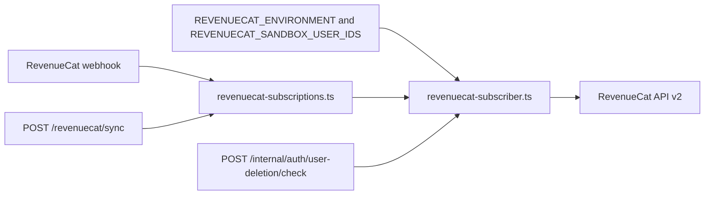
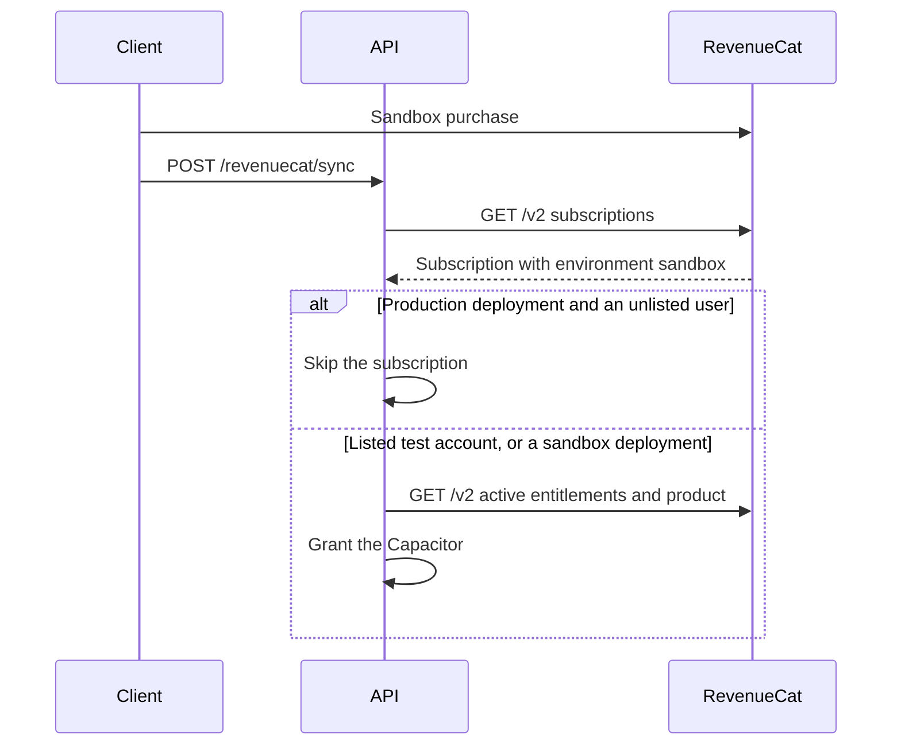

# RevenueCat sandbox subscriptions

Status: accepted. The requester confirmed the same account policy as Apple IAP sandbox purchases.

## Context

`GET /v2/projects/{project}/customers/{id}/subscriptions` returns the subscriptions of both store environments.
Sandbox subscriptions are test purchases. The API granted Capacitor Flux for both environments.

## Decision

Each subscription has an `environment` field. The server grants only the environment of its deployment.

- `REVENUECAT_ENVIRONMENT` is `production` by default. A dev deployment that sells sandbox subscriptions sets `sandbox`.
- `REVENUECAT_SANDBOX_USER_IDS` lists exact internal user IDs. A production deployment also grants their sandbox subscriptions.
- An empty list keeps production unchanged. It follows `APPLE_IAP_SANDBOX_USER_IDS` in [Apple IAP sandbox accounts](./2026-09-27-apple-iap-sandbox-accounts.md).

The filter applies to the Capacitor reconciliation and to the account deletion check.
A sandbox subscription of a normal user thus grants no Flux and does not block a deletion.

The list of active entitlements ignores the `environment` query parameter.
Its end of access can come from an excluded sandbox subscription that grants the same entitlement.
In that case the entitlement ends with `current_period_ends_at` of the subscription that counts.
Otherwise the active entitlement keeps the end of access, so a grace period still counts.

## Scope and non-goals

This change filters subscriptions in `revenuecat-subscriber.ts` and adds two environment variables.
It does not change the webhook, the wallet, or the database schema.

It does not change the dev build, create a second RevenueCat project, or create test accounts.
Operators must use new, dedicated accounts for `REVENUECAT_SANDBOX_USER_IDS` and remove them after testing.

## Dependencies and affected files



```text
server/
  apps/api/src/libs/env.ts
  apps/api/src/app.ts
  apps/api/src/services/adapters/revenuecat-subscriber.ts
  apps/api/src/services/adapters/revenuecat-subscriber.test.ts
  apps/api/README.md
  docs/ai/adr/2026-10-14-revenuecat-sandbox-subscriptions.md
```

## Sequence



## Test plan

Run the subscriber client tests for these cases:

- A sandbox subscription of a production user grants nothing and reads no product.
- A listed test account and a sandbox deployment get their sandbox subscription.
- A sandbox deployment grants no production subscription.
- A shared entitlement ends with the period of the subscription that counts.
- A renewing sandbox subscription does not block the deletion of a production user.
