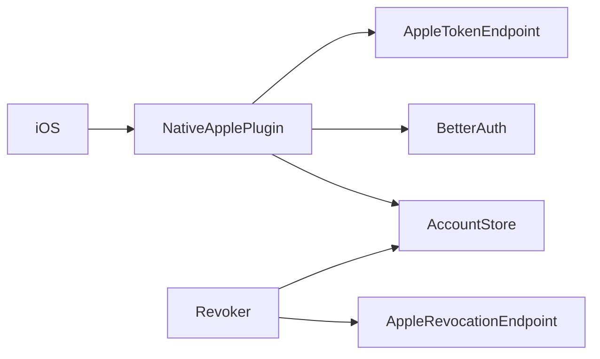
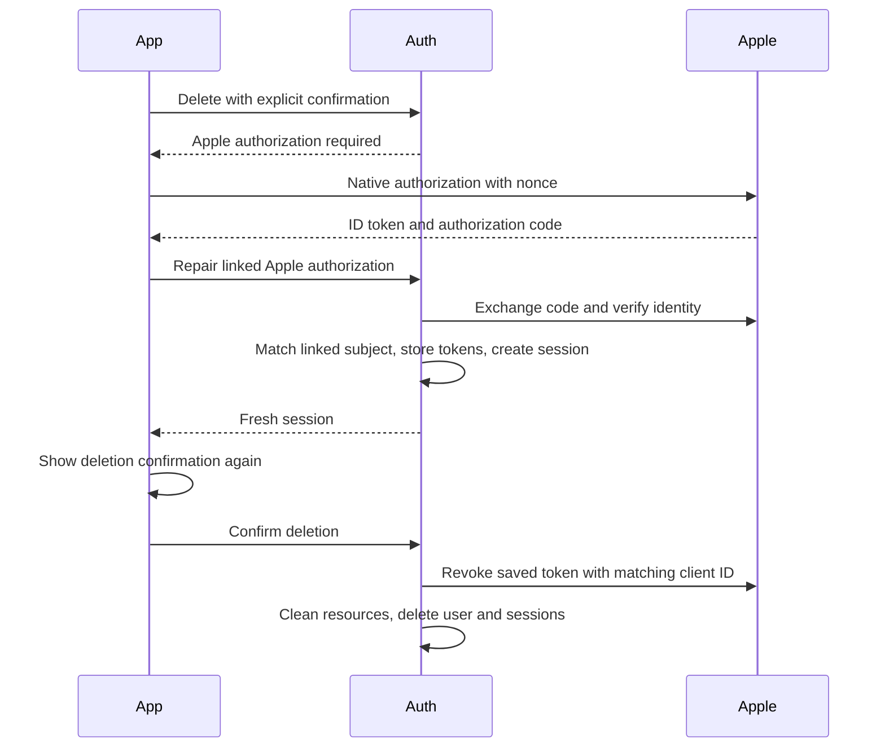

# Native Apple authorization for account deletion

Status: proposed

## Decision and scope

Native Apple sign-in exchanges the authorization code on the server before it creates a session.
The server verifies both Apple ID tokens and requires the same subject, audience, and nonce.
It stores the returned refresh token and ID token on the existing Better Auth account.
Revocation uses the stored ID token audience as the client ID, restricted to configured Apple identifiers.
Existing web grants without an ID token continue to use the configured web client ID.

An authenticated repair endpoint accepts new Apple authorization for an already linked Apple subject only.
It neither links another account nor creates a user. It returns a fresh session after token storage succeeds.
This supports existing accounts without saved tokens. Deletion still requires a separate explicit confirmation and a fresh session.
Missing Apple tokens return `APPLE_REAUTHENTICATION_REQUIRED` before any provider revocation.
Provider failures retain the user and allow retry. Credentials never appear in logs or client responses.

Non-goals: database migrations, changes to other providers, automatic deletion after authorization, and weaker session checks.

## Dependencies and affected files



```text
server/apps/auth/src/
  plugins/apple-native.ts
  auth.ts
  social-authorization.ts
  tests/apple-native.test.ts
  tests/social-authorization.test.ts
```



## Test plan

Exercise production handlers with signed fixture tokens and mocked Apple HTTP responses.
Cover new and existing accounts, nonce and subject mismatch, unsupported audiences, code rejection, unauthenticated repair,
foreign Apple accounts, token persistence, fresh sessions, missing-token errors, native revocation, and deletion retries.
Run Auth tests, TypeScript checks, and lint. Test the native request contract and account isolation with Swift fixtures.
Real Apple authorization and destructive acceptance require a designated test account after deployment.
