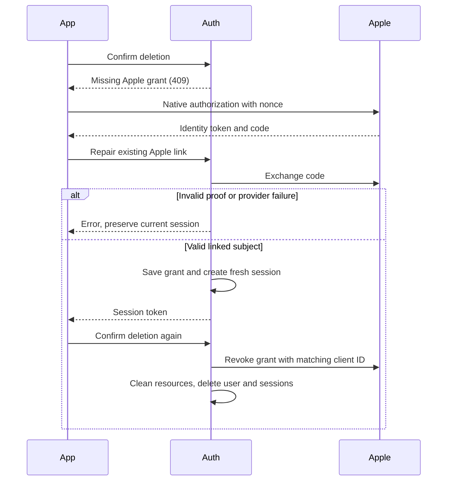

# Native Apple authorization for account deletion

Status: proposed

## Decision and scope

`POST /api/auth/sign-in/apple-native` accepts `identityToken`, `authorizationCode`, raw `nonce`, and optional `user.name`.
It exchanges the code and saves revocation tokens before returning the Better Auth session.
`POST /api/auth/account/apple-authorization` accepts the same body with an authoritative session.
It repairs only the current user's linked Apple subject and returns a fresh session. Deletion requires a separate explicit confirmation.
Both tokens require valid signatures, expiry, allowed audiences, and matching subjects.
The native token must match SHA-256 of the raw nonce. If the exchanged token contains nonce, it must match the native token.
Revocation uses the saved ID-token audience. Web grants without an ID token use the configured web client ID.
Non-goals: migrations, changes to other providers, automatic deletion, and weaker session checks.

## Failure boundaries

- Invalid proofs return 401. Rejected codes return 400. Invalid exchange responses return 502. Network, JWKS, and configuration failures return 503.
- Native sign-in preserves Better Auth's own response, including a 401 from its second token verification.
- Repair failures preserve existing sessions. Failed sign-in token storage removes the new session but can leave a new user and creation-hook effects.
- Missing Apple grants return 409 before provider revocation. Cleanup failures preserve the account for retry.
- The email deletion route has no early Apple-grant check. An old account without tokens can receive email but encounter 409 at deletion callback.
- Malformed stored ID tokens fail deletion through the normal error handler. They no longer receive a dedicated 503 mapping.
- Each Apple account retains one grant. Later authorizations can replace it, so earlier grants cannot all be revoked with this schema.
- Credentials never appear in logs or client responses. Deploy the server before the native client update.

## Repair and deletion

## Verification

Tests use production handlers, signed fixture tokens, and mocked Apple HTTP responses.
They cover new and existing users, identity isolation, nonce and audience checks, provider failures, token storage, authoritative sessions, and deletion retry.
Run Auth tests, typecheck, and root lint. Real Apple exchange, repair, and deletion require a designated device test account after deployment.
