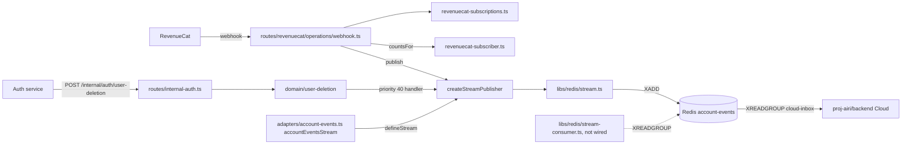
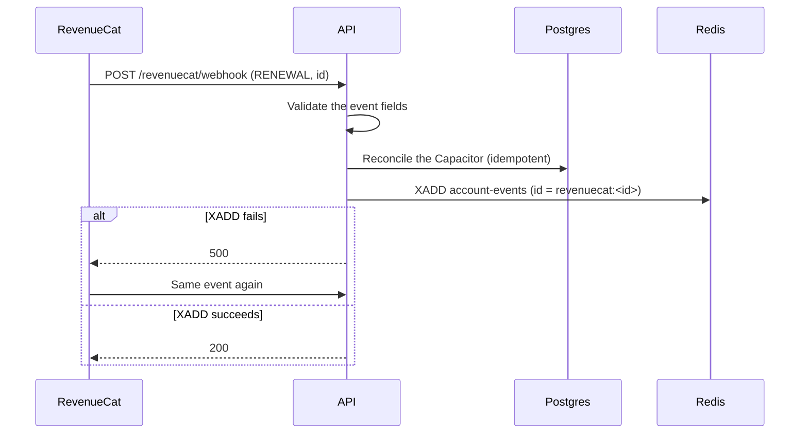
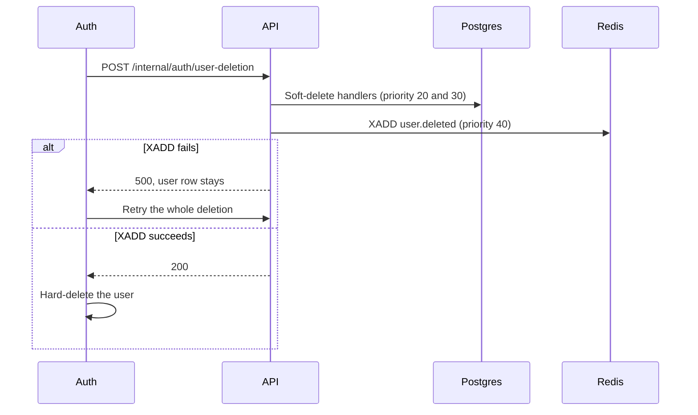
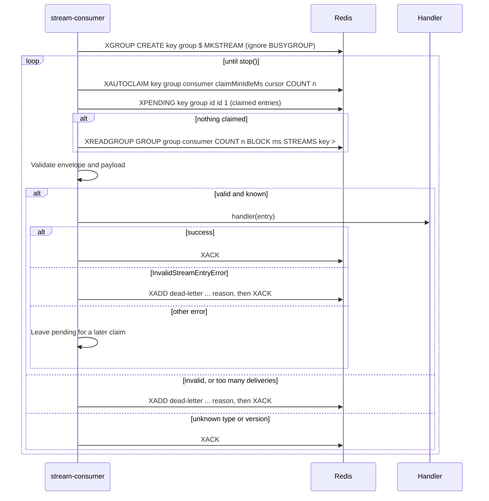

# Account events stream

Status: accepted. The cross-repository account notifications contract (revision 2 of 2026-10-19) fixes the envelope, the stream infrastructure, the account events, and the producer rule.

## Context

Cloud (`proj-airi/backend`) owns the user inbox that the client shows as "Notifications".
Some notifications start from facts that only this API knows: a subscription renewal, a failed subscription payment, and a user deletion.
Cloud and this API share one Redis instance through `REDIS_URL`.

moeru-ai/airi #1792 removed an earlier Redis Streams pipeline. Its `debitFlux` caller ignored `XADD` failures, so a lost event did not fail a request and nothing retried it.

## Decision

Redis Streams are shared API infrastructure in `server/apps/api/src/libs/redis/`, next to `cache.ts`. It has two halves on the same definitions and envelope:

- `stream.ts`: stream definitions and the producer.
- `stream-consumer.ts`: the consumer group loop. It matches the Go `internal/streams` consumer in `proj-airi/backend`.

Account events are the first stream. This API only produces them. No TypeScript consumer runs now.

### Producer

- `defineStream({ key, maxLength, events })` returns a typed stream definition. `events` maps each `type` to `{ version, payload }`, where `payload` is a Valibot schema. It checks the key, the limit, and each version when the module loads.
- `createStreamPublisher(redis, definition)` returns `{ publish(type, { id, payload, occurredAt? }) }`. The payload type follows `type`. `publish` validates the input, encodes the envelope, and runs `XADD <key> MAXLEN ~ <maxLength> * ...`.
- `occurredAt` is the publish time when the producer omits it.
- A payload schema describes the JSON object, because both halves validate with it. A date is an RFC 3339 string, for example `pipe(string(), isoTimestamp())`.

### Consumer

`createStreamConsumer(redis, definition, handlers, options)` returns `{ start(), stop() }`.

- `handlers` maps a `type` to an async handler. The handler gets `{ streamEntryId, id, type, version, occurredAt, payload }`, with the payload output of the schema.
- `options`: `group`, `consumer`, `deadLetterKey`, `maxDeliveries` (default 5), `claimMinIdleMs` (default 30000), `blockMs` (default 5000), `count` (default 10), `deadLetterMaxLength` (default 10000).

The loop runs these steps:

1. `start()` runs `XGROUP CREATE <key> <group> $ MKSTREAM` and ignores `BUSYGROUP`.
2. `XAUTOCLAIM` entries that are idle for `claimMinIdleMs`. `XPENDING` gives the delivery count of each claimed entry.
3. When nothing is claimed, `XREADGROUP ... BLOCK <blockMs> COUNT <count> STREAMS <key> >` on a dedicated connection. A blocking read stops all other commands on its connection.
4. Validate the envelope and the payload, then call the handler of the type.

| Result | Action |
| --- | --- |
| Handler success | `XACK` |
| Invalid envelope, invalid payload, `InvalidStreamEntryError` from the handler, or more than `maxDeliveries` deliveries | Copy the fields with `reason` to the dead-letter stream, then `XACK` |
| Unknown type, unknown version, or no handler | Log a warning, then `XACK`. A producer can deploy first. |
| Other handler error | No ack. The entry stays pending, and a later claim retries it. |

`stop()` interrupts a blocking read, lets the current batch finish, and closes the read connection. Register `start()` and `stop()` with `lifecycle.appHooks`.

The API does not wire a consumer now. The API has no background loops (see `server/apps/api/AGENTS.md`), so the first consumer needs its own ADR.

Every entry has the same flat string envelope. The envelope has no domain fields:

| Field | Value |
| --- | --- |
| `id` | Producer event ID. Consumers use it as the dedupe key. |
| `type` | Event type, for example `user.deleted` |
| `version` | Payload schema version as a decimal string |
| `occurredAt` | RFC 3339 UTC timestamp |
| `payload` | JSON object as a string |

### Add a stream, an event, a producer, or a consumer

The infrastructure does not change. Edit only the domain module that owns the stream, and `app.ts` for wiring:

1. To add a stream, call `defineStream` in the domain module.
2. To add an event, add a `type` with `version: 1` and its payload schema to the `defineStream` call.
3. To change a payload in a breaking way, increase its `version`. Deploy the consumer handler for the new version first.
4. To add a producer, provide `createStreamPublisher(redis, definition)` through `injeca` in `app.ts`. Let each publish failure fail the request.
5. To add a consumer, write idempotent handlers for `id` in the domain module. Provide `createStreamConsumer(...)` through `injeca`, and register `start()` and `stop()` with `lifecycle.appHooks`.

### Account events

`src/services/adapters/account-events.ts` defines the `account-events` stream with `maxLength` 100000. Cloud reads it with the `cloud-inbox` consumer group. The consumer is not part of this repository.

| `type` | `version` | `payload` | `id` |
| --- | --- | --- | --- |
| `subscription.renewed` | `1` | `{"userId", "plan", "periodEnd": RFC3339}` | `<provider>:<provider event id>` |
| `subscription.payment_failed` | `1` | `{"userId", "plan", "retryAt"?: RFC3339}` | `<provider>:<provider event id>` |
| `user.deleted` | `1` | `{"userId"}` | `user-deletion:<userId>` |

The payload schemas are strict, so a field outside the contract fails the publish.

### Producer rule

`publish` never swallows a failure. A validation error, a Redis error, or a null `XADD` reply rejects the publish.
Each publish runs inside a request that its caller retries:

- The RevenueCat webhook publishes after the Capacitor reconciliation. A publish failure returns 500, so RevenueCat sends the event again.
- The user deletion pipeline publishes `user.deleted` in a handler with priority 40, after every soft delete. A publish failure fails `POST /internal/auth/user-deletion`, so Auth does not hard-delete the user and retries the deletion.

A retry can append the same `id` again. The reconciliation and the soft deletes are idempotent, and Cloud deduplicates on `id`.

This design differs from #1792 in these points:

- The #1792 stream was published from a billing write and continued when `XADD` failed. This design fails the request.
- The #1792 pipeline had a worker in this API. This API now only produces. Cloud owns the consumer, its retries, and its dead-letter stream.
- The #1792 pipeline made Redis part of the billing path. Here, Postgres stays the truth for billing. The stream only carries notification facts.

### Provider event mapping

| Provider | Provider event | Account event | Values |
| --- | --- | --- | --- |
| RevenueCat | `RENEWAL` | `subscription.renewed` | `userId` = `app_user_id`. `plan` = `product_id`. `periodEnd` = `expiration_at_ms`. `occurredAt` = `event_timestamp_ms`. |
| RevenueCat | `BILLING_ISSUE` | `subscription.payment_failed` | `userId` = `app_user_id`. `plan` = `product_id`. RevenueCat sends no retry time, so `retryAt` is not set. |
| Stripe | none | none | Stripe sells only one-time Flux packages. The webhook ignores sessions that are not `mode: payment`, and no subscription event exists. |
| Apple IAP | none | none | Apple IAP sells only consumables. Notifications other than `ONE_TIME_CHARGE` are ignored. |

`plan` is the store product ID. It is also the key of the `REVENUECAT_CAPACITORS` config.

A RevenueCat event counts only for the store environment of the deployment. The rule is the same as the Capacitor grant in [RevenueCat sandbox subscriptions](./2026-10-14-revenuecat-sandbox-subscriptions.md).
TestFlight purchases are sandbox purchases, so a production user gets no notification for a sandbox renewal.

A `RENEWAL` or `BILLING_ISSUE` event without the required fields returns 400 before the reconciliation.

## Scope and non-goals

This change adds the stream infrastructure and the account events stream. It publishes from the RevenueCat webhook and the deletion pipeline, and wires them in `app.ts`.

It does not wire a TypeScript consumer into the API, and it does not add a stream for `flux.granted`. Admin delivers `flux.granted` in process.
It does not add Stripe subscriptions. It does not change the Capacitor reconciliation or the deletion handlers that exist.

## Dependencies



## Affected files

```text
server/
  apps/api/src/app.ts
  apps/api/src/app.test.ts
  apps/api/src/libs/redis/stream.ts
  apps/api/src/libs/redis/stream.test.ts
  apps/api/src/libs/redis/stream-consumer.ts
  apps/api/src/libs/redis/stream-consumer.test.ts
  apps/api/src/libs/tests/redis.ts
  apps/api/src/libs/tests/redis-stream-groups.ts
  apps/api/src/routes/internal-auth.test.ts
  apps/api/src/routes/revenuecat/index.ts
  apps/api/src/routes/revenuecat/operations/webhook.ts
  apps/api/src/routes/revenuecat/route.test.ts
  apps/api/src/services/adapters/account-events.ts
  apps/api/src/services/adapters/account-events.test.ts
  apps/api/src/services/adapters/revenuecat-subscriber.ts
  apps/api/src/services/domain/user-deletion/types.ts
  apps/api/README.md
  docs/ai/adr/2026-10-18-account-events-stream.md
```

## Sequence







## Test plan

- `defineStream` rejects an empty key, a limit that is not a positive integer, and a version that is not a positive integer.
- `publish` writes the envelope with the version of the type, sets a missing `occurredAt`, and trims with `MAXLEN ~ <maxLength>`.
- `publish` rejects an invalid ID, date, payload, or type, and writes nothing.
- `publish` rejects when `XADD` fails or returns null.
- The account events stream writes the three contract payloads at version 1 and rejects fields outside the contract.
- The consumer round-trips a published entry and acks it. It creates the group at the stream end and tolerates `BUSYGROUP`.
- The consumer dead-letters an invalid envelope, an invalid payload, an `InvalidStreamEntryError`, and an entry with more than `maxDeliveries` deliveries.
- The consumer acks an unknown type, an unknown version, and a type without a handler.
- A failed handler leaves the entry pending, and a later claim retries it.
- `stop()` waits for the running handler and its ack, and interrupts a blocking read.

ioredis-mock 8.13 has no `XGROUP`, `XREADGROUP`, `XAUTOCLAIM`, `XPENDING`, `XACK`, or generic `call()`.
`libs/tests/redis-stream-groups.ts` adds these commands in memory for the consumer tests.
One test runs the consumer against a real Redis when `TEST_REDIS_URL` is set.
- `RENEWAL` and `BILLING_ISSUE` each publish one event after the reconciliation.
- A publish failure returns 500. The retry publishes the same `id` and does not grant Flux again.
- Other event types, and sandbox events of production users, publish nothing.
- A `RENEWAL` without `expiration_at_ms` returns 400 before the reconciliation.
- The deletion publishes `user.deleted` after the soft deletes. A publish failure fails the deletion request with 500.
