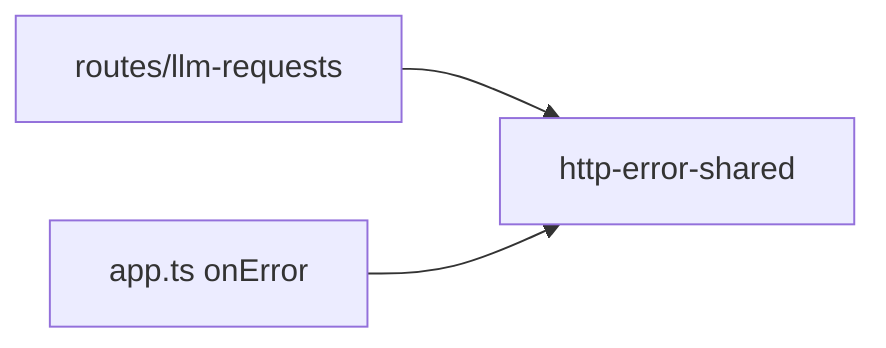
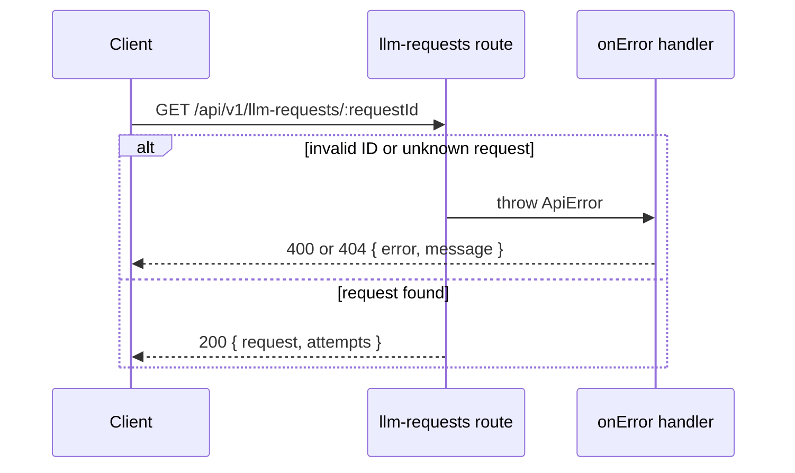

# HTTP response conventions

Status: accepted

## Context

`2026-10-09-shared-error-response.md` gave the API service and the Auth service one error model.
It did not set rules for success bodies, list bodies, delete responses, or error code names.
Each route chose its own shape, so a client cannot parse lists or errors in one way.

## Decision

These rules apply to each new HTTP route in `server/apps/api` and `server/apps/auth`.

### Success

- A success response has no envelope. The route returns its resource directly.
- A route that creates a resource returns `201` and the resource.
- A route that deletes a resource returns `204` with no body.
- A date is an ISO 8601 string.

### Lists

- A list response is an object. It is never a bare array.
- The list is in the `records` key: `{ records: [...] }`.
- A paginated list reads `limit` and `offset` with `LimitOffsetPaginationQuerySchema` and returns `{ records, hasMore }`.
- An object key keeps a later pagination change additive. A bare array cannot get `hasMore` without a breaking change.

`records` and `hasMore` are the shape that `GET /api/v1/flux/history`, `GET /api/v1/flux/usage`, and `GET /api/v1/llm-requests` already return.

### Errors

- A route, middleware, or service throws an `ApiError` from `@proj-airi/http-error-shared`.
- Only the `onError` handler writes the body `{ error, message, details? }`.
- `error` is an `UPPER_SNAKE` code, for example `SUBSCRIPTION_ACTIVE`. A client branches on `error` only.
- `message` is text for a person. A client does not parse it.

### Exceptions

These responses follow another protocol, so the rules above do not apply:

| Responses | Protocol that owns the shape |
| --- | --- |
| `/api/v1/openai/*` | OpenAI-compatible gateway. A later decision can change its errors to the OpenAI error shape. |
| WebSocket close reasons, for example `invalid_start_frame` in `audio-speech-ws` | WebSocket close frames |
| Steam sign-in errors in `server/apps/auth/src/plugins/steam.ts` | OAuth redirect error parameters |
| `/api/auth/get-session` and `/api/auth/list-sessions` | Better Auth client protocol |
| Stripe, Apple, and RevenueCat webhooks | The provider that sends the webhook |

## Known deviations

These deployed routes break the rules. Each change is a breaking change for deployed web, desktop, and mobile clients.

| Route | Current body | Rule |
| --- | --- | --- |
| `GET /api/v1/characters` | Bare array | `{ records }` |
| `GET /api/v1/providers` | Bare array | `{ records }` |
| `GET /api/v1/voice-packs` | Bare array | `{ records }` |
| `GET /api/v1/stripe/packages` | Bare array | `{ records }` |
| `GET /api/v1/chats` | `{ chats }` | `{ records }` |
| `GET /api/v1/character-cards` | `{ documents }` | `{ records }` |
| `GET /api/v1/character-cards/:id/history` | `{ history }` | `{ records }` |
| `GET /api/v1/display-models` | `{ models }` | `{ records }` |
| `GET /api/v1/revenuecat/capacitors` | `{ productIds }` | `{ records }` |
| `GET /api/v1/revenuecat/catalog` | `{ capacitors, resetInterval }` | `{ records }` and other fields |
| `DELETE /api/v1/chats/:id` | The deleted chat | `204` with no body |
| Auth errors `email/send_failed`, `email/service_not_configured`, `oauth/provider_not_configured`, `oauth/revocation_not_supported`, `oauth/revocation_token_missing` | Namespaced lowercase codes | `UPPER_SNAKE` |
| Auth 404 and 413 | Hono plain text | `{ error, message }` |
| API 404 | `{ error, message, ui }` | `{ error, message }` |

Before you change a deviation, find each client that reads the route. Then change the server and the clients together, after each supported client version reads the new shape.
Do not add a compatibility layer that returns both shapes.

## Scope

- Add these rules to `server/AGENTS.md`.
- `GET /api/v1/llm-requests/:requestId` wrote two error bodies by hand without `message`. It now throws an `ApiError`.
  The body gets a `message` field. The `error` codes `INVALID_REQUEST_ID` and `NOT_FOUND` do not change. No client in this repository reads this route.

Non-goals:

- A change to a known deviation.
- A change to the exceptions.
- Cursor pagination.

## Module dependencies



## Affected files

```text
server/AGENTS.md                                   response rules
server/docs/ai/adr/
  2026-10-19-http-response-conventions.md
server/apps/api/src/routes/llm-requests/
  index.ts                                         throws ApiError
  route.test.ts                                    new
server/apps/api/src/services/domain/
  request-log.test.ts                              installs the shared onError handler
```

## Error flow



## Test plan

- `routes/llm-requests/route.test.ts` asserts the status and the body for an invalid ID and for an unknown request.
- `services/domain/request-log.test.ts` mounts the routes with the shared `onError` handler, because the routes now throw.
- Typecheck `server/apps/api`, and run the `api-server` test project.
