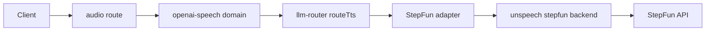
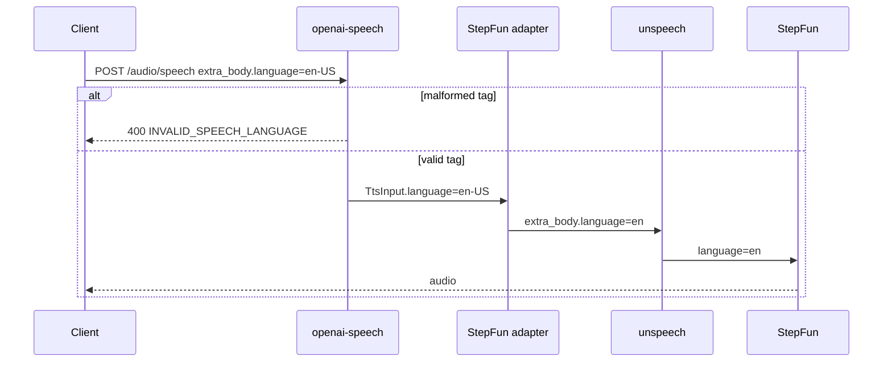

# TTS speech language

Status: proposed

## Decision

A caller of `POST /api/v1/audio/speech` can send the language of the speech text in `extra_body.language`, as a BCP 47 tag such as `en-US` or `ja`.
The API checks the tag with Valibot. A malformed tag fails the request with 400 `INVALID_SPEECH_LANGUAGE`, before billing and routing.
The API puts the tag in the new `TtsInput.language` field. Each TTS adapter maps it to its provider code or ignores it.
The StepFun adapter sends the primary subtag, for example `en` for `en-US`, in `extra_body.language` to unspeech. unspeech sends it to StepFun as `language`.
The StepFun adapter does not send a language that StepFun does not read. StepFun reads `zh`, `en`, `ja`, `ko`, `fr`, and `es`. The last four are a StepFun preview.

## Scope

StepFun guesses the language of a text when the request has none. The formula speech eval found that the Chinese voice `jilingshaonv` reads English text such as `50 percent` and `9.8 m/s^2` with Chinese digits and units.
The voice catalog lists `zh-CN`, `en`, and `ja` for every StepFun voice, and `DEFAULT_TTS_VOICES` recommends `jilingshaonv` for `en-US`, `zh-CN`, and `ja-JP`. Thus, the voice is not the cause. The missing language is.

Non-goals:

- Clients that send the language. The stage apps and the formula speech eval adopt the field in separate changes.
- Language mapping for the Azure, DashScope CosyVoice, and Volcengine adapters. Their voices already carry a locale.
- A language list per model in the provider catalog.
- A default language. An absent language keeps the current behavior.

## Module dependencies



## Affected files

```text
server/apps/api/src/
  services/domain/openai-speech/index.ts    reads and checks extra_body.language
  services/adapters/tts/types.ts            TtsInput.language
  services/adapters/tts/stepfun.ts          maps the tag to the StepFun code
  services/adapters/tts/index.test.ts
  routes/openai/v1/route.test.ts
server/docs/ai/adr/2026-10-19-tts-speech-language.md
```

The unspeech change is moeru-ai/unspeech#52.

## Sequence



## Test plan

- API route tests: a valid tag reaches the TTS router as `TtsInput.language`, and a malformed tag returns 400 before routing.
- Adapter tests: `en-US`, `ja`, and `ZH-cn` become `en`, `ja`, and `zh`. `de-DE` sends no language.
- Run the API typecheck, the API tests, and lint.
- After unspeech#52 is released and deployed, synthesize the same English text with and without `extra_body.language=en-US`, and compare the transcripts of the formula speech eval.
- The StepFun docs do not confirm that the China endpoint of `stepaudio-2.5-tts` reads `language`. The deployed check above confirms it.
