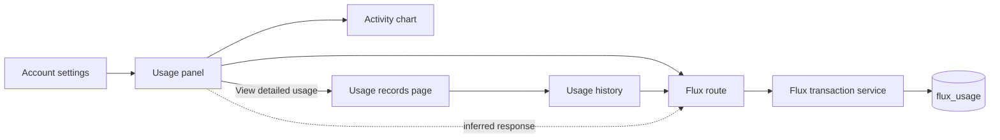
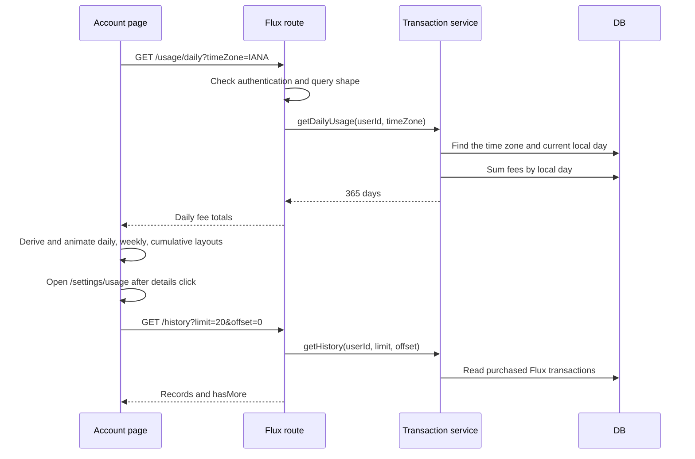

# Flux usage activity

Status: accepted

## Decision

`GET /api/v1/flux/usage/daily` returns `{ days }` for the last 365 local days of the signed-in user.
`timeZone` is an IANA name. PostgreSQL validates the name and uses it to group fees.
A missing or invalid name returns 400 `INVALID_TIME_ZONE`.
Each day has `date` (`YYYY-MM-DD`) and `microFlux`, the sum of confirmed LLM and speech fees. Empty days contain zero.
The client derives daily, weekly, and cumulative views from these days. Switching views sends no request.
The summaries show Flux used, peak daily Flux, longest streak, and current streak within this window.
The client infers response types from the Hono routes. Valibot validates request data.
The deployed `GET /api/v1/flux/usage` fee listing remains available to the iOS client.
The activity chart reads `/usage/daily`. The balance card reads `/stats`, and transaction history reads `/history`.
The account page owns the usage overview. Its details link opens the separate `/settings/usage` history page.
The charging page at `/settings/flux` reads neither usage endpoint. Its details link also opens `/settings/usage`.
Wallet history metadata remains opaque JSON.
The history client shows one row for each record, with its description and token counts.
The server query groups old `tts_request` debits by chat turn. The client adds no grouping.
`BillingService` owns ledger writes. The Flux transaction service exposes reads only.
The usage components mount after session verification. Navigation and sign-out unmount them and cancel their requests.

## Scope

Replace the three charts with one animated activity chart. Keep authentication, the IANA time zone, and the 365-day window.

## Non-goals

This change adds no persistence, cache, background task, or lifetime metric.
Session duration needs a definition that separates visits to the same conversation.

## Modules



```text
packages/stage-pages/src/pages/settings/
  account/account-settings-page.vue
  usage.vue
  flux.vue
packages/stage-ui/src/components/scenarios/flux/
  usage-panel.vue
  usage-history.vue
  usage-activity-chart.vue
  usage-stats.ts
server/apps/api/src/
  routes/flux/index.ts
  routes/flux/route.test.ts
  services/domain/flux-transaction.ts
server/apps/api/README.md
```



## Test plan

Verify local-day boundaries, user isolation, empty days, and time zone validation through PGlite.
Verify streaks, weekly sums, cumulative totals, partial weeks, and year boundaries with unit tests.
Verify that the deployed fee listing keeps its paginated response.

## Known limits

`flux_usage` stores confirmed fees. Daily Flux can differ from wallet history while fees wait in the pool.

`created_at` is `timestamp` without time zone. Drizzle reads and writes it as UTC.
The query reads that value as UTC, then converts it to the caller time zone.
The database default `now()` must run in UTC, or the local day is wrong.
That UTC reading goes away when the ledger tables use `timestamptz`.
