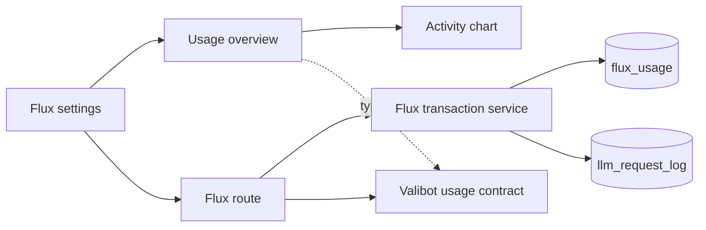
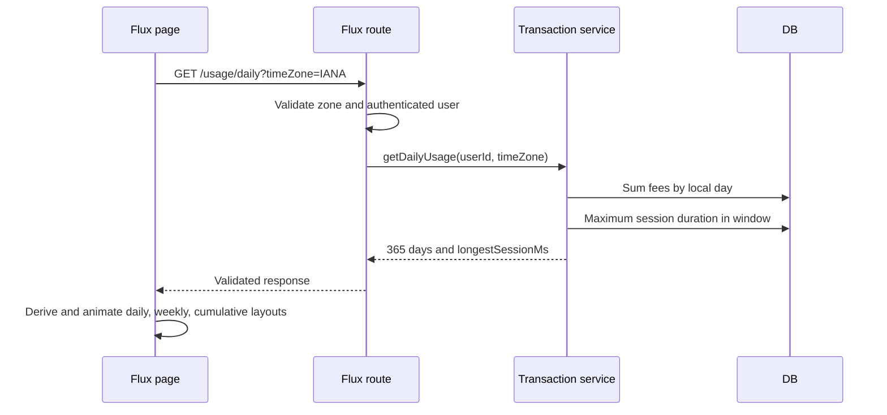

# Flux usage activity

Status: accepted

## Decision

`GET /api/v1/flux/usage/daily` returns `{ days, longestSessionMs }` for the last 365 local days of the signed-in user.
`timeZone` is an IANA name. A missing or invalid name returns 400 `INVALID_TIME_ZONE`.
Each day has `date` (`YYYY-MM-DD`) and `microFlux`, the sum of confirmed LLM and speech fees. Empty days contain zero.
The client derives daily, weekly, and cumulative views from these days. Switching views sends no request.
The five summaries show Flux used, peak daily Flux, longest session, longest streak, and current streak within this window.
`longestSessionMs` uses sessions whose first request falls within this window. SQL returns the maximum duration without transferring individual sessions.
Valibot defines the response contract in `src/types/flux-usage.ts`. The client imports its inferred types through the API package export.
Remove `GET /api/v1/flux/usage` and `getUsageHistory`. No repository client calls this paginated fee listing.
The activity chart reads `/usage/daily`. The balance card reads `/stats`, and transaction history reads `/history`.

## Scope

Replace the three charts with one animated activity chart. Keep authentication, the IANA time zone, and the 365-day window.
This change adds no persistence, cache, background task, or lifetime metric.

## Modules



```text
packages/stage-pages/src/pages/settings/flux.vue
packages/stage-ui/src/components/scenarios/flux/
  usage-overview.vue
  usage-activity-chart.vue
  usage-stats.ts
server/apps/api/src/
  types/flux-usage.ts
  routes/flux/index.ts
  routes/flux/route.test.ts
  services/domain/flux-transaction.ts
server/apps/api/README.md
```



## Test plan

Verify local-day boundaries, user isolation, empty days, and session cutoffs against PostgreSQL through PGlite.
Verify weekly sums, cumulative totals, partial weeks, and daily intensity levels with unit tests.
Verify switching, tooltip content, keyboard input, narrow layouts, and reduced motion in browser tests.
Verify that the removed fee listing returns 404 without calling the daily usage service.

## Known limits

Speech writes no `llm_request_log` row and stores no `sessionId`. Speech fees affect Flux usage, but not longest session.
`llm_request_log` writes are best-effort. A failed write can shorten the measured session.
`flux_usage` is a confirmed fee, not a wallet debit. Daily Flux can differ from the wallet history while fees wait in the pool.

`created_at` is `timestamp` without time zone. Drizzle reads and writes it as UTC.
The query reads that value as UTC, then converts it to the caller time zone.
The database default `now()` must run in UTC, or the local day is wrong.
That UTC reading goes away when the ledger tables use `timestamptz`.
