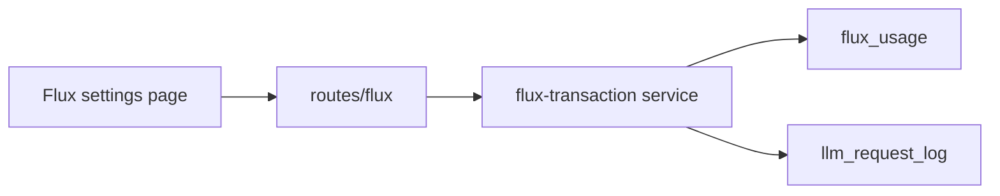
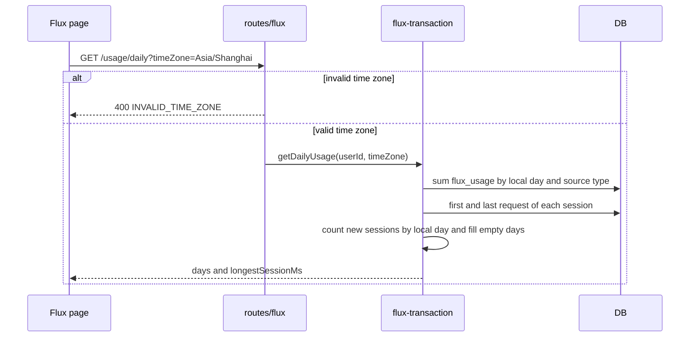

# Flux usage charts

Status: accepted

## Decision

`GET /api/v1/flux/usage/daily?timeZone=<IANA name>` returns the daily Flux usage of the signed-in user for the last 365 local days.
The response is `{ days, longestSessionMs }`. Each item of `days` has `date`, `llmMicroFlux`, `ttsMicroFlux`, and `newSessionCount`.
`date` is `YYYY-MM-DD` in the caller time zone. The API returns one item for each day and writes zero for a day without usage.

Fees come from `flux_usage`. A fee with `source_type` `llm` or `tts` adds to the local day of its `created_at`.
Other source types are not in the response, because the charts show only these two layers.

A new session is a client session ID in `llm_request_log.session_id`. The session counts once, on the local day of its first request.
The first request is the oldest request of the user with this session ID, in all history.
A request without a session ID counts for no session. LLM and speech are not separate in `newSessionCount`.
`longestSessionMs` is the largest difference between the last and the first request of a session. Only sessions that started in the 365 days count.

A missing or invalid `timeZone` returns 400 `INVALID_TIME_ZONE`. The name must be an IANA name. An offset such as `+08:00` is not valid.
The Flux page shows three charts above the existing history panel: a heat map of Flux for the calendar year of the newest day, including later days of that year, a 30-day area chart of Flux with an LLM layer and a speech layer, and a 30-day bar chart of new sessions.

## Scope

The page reads one response for all three charts and the five summary cards. The client cuts the last 30 days from the 365 days. The heat map keeps the days of the newest day's calendar year and adds an empty day for each later date of that year.
The client calculates the streaks from days that have Flux usage.

Non-goals:

- Receipts and top-up records. These are a separate change.
- A split of the session chart by source or model.
- A per-model chart.
- Counting speech requests as sessions.

## Known limits

The speech service does not write `llm_request_log` rows and does not store `sessionId`. Thus speech fees add to the Flux charts and never to the session chart.
The API writes `llm_request_log` rows on a best-effort basis. A failed write lowers the session count for that session.
`flux_usage` is a confirmed fee and is not the same as a wallet debit. The daily Flux can differ from the wallet history while fees wait in the pool.

`created_at` is a `timestamp` without time zone. Drizzle reads and writes it as UTC. The query reads it as UTC before it converts the value to the caller time zone.
The database default `now()` must run in UTC for this reading to be correct.

## Module dependencies



## Affected files

```text
server/apps/api/src/
  routes/flux/index.ts                      GET /usage/daily and the timeZone check
  routes/flux/route.test.ts
  services/domain/flux-transaction.ts       getDailyUsage
  services/domain/flux-transaction.test.ts
packages/stage-ui/src/components/scenarios/flux/
  usage-stats.ts                            heat map cells, streaks, last 30 days
  usage-heatmap.vue
  usage-area-chart.vue
  usage-session-chart.vue
  usage-tooltip.vue                         tooltip shared by the charts and the heat map
packages/stage-pages/src/pages/settings/flux.vue
packages/i18n/src/locales/{en,zh-Hans}/settings.yaml
server/docs/ai/adr/2026-10-25-flux-usage-charts.md
```

## Sequence



## Test plan

- Service tests with a real test database: the local day changes with the time zone, LLM and speech fees are in separate layers, and empty days are zero.
- Service tests: a session counts once on the day of its first request, a request without a session ID counts for no session, and `longestSessionMs` is correct.
- Route tests: a valid request returns the service result, and a missing or invalid time zone returns 400.
- Run the API typecheck, the API tests, and lint.
