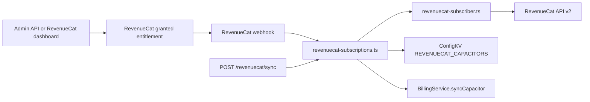
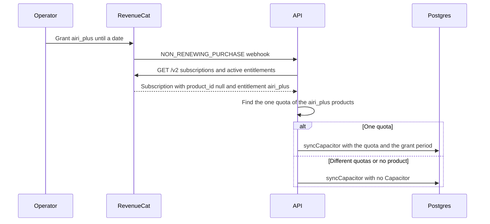

# Promotional Capacitors

Status: accepted. The requester confirmed on 2026-10-29 that an operator gives a Go or Plus subscription through a RevenueCat granted entitlement.

## Context

An operator gives a subscription by granting an entitlement in RevenueCat, for example `airi_go` or `airi_plus`.
The grant has an end date. RevenueCat lists it as a subscription with `product_id: null`, and sends a production `NON_RENEWING_PURCHASE` webhook with the store `PROMOTIONAL`.

`REVENUECAT_CAPACITORS` maps a store product to an entitlement and a quota.
The reconciliation looked the quota up by product, so a promotional subscription granted no Capacitor.
[Subscription credits](./2026-10-04-subscription-credits.md) recorded that rule when the API v2 schema started to accept a null product.
The client still unlocked the entitlement, so the user saw Go or Plus without Capacitor Flux.

## Decision

A promotional subscription grants the Capacitor of its entitlement.

- `fetchEntitlements` returns a promotional entitlement with `productId: null`. It reads no product.
- The quota is the one quota that the `REVENUECAT_CAPACITORS` products of that entitlement share.
- When those products have different quotas, or no product grants the entitlement, the grant names no Capacitor and grants none.
- The period starts at `current_period_starts_at` and ends with the active entitlement, as for a store subscription.
- A grant without an end date grants no Capacitor, because a Capacitor without an expiry is not sold.
- The latest period start wins when two Capacitors are active. A grant after a paid subscription replaces its Capacitor until the grant ends.

The webhook already reconciles every event type except `TEST`, so the grant webhook needs no change.

## Scope and non-goals

The change is in `revenuecat-subscriber.ts` and `revenuecat-subscriptions.ts`. It does not change the webhook, the wallet, the database schema, or ConfigKV.

Non-goals:

- An API route that grants or revokes. The admin API calls RevenueCat.
- A quota per grant. RevenueCat stores only the entitlement and the end date.
- A change to the account deletion check. It reads `status` and `auto_renewal_status` for every subscription, promotional ones included.

## Dependencies and affected files



```text
server/
  apps/api/README.md
  apps/api/src/services/adapters/revenuecat-subscriber.ts
  apps/api/src/services/adapters/revenuecat-subscriber.test.ts
  apps/api/src/services/adapters/revenuecat-subscriptions.ts
  apps/api/src/services/adapters/revenuecat-subscriptions.test.ts
  docs/ai/adr/2026-10-04-subscription-credits.md
  docs/ai/adr/2026-10-29-promotional-capacitors.md
```

## Sequence



## Test plan

- `revenuecat-subscriber.test.ts`: a promotional subscription returns its entitlement with a null product and reads no product.
- `revenuecat-subscriptions.test.ts`: a promotional entitlement syncs the quota of its products; a later grant replaces a paid Capacitor; two products with one quota sync it; products with different quotas sync nothing; an entitlement without a product syncs nothing.
- Manual: grant a sandbox test account an entitlement in RevenueCat and read its wallet through the admin dashboard.
