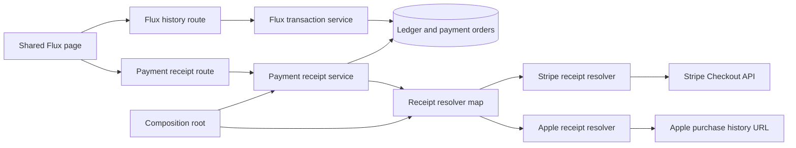
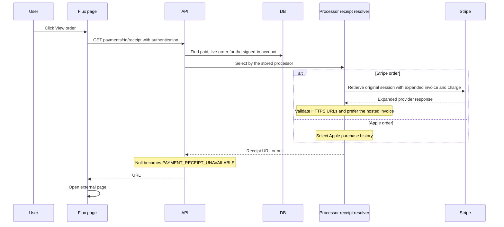

# View payment records for Flux purchases

Status: proposed. The requester authorized a small action on each paid recharge record, selected by the original payment processor.

## Decision

Join wallet credits to paid, live payment orders through the existing request ID and account ID.
Add a nullable `paymentOrderId` to each Flux history record.
The shared Flux page makes each recharge row or card clickable with one native button across the record.
Desktop rows use AIRI's trailing arrow, theme-color hover fill, and keyboard focus outline.
Mobile cards show a quiet View order label beside the date. Touch uses a brief neutral press fill, without a persistent highlight.
Hover feedback applies only to devices that support hover. Keyboard focus remains visible on every device.
Enter and Space activate the record. Other transactions remain unchanged.

`GET /api/v1/payments/:id/receipt` checks the signed-in account before it resolves the original processor.
Stripe retrieves the Checkout Session with its invoice and latest charge expanded.
Prefer the hosted invoice URL. Without an invoice URL, use the charge receipt URL.
Apple purchases open Apple's purchase history at `https://reportaproblem.apple.com/`.
Apple does not expose a documented web link for an individual transaction.

The payment receipt service checks order ownership and selects a resolver from a processor map.
The composition root registers Stripe and Apple receipt resolvers. Each resolver owns its provider schema and URL rules.
A new processor adds one resolver and one registration without changing the core service, page, or HTTP contract.
An unavailable or invalid provider receipt returns null. The core converts it to `PAYMENT_RECEIPT_UNAVAILABLE` at one boundary.
Provider request failures still propagate. Missing Stripe credentials still return `STRIPE_NOT_CONFIGURED`.
This registry handles only receipt lookup. Checkout, webhooks, refunds, subscriptions, and history eligibility remain outside it.
Current sales channels, package configuration, client platform, and purchase restrictions do not select the receipt destination.
Resolve Stripe URLs on demand so the application does not persist expiring receipt links.

## Scope and non-goals

This change adds an authenticated read endpoint, one history field, and an action across each recharge record.
It requires no migration, payment settlement change, invoice creation, subscription change, or page redesign.
Missing, deleted, unpaid, and foreign orders return the same not-found error.
Unsupported processors and unavailable receipts return an explicit error. The existing page alert reports the error, and the record remains available for retry.

## Module dependencies



## Affected files

```text
packages/
  stage-pages/src/pages/settings/flux.vue
  stage-pages/src/pages/settings/flux.browser.test.ts
  stage-pages/src/pages/settings/components/payment-receipt-button.vue
  i18n/src/locales/{en,zh-Hans}/settings.yaml
server/apps/api/src/
  app.ts
  routes/flux/{index.ts,route.test.ts}
  routes/payments/{index.ts,route.test.ts}
  services/domain/flux-transaction{.ts,.test.ts}
  services/domain/payment/{receipt.ts,tests/receipt.test.ts}
  services/adapters/payment-receipts/{stripe-receipt.ts,apple-receipt.ts}
```

## Request sequence



## Test plan

- Check history association, pagination, account isolation, and unrelated grants.
- Check invoice precedence, charge receipts, missing receipts, and provider failures.
- Check Apple orders with Stripe unavailable and unsupported processors.
- Check registration of another processor without changing the core service.
- Check malformed Stripe responses and unsafe URLs return `PAYMENT_RECEIPT_UNAVAILABLE`.
- Check authentication and rejection before provider access for foreign, deleted, and unpaid orders.
- Check the complete row and card hit areas, keyboard activation, absent purchase packages, and error recovery.
- Run API and shared page tests, workspace typechecks, root typecheck, and repository lint.

## Sources

- [Stripe Checkout retrieval](https://docs.stripe.com/api/checkout/sessions/retrieve)
- [Stripe hosted invoice URL](https://docs.stripe.com/api/invoices/object#invoice_object-hosted_invoice_url)
- [Stripe charge receipt URL](https://docs.stripe.com/api/charges/object#charge_object-receipt_url)
- [Apple purchase history](https://support.apple.com/en-us/118212)
