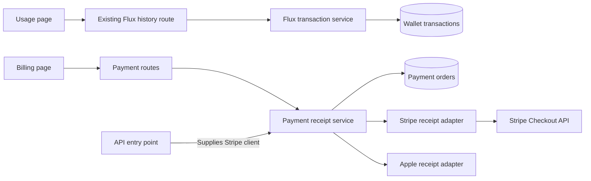
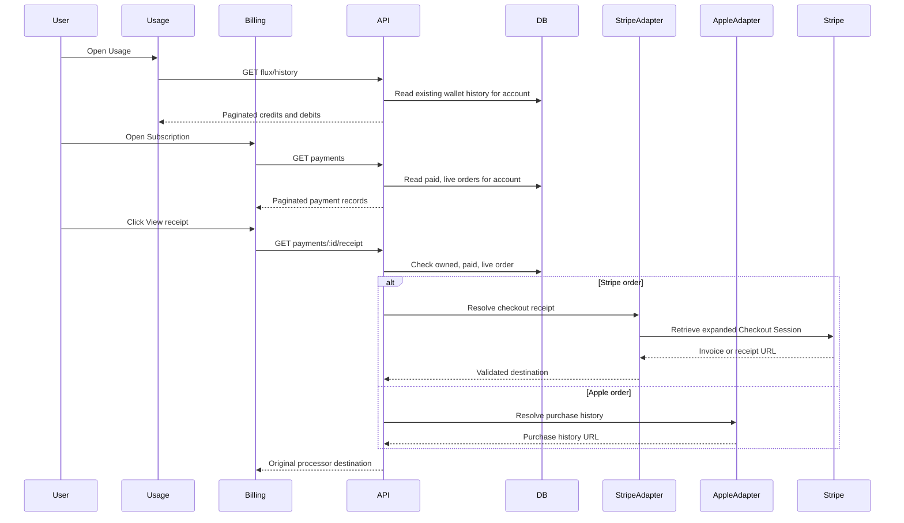

# Separate Flux usage from billing and receipts

Status: accepted.

## Decision

Usage moves the existing Flux transaction history to `/settings/usage`.
Its fields, record types, amount formatting, speech grouping, pagination, and loading behavior remain unchanged.
It keeps the existing `GET /api/v1/flux/history` contract, including credits and debits.

The Subscription page keeps the current Capacitor subscription and Flux purchase controls at `/settings/flux`.
A separate receipt table reads `GET /api/v1/payments?limit=20&offset=0`.
The response contains `{ records, hasMore }` for paid, live orders owned by the signed-in account.
Each record contains `id`, `processor`, `status`, `amount`, `currency`, `fluxAmount`, `creditedAt`, and `createdAt`.
The API returns amounts in major currency units and uses uppercase currency codes.
Each receipt adapter converts amounts from its channel's units.
Unavailable amounts use null. The page formats the amount for the selected language.
The display date uses `creditedAt`, or `createdAt` for an order without a credit timestamp.
Ordering uses that same date, then the order ID, descending. Listing never calls a payment processor.
Wallet history remains independent of payment orders.

Each page loads only its own list. The receipt query cache scopes reads to the account and session.
The public package catalog stays fresh for five minutes. The receipt list stays fresh for one minute.
Receipt refresh and pagination load on request. The receipt list does not poll or refetch on window focus.
The existing Capacitor loading, balance refresh, and quota analytics remain unchanged.

`GET /api/v1/payments/:id/receipt` checks account ownership before resolving the original processor.
Stripe retrieves the Checkout Session with its invoice and latest charge expanded.
Prefer a valid HTTPS hosted invoice URL. If one is unavailable, use a valid HTTPS charge receipt URL.
Apple purchases open Apple's purchase history at `https://reportaproblem.apple.com/`.
Apple does not expose a documented web link for an individual transaction.
Resolve links only after the user clicks View receipt. Do not persist expiring receipt links.
The API entry point supplies the Stripe client to the receipt service.
The receipt service selects its adapter by the processor on the original order.
Each adapter owns that channel's amount conversion and receipt destination.

## Scope and non-goals

This change adds an authenticated order list, separate settings entries, and independent usage and receipt tables.
It requires no migration, settlement change, invoice creation, refund flow, or subscription billing integration.
Subscription controls and their management link remain in their existing section.
RevenueCat Billing's customer portal lists subscription payments and provides downloadable receipts and invoices.
The added receipt list covers recorded Flux purchases. It does not import subscription invoices into payment orders.
Missing, deleted, unpaid, and foreign orders return the same not-found error for receipt lookup.
Unsupported processors and unavailable receipts return an explicit error. The action remains available for retry.

## Module dependencies



## Affected files

```text
packages/
  stage-pages/src/pages/settings/{flux.vue,usage.vue}
  stage-pages/src/pages/settings/components/{payment-history.vue,payment-receipt-button.vue}
  stage-ui/src/stores/{auth.ts,auth.test.ts}
  i18n/src/locales/{en,zh-Hans}/settings.yaml
server/apps/api/src/
  app.ts
  routes/payments/{index.ts,route.test.ts}
  services/adapters/payment/{apple-iap.ts,stripe.ts,types.ts}
  services/domain/payment/{receipt.ts,tests/receipt.test.ts}
```

## Request sequence



## Test plan

- Check order pagination, stable ordering, nullable amounts, and account isolation without wallet rows.
- Check authentication, invoice precedence, charge receipts, missing receipts, and processor failures.
- Check Apple orders with purchases disabled and rejection before provider access for inaccessible orders.
- Check desktop and mobile pages, public packs, subscription states, receipt retries, and keyboard activation with browser scenarios.
- Check original usage fields, credit and debit records, speech grouping, and pagination after moving the entry.
- Check request counts, receipt cache reuse, pagination, and account changes.
- Run affected tests, workspace and root typechecks, locale checks, and repository lint.

## Sources

- [Stripe Checkout retrieval](https://docs.stripe.com/api/checkout/sessions/retrieve)
- [Stripe hosted invoice URL](https://docs.stripe.com/api/invoices/object#invoice_object-hosted_invoice_url)
- [Stripe charge receipt URL](https://docs.stripe.com/api/charges/object#charge_object-receipt_url)
- [Apple purchase history](https://support.apple.com/en-us/118212)

- [Apple transaction price](https://developer.apple.com/documentation/appstoreserverapi/price)
- [Stripe currency units](https://docs.stripe.com/currencies#special-cases)
- [RevenueCat Billing customer portal](https://www.revenuecat.com/docs/web/web-billing/customer-portal)
