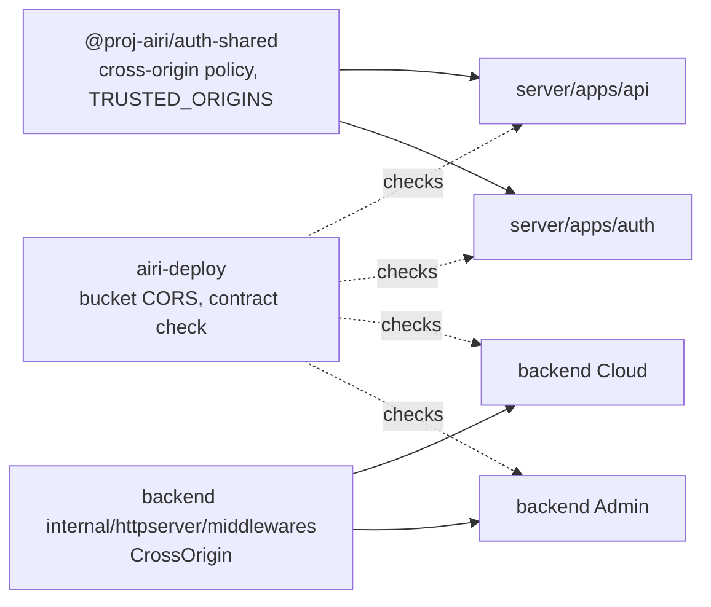
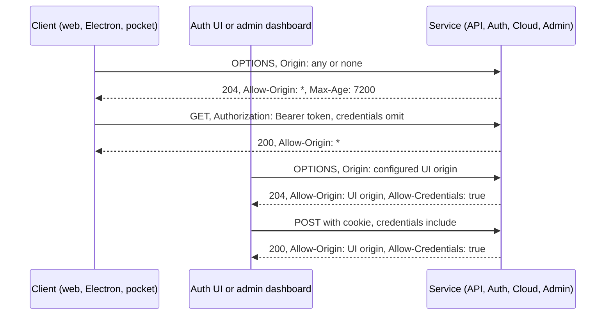

# Cross-origin boundary

Status: proposed. The owner asked for one cross-origin policy for every AIRI service on 2026-11-07.

## Context

CORS failures came back many times, and each fix added one origin to one list:

| Date | Failure | Fix at the time |
| --- | --- | --- |
| 2026-05-14 | stage-pocket on a LAN HTTPS dev host was rejected | `ADDITIONAL_TRUSTED_ORIGINS` in the TypeScript services only |
| 2026-05-26 | Stripe checkout from packaged Electron had no trusted origin | Fallback to `WEB_APP_URL` |
| 2026-07-10 | The Auth UI could not reach a new backend origin | Hard-coded origin in the Auth UI |
| 2026-09-10 | OIDC login failed on Worker preview origins | Suffix added to two lists |
| 2026-10-14 | Direct uploads to the production bucket failed from stage-web, then from Electron dev | Manual `PutBucketCors` with listed origins and ports |
| 2026-11-05 | Cloud `/v1/inbox` sent no `Access-Control-Allow-Origin` to an opaque origin | Not fixed |

The causes are structural:

- At least five origin lists exist: the API, Auth, the Auth UI, Go Cloud, and the production bucket. Go also keeps two lists that no code calls.
- Every service sends `Access-Control-Allow-Credentials: true`. A credentialed response must name one exact origin, so each service needs a list.
- Most requests carry no ambient credential. stage-web, Electron, and stage-pocket send a bearer token with `credentials: 'omit'`. The API and Cloud read no cookies.
- Client origins are unusual and change. Packaged Electron loads `file://`. stage-pocket is `capacitor://localhost` on iOS and `https://localhost` on Android. Dev servers use many ports.

CORS protects only credentials that the browser attaches by itself, that is, cookies. For a bearer request, an origin list blocks our own clients and protects nothing.

## Decision

The credential that a request carries decides its cross-origin policy. No service keeps an origin list for CORS.

### Policy

| Class | Requests | Policy |
| --- | --- | --- |
| Bearer | stage clients to the API, Auth, and Cloud | `Access-Control-Allow-Origin: *`. No `Allow-Credentials`. |
| Capability URL | Presigned bucket URLs | Bucket CORS allows `*`. The signature is the credential. |
| Cookie | The Auth UI to Auth, and the admin dashboard to Admin | The service reflects only the origin of its own configured UI, with `Allow-Credentials: true`. Every other origin gets the bearer policy. |
| Third party | Browser analytics | The endpoint allows `*`, or it goes through a first-party proxy. |

Each cross-origin response also follows these rules:

- A preflight reflects `Access-Control-Request-Headers` and allows `GET, HEAD, POST, PUT, PATCH, DELETE, OPTIONS`.
- `Access-Control-Max-Age` is `7200`, the Chromium limit.
- A service lists the response headers that clients read in `Access-Control-Expose-Headers`.
- A response sends `Vary: Origin, Access-Control-Request-Headers` when its headers depend on them.

A wildcard response is safe for a cookie service too. A browser does not show a credentialed response that has `Access-Control-Allow-Origin: *`. CSRF protection for cookie routes stays in the service, for example the Better Auth origin check and `SameSite=Lax` cookies.

### Credentialed origin

| Service | Credentialed origin | Source |
| --- | --- | --- |
| API | None | |
| Cloud | None | |
| Auth | Origin of `AUTH_UI_URL` | `server/apps/auth/src/env.ts` |
| Admin | Origin of `ADMIN_UI_URL` | `proj-airi/backend` `internal/configs` |

Each service has one credentialed origin at most. A local environment sets the UI URL to its dev server.

### Redirect allowlist

Some features still need trusted origins, but they do not decide CORS:

- OIDC redirect URIs and Better Auth `trustedOrigins`.
- The Stripe checkout return base.

These features read one list, `TRUSTED_ORIGINS` in `@proj-airi/auth-shared`, plus `ADDITIONAL_TRUSTED_ORIGINS`. The API and Auth stop keeping their own copies. The Stripe return base accepts only web origins. It falls back to `WEB_APP_URL` for `capacitor://localhost`, `https://localhost`, and a missing origin.

### Implementation

- TypeScript: `@proj-airi/auth-shared` exports the policy as one function. The API and Auth apply it to `/api/*`.
- Go: one middleware in `proj-airi/backend` applies the policy to Cloud and Admin. The Cloud and Admin origin checks and the unused lists are removed.
- Bucket: `proj-airi/airi-deploy` keeps the bucket CORS rule as code and a script that applies it.
- Contract check: `proj-airi/airi-deploy` sends preflights with each client origin to each host and checks the headers.

## Module dependency graph



## Affected files

```text
moeru-ai/airi
├── server/docs/ai/adr/2026-11-07-cross-origin-boundary.md
├── server/packages/auth-shared/src/
│   ├── cross-origin.ts            policy function
│   └── origin.ts                  TRUSTED_ORIGINS, the one redirect allowlist
├── server/apps/api/src/
│   ├── app.ts                     applies the bearer policy
│   └── utils/origin.ts            redirect helpers only, web-only Stripe base
├── server/apps/auth/src/
│   ├── server.ts                  applies the policy with the AUTH_UI_URL origin
│   └── origin.ts                  reads TRUSTED_ORIGINS
└── server/dev/s3/cors.json        allows every origin

proj-airi/backend
├── internal/httpserver/middlewares/cors.go    one CrossOrigin middleware
├── internal/cloudhttp/server.go               uses it, no list
├── internal/httpserver/routes.go              Admin uses it with ADMIN_UI_URL
├── internal/services/authpolicy/              unused lists removed
└── internal/configs/config.go                 unused origin settings removed

proj-airi/airi-deploy
├── storage/bucket-cors.json + scripts/apply-bucket-cors.ts
├── scripts/check-cors.ts + its workflow
└── caddy/Caddyfile                            forwards every /api/admin/ route to Admin
```

## Sequence



## Scope

- The CORS policy of the API, Auth, Cloud, and Admin.
- One redirect allowlist for the TypeScript services.
- The production and local bucket CORS rules.
- A contract check that runs after deploys and on a schedule.
- The Admin cover routes that the production edge does not forward today.

## Non-goals

- Moving the Auth UI or the admin dashboard to the `api.airi.build` origin. Same-origin hosting removes credentialed CORS completely. It also changes the edge, the Worker base paths, and the OIDC login URL. The single credentialed origin gives the same safety without a hosting change.
- A custom Electron protocol such as `app://airi`. With the bearer policy, the Electron origin does not affect CORS.
- `CapacitorHttp`. It replaces the global `fetch` and handles streamed responses poorly.
- Cookies on the `*.pages.dev` server-dev UIs. They are cross-site to `api-dev.airi.build`, so `SameSite=Lax` cookies do not go with their requests. Moving them to `airi.build` subdomains fixes this later.
- The analytics endpoint. It already returns `Access-Control-Allow-Origin: *` to every client origin.

## Test plan

- Unit tests for the TypeScript policy function and the Go middleware:
  - A bearer preflight from `https://airi.moeru.ai`, `null`, `capacitor://localhost`, `https://localhost`, and `http://localhost:5173` gets `*`.
  - A request with no `Origin` gets `*`.
  - The configured UI origin gets its own origin and `Allow-Credentials: true`.
  - Another origin gets `*` and no `Allow-Credentials`.
  - Requested headers are reflected, and `Max-Age` is `7200`.
- Route tests in the API, Auth, Cloud, and Admin for one preflight each.
- A test that the Stripe return base falls back to `WEB_APP_URL` for `capacitor://localhost` and `https://localhost`.
- The contract check against production and dev after each deploy.
