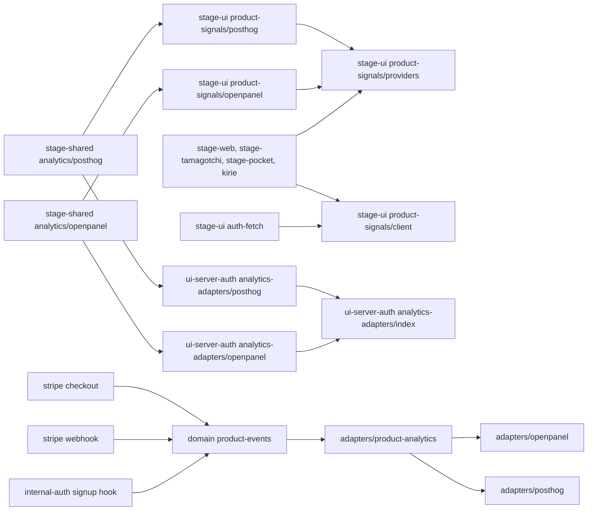
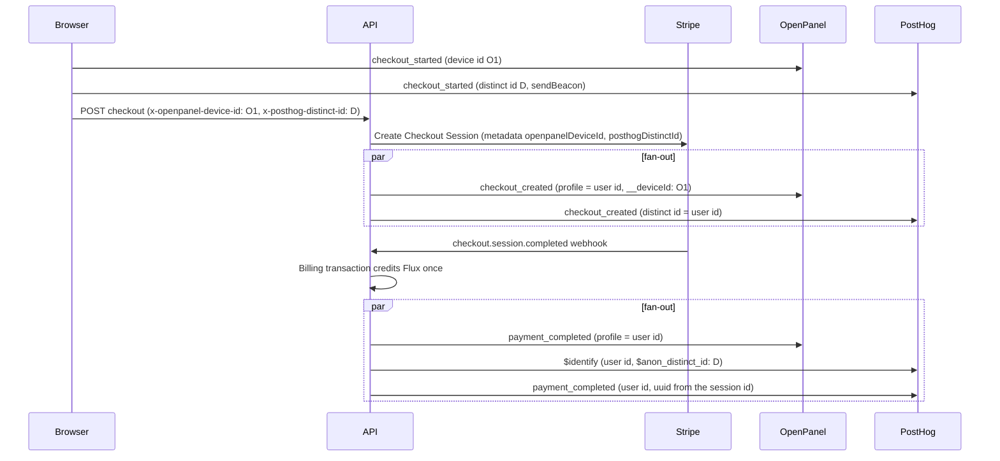

# Product analytics on OpenPanel and PostHog in parallel

Status: proposed

## Context

moeru-ai/airi #2480 moved product analytics from PostHog Cloud to a self-hosted OpenPanel project in 2026-09. The main reason was the PostHog bill.

OpenPanel does not have several functions that AIRI needs, for example feature flags, experiments, and SQL queries. The self-hosted stack also needs operation work: backups, snapshots, and image upgrades.

The old PostHog bill came mostly from the configuration, not from the business events:

- Autocapture sent clicks, form changes, and page leaves.
- The docs site sent anonymous traffic into the same project.
- The API sent one `$ai_generation` event for each model call.

A direct move back to PostHog has a risk. Nobody has compared the two data sets for the same traffic yet.

## Decision

All clients and the API send each product event to OpenPanel and to PostHog in parallel. A later decision removes one provider after the data sets are compared.

### Clients

`packages/stage-ui/src/libs/product-signals/providers.ts` loads both adapters and sends each call to both:

- A content blocker can reject one provider module. The other provider still runs. Analytics stays off only when no provider loads.
- One provider that throws does not stop the call for the other provider.
- Each adapter returns its own identity headers. `auth-fetch` sends the joined headers to the API origin only.

The auth UI (`apps/ui-server-auth/src/modules/analytics-adapters/index.ts`) does the same for its two adapters.

The PostHog project settings decide which PostHog capture products run, for example autocapture, exception capture, web vitals, heatmaps, and session replay. posthog-js reads them from the remote config. `packages/stage-shared/src/analytics/posthog.ts` therefore does not set these switches. It sets only these options:

| Option | Value | Why |
| --- | --- | --- |
| `api_host` | `https://t.airi.build` | The proxy host. Content blockers block the PostHog host names. |
| `defaults` | `2025-05-24` | Route views use `history_change`. |
| `person_profiles` | `identified_only` | Anonymous events cost less than identified events. |
| `capture_pageleave` | `false` | No report reads page leaves. No project setting controls them, so this is the one capture switch in the client. |
| `session_recording` | `maskAllInputs`, `maskTextSelector: '*'` | Chat messages are page text. A replay never records text, even when the project turns replay on. |
| `before_send` | `stripPosthogUrlQueries` | Removes query strings and fragments from URL properties, so OAuth codes never enter PostHog. |

A project setting cannot turn off the two privacy rules, because client options win over the remote config.

The stage adapter adds two options for the installed apps:

- `before_send` also runs `reportAppLocation` on the desktop and mobile apps. A desktop page is a `file:` URL, and `$pathname` is a directory of the user's computer. Every `$` URL, pathname, and host property is reported under the app origin of `stage-shared/analytics/app-origins.ts`, the same origin that OpenPanel uses.
- The desktop app uses hash routes, so `capture_pageview` also follows the hash there.

On 2026-11-15 the project settings turned off exception capture, web vitals, performance capture, and heatmaps. Autocapture and session replay were already off. Sentry receives the error reports.

### Product events

Each sent message is one `message_round` or one `message_round_failed`. `message_round` now carries `provider_type` and `provider_name`, so `message_sent` is removed. These events are also removed, because they add volume and no product decision:

- `voice_input_started` and `stt_succeeded`. A voice round is a `message_round` with `trigger_method: voice`. `stt_failed` stays.
- `provider_card_clicked`. `provider_configured` replaces it. It is sent once, when a provider first passes its settings check.
- `chat_session_deleted`. It duplicated `conversation_deleted`.
- The `expand_controls` and `collapse_controls` controls island actions.

The stage PostHog adapter keeps the behavior of the OpenPanel adapter:

- The app consent setting wins over the consent that PostHog stores.
- Logout and a consent change start a new device identity with `reset(true)`. `reset` also clears the stored consent and the super properties, so the adapter sets them again.
- An event before a navigation uses `sendBeacon`.

PostHog stores the device id in local storage and a cookie. Its anonymous visitor count is therefore persistent across tabs. The OpenPanel device id is only for one tab session. Compare visitor counts with this difference in mind.

### API

`services/adapters/product-analytics.ts` owns the sink contract and `createFanoutSink`. The fan-out sends each confirmed funnel fact (`signup_completed`, `checkout_created`, `payment_completed`) to every configured provider at the same time. Each provider gets one attempt. A failed provider does not stop the others.

Each provider is on when its environment variables are set:

- OpenPanel: `OPENPANEL_API_URL`, `OPENPANEL_CLIENT_ID`, `OPENPANEL_CLIENT_SECRET`.
- PostHog: `POSTHOG_PROJECT_KEY`. `POSTHOG_API_HOST` defaults to `https://t.airi.build`.

A checkout carries the browser identity of each provider in its own headers:

| Provider | Headers | Stripe metadata | Product event metadata |
| --- | --- | --- | --- |
| OpenPanel | `x-openpanel-device-id`, `x-openpanel-session-id` | `openpanelDeviceId`, `openpanelSessionId` | `openpanel_device_id`, `openpanel_session_id` |
| PostHog | `x-posthog-distinct-id`, `x-posthog-session-id` | `posthogDistinctId`, `posthogSessionId` | `posthog_distinct_id`, `posthog_session_id` |

The OpenPanel names do not change, so a Checkout Session from an older client keeps its OpenPanel attribution.

`services/adapters/posthog.ts` sends each fact with `posthog-node`:

- Each fact uses `captureImmediate`. It has one attempt and a timeout of five seconds, because the signup hook waits for it.
- When the browser distinct id is not the user id, the adapter first sends `$identify` with `$anon_distinct_id`. This merges the anonymous visit into the user.
- A source event id gives a stable UUID v5 for each event, so a repeated delivery has the same uuid.

The billing transaction still suppresses replayed payment webhooks. The domain service rejects metadata keys that start with `$`, and the other reserved keys.

### Module dependency graph



### Affected files

```text
packages/stage-shared/src/analytics/posthog.ts                   (new)
packages/stage-shared/src/analytics/app-origins.ts               (moved from openpanel.ts)
packages/stage-ui/src/libs/product-signals/utils/reported-location.ts
packages/stage-ui/src/libs/product-signals/events/chat/            (message_sent removed)
packages/stage-ui/src/composables/{use-analytics,use-provider-validation}.ts
packages/stage-ui/src/stores/{chat,chat/session-store,modules/hearing}.ts
packages/core-agent/src/runtime/chat-orchestrator-runtime.ts      (provider on onMessageRound)
packages/stage-pages/src/pages/settings/{modules,providers}/       (card click events removed)
packages/stage-ui/src/libs/product-signals/posthog.ts             (new)
packages/stage-ui/src/libs/product-signals/providers.ts           (new, client fan-out)
packages/stage-ui/src/libs/product-signals/client.ts              (identity headers)
packages/stage-ui/src/libs/product-signals/openpanel.ts           (identity headers)
packages/stage-ui/src/libs/auth-fetch.ts
apps/ui-server-auth/src/modules/analytics-adapters/{index,posthog}.ts
apps/{stage-web,stage-tamagotchi,stage-pocket,stage-tamagotchi-kirie}/.../main.ts
apps/{stage-web,ui-server-auth}/vite.config.ts                    (neutral chunk names)
server/apps/api/src/services/adapters/product-analytics.ts        (new, sink contract and fan-out)
server/apps/api/src/services/adapters/{openpanel,posthog}.ts
server/apps/api/src/services/domain/product-events.ts
server/apps/api/src/routes/stripe/operations/{checkout,webhook}.ts
server/apps/api/src/libs/env.ts
server/apps/api/src/app.ts
```

### Checkout attribution sequence



## Scope and non-goals

- Out of scope: the copy of the OpenPanel events since 2026-09-09 into PostHog. A one-time script outside the repository does it.
- Out of scope: the removal of one provider. It needs its own decision after the comparison.
- Out of scope: the PostHog project settings and billing limits. The PostHog project owner keeps them.
- Out of scope: per-generation events. Generation data stays in `llm_request_log`.
- Out of scope: the docs site.

## Test plan

- `packages/stage-shared/src/analytics/posthog.test.ts`: URL properties and person properties lose their queries and fragments.
- `packages/stage-ui/src/libs/product-signals/posthog.browser.test.ts`: with the real SDK, consent drops events, logout gives a new device id, super properties stay after a reset, and no `$opt_in` event is sent.
- `packages/stage-ui/src/libs/product-signals/utils/reported-location.test.ts`: no app page property keeps a local directory, and product properties do not change.
- `packages/stage-ui/src/libs/product-signals/events/chat/runtime.test.ts`, `stores/chat.contract.test.ts`: `message_round` carries the provider and the round correlation, and no `message_sent` hook exists.
- `packages/stage-ui/src/libs/product-signals/providers.browser.test.ts`: one event reaches both SDKs, the identity headers of both providers are joined, and consent off stops both.
- `server/apps/api/src/services/adapters/product-analytics.test.ts`: the fan-out reaches every provider, and one failure does not stop the others.
- `server/apps/api/src/services/adapters/posthog.test.ts`: `$identify` comes before the fact, replays have the same uuid, and a rejected request has one attempt and does not throw.
- `server/apps/api/src/services/domain/product-events.test.ts`, `routes/stripe/checkout.test.ts`, `routes/stripe/route.test.ts`: the identity of each provider reaches Stripe metadata and the sink.
- `packages/stage-ui/src/libs/auth-fetch.test.ts`: the identity headers go only to the API origin.
- Before the release: set `POSTHOG_PROJECT_KEY` on the API deployment. Send one marked browser event and one server event, and confirm them in both providers.
