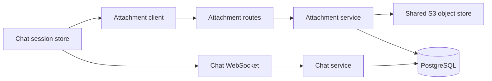
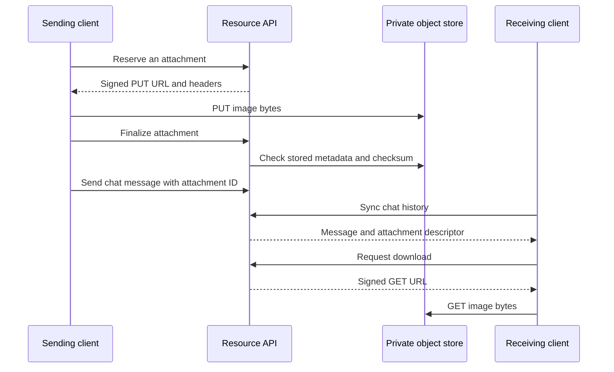

# Sync chat images through private object storage

Status: proposed

## Decision

Store image bytes in the existing private S3 bucket. Store the owner, object key, state, creation time, and last update time in PostgreSQL.
Chat messages reference ready attachments by ID. The API signs a download after it checks ownership or active chat membership.

## Scope

The client queues up to four images with each message. The API validates each image's declared type, size, and checksum.
The shared object store signs a write-once PUT with a SHA-256 checksum. Finalization checks the stored checksum, size, and content type.
The download authorization includes the expected SHA-256. The client checks the size and checksum before it saves the image.

## Non-goals

This change does not synchronize model inputs other than images. It does not add public object access or provision a new bucket.

## Modules



```text
packages/stage-ui/src/
├── libs/chat-sync/attachments.ts
└── stores/chat/session-store.ts
server/
├── apps/api/src/routes/attachments/
├── apps/api/src/schemas/attachments.ts
├── apps/api/src/services/domain/attachments.ts
├── apps/api/src/services/domain/chats.ts
├── apps/api/drizzle/
└── packages/server-sdk-shared/src/chat.ts
```

## Sequence



## Tests

Check upload retry, finalization, and download authorization in the attachment service tests.
Check descriptor handling in the WebSocket contract and browser tests.
Send a test image from one client and load the same conversation from a second client against local RustFS.
