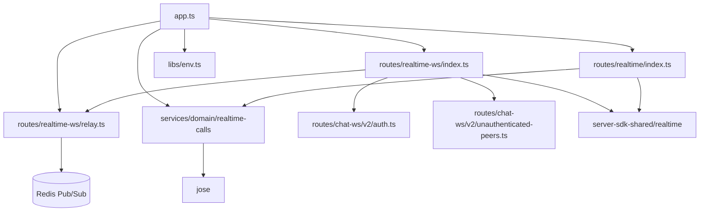
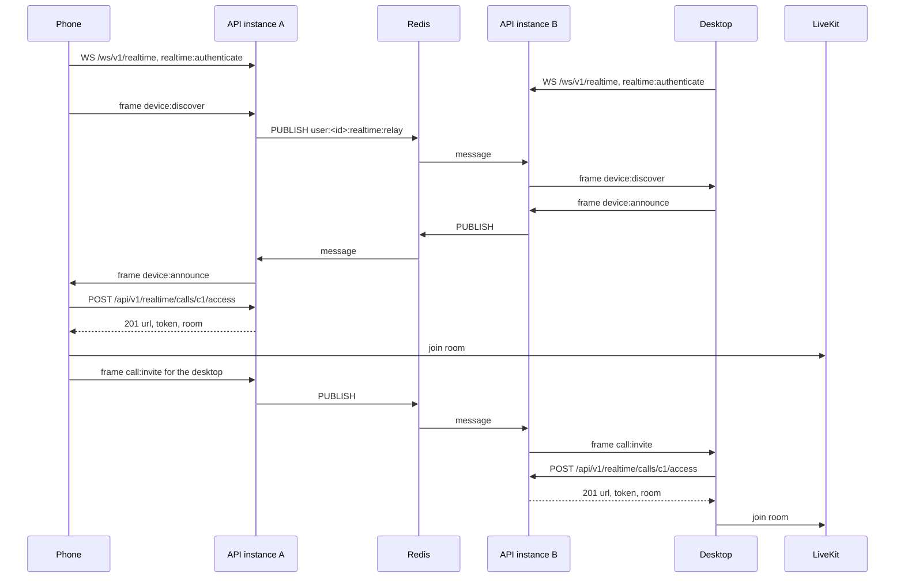

# Realtime relay and call access

Status: proposed

## Context

A user calls AIRI from a phone, and the home computer of the user runs the agent. `docs/ai/adr/2026-11-11-realtime-call-planes.md` at the repository root gives the full design. A call uses two planes:

- The message plane carries small control events between the devices of one account.
- The media plane carries audio through a LiveKit server.

Neither device can accept an inbound connection. Both devices already hold an access token for this API. This API therefore gives the devices a place to meet, and it gives them access to the media server.

`/ws/v2/chat` already has the pattern: an anonymous upgrade, authentication in the first frame, a registry of local connections for each user, and Redis Pub/Sub between instances.

## Decision

### `GET /ws/v1/realtime`

- The upgrade is anonymous. The first frame must be the Eventa invoke `realtime:authenticate` with an access token.
- After authentication, the route forwards each frame to the other connections of the same user. It sends the frame text with no change.
- The route reads only the Eventa event id of a frame. The id must start with `proj-airi:realtime:`. The route does not parse the body.
- The device contracts are in `@proj-airi/realtime-protocol`. This API does not import that package. A new contract needs no server change.
- A frame has a limit of 16 KiB. The `ws` receiver enforces it from the start of the connection.
- One connection can forward 200 frames in 10 seconds.
- The route persists nothing. A frame for a device that is not connected is lost.

| Condition | Result |
| --- | --- |
| A frame that is not the authenticate invoke, before authentication | Close 4001 |
| A token that is not valid | Close 4001 |
| No authentication in 15 seconds | Close 1013 |
| More than 100 unauthenticated connections on one instance | Terminate the new socket |
| After authentication: a frame over the limit, not JSON, or with an id outside the prefix | Close 1008 |
| After authentication: a second authenticate frame | Close 1008. The route does not forward it, because it holds a token. |
| After authentication: more frames than the rate limit | Close 1008 |

### `POST /api/v1/realtime/calls/:callId/access`

- The route needs a signed-in user. The body is `{ deviceId }`. `callId` and `deviceId` match `^[\w-]{1,64}$`.
- The response is `201` with `{ url, token, room }`.
- `room` is `call_<userId>_<callId>`. The token lets the device join this room only, for 10 minutes.
- The participant identity is `<userId>_<deviceId>`.
- The token is a LiveKit access token: a JWT with HS256, signed with the API secret. The API signs it with `jose`. It does not call the media server.
- When `LIVEKIT_URL`, `LIVEKIT_API_KEY`, or `LIVEKIT_API_SECRET` is not set, the route returns `503 REALTIME_CALLS_DISABLED`.
- The rate limit is 30 requests in 60 seconds for each user.

### Instances

- Each instance keeps its local connections in memory. This state has no value after the socket closes.
- An instance subscribes to `user:<userId>:realtime:relay` while it has a connection of that user.
- A forward delivers to the local connections first, and then publishes `{ originInstanceId, userId, frame }`. An instance skips its own messages.
- A failed publish loses one control event. The devices apply timeouts and repeat discovery, so the sender gets no error.

## Scope and non-goals

In scope: the two routes, the shared contracts, and three environment values.

Not in scope:

- A device registry in Postgres. Presence is an exchange of `device:discover` and `device:announce` events between devices.
- Billing or a usage ledger for call minutes.
- Calls to the LiveKit server API. The API creates no room and removes no participant.
- Media relay. Audio does not pass through this API.
- Delivery to a device that is offline.

## Dependencies



## Affected files

```text
server/
  packages/server-sdk-shared/
    src/realtime.ts                         new: authenticate invoke, frame limit, event prefix, call access schemas
    package.json, tsdown.config.ts          new export ./realtime
  apps/api/src/
    app.ts                                  wires the relay, both routes, and the call access service
    libs/env.ts                             LIVEKIT_URL, LIVEKIT_API_KEY, LIVEKIT_API_SECRET
    utils/redis-keys.ts                     userRealtimeRelayRedisKey
    routes/realtime-ws/
      index.ts                              connection states and frame rules
      relay.ts                              local registry and Pub/Sub fanout
      testing.ts                            Pub/Sub double for tests
    routes/realtime/index.ts                call access route
    services/domain/realtime-calls/index.ts token signing
```

## Sequence



## Test plan

- `routes/realtime-ws/relay.test.ts`: delivery to the other connections, isolation between users, one delivery across two instances, leave, subscription lifetime, and an invalid Pub/Sub message.
- `routes/realtime-ws/index.test.ts`: an Eventa client on an in-memory socket pair. Authentication, forwarding, each close condition after authentication, and cleanup on close.
- `services/domain/realtime-calls/index.test.ts`: the claims, the signature, and the room name of a token.
- `routes/realtime/route.test.ts`: 401, 503, 201, and each invalid input.
- Not covered by these tests: a LiveKit server that accepts the token. The end-to-end run of the client PR covers it.
