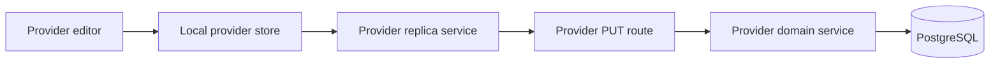
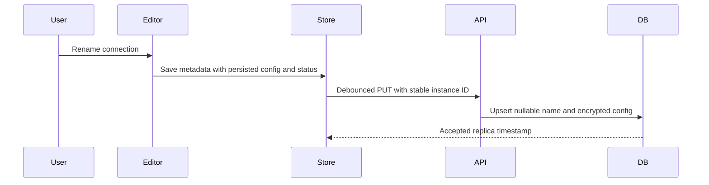

# Provider connection display names

Status: accepted

## Decision

A provider connection can have a custom display name. The name is UI metadata and stays outside runtime credentials.

The local provider store owns the connection. Cloud synchronization keeps the existing stable instance ID and replica merge policy.

The API stores `display_name` as nullable text. A new migration follows published migration 0034. Existing migrations remain unchanged.

An empty custom name selects the localized provider definition name. The stored metadata does not freeze that localized default.

## Scope and non-goals

This change covers editing, persistence, replica synchronization, and display. It does not change validation, model selection, authentication, or billing.

A rename uses persisted credentials and validation status. A pending credential draft remains pending until validation completes.

## Module dependencies



## Affected files

```text
packages/provider-inference/src/types.ts
packages/stage-pages/src/pages/v2/settings/providers/
packages/stage-ui/src/libs/providers/display-name.ts
packages/stage-ui/src/stores/providers/{config,merge}.ts
packages/stage-ui/src/services/inference-service-providers.ts
server/apps/api/src/{routes/providers,services/domain,schemas}/
server/apps/api/drizzle/
```

## Update sequence



## Validation

Run provider metadata, replica merge, credential draft, and API domain tests.

Upgrade an in-memory PGlite database through the migration journal. Preserve existing rows, indexes, and upload sessions.

Inspect rename and localization through the real settings page. Run workspace and root typechecks, affected tests, i18n checks, and lint.
