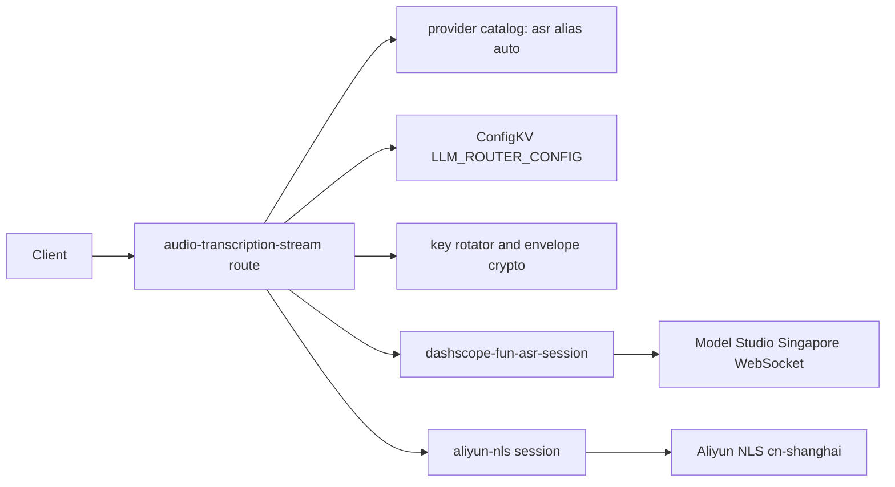
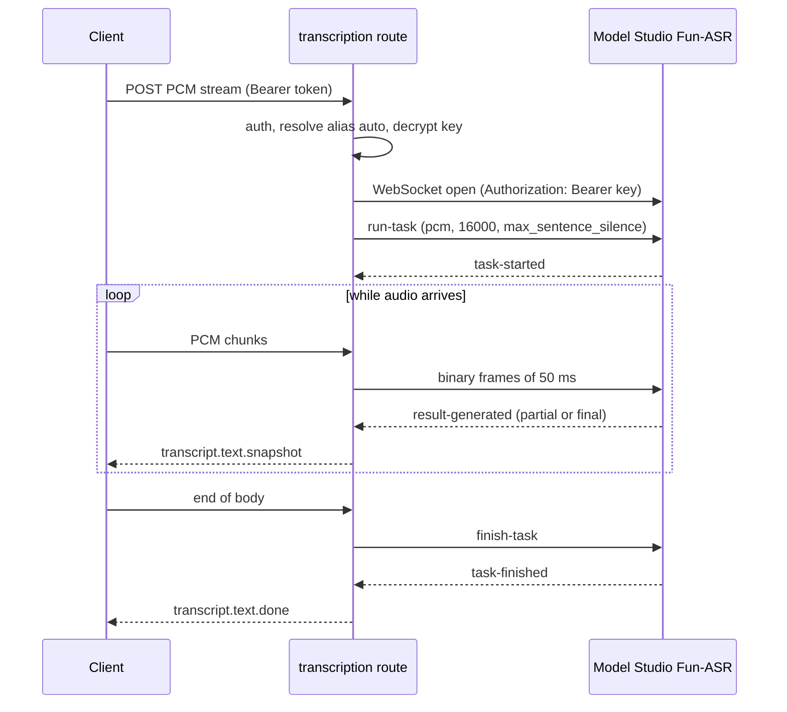

# Official ASR on Model Studio Fun-ASR in Singapore

Status: accepted

## Context

The API runs in the Railway Singapore region. The official ASR provider is Aliyun NLS in `cn-shanghai`.

On 2026-11-22 we measured these values from the production API container:

- A TCP connect to `nls-gateway-cn-shanghai.aliyuncs.com` takes 800 to 1000 ms. Requests often time out.
- A streaming transcription of 3.9 s of audio gave its final text 8.6 s after the audio ended. Other runs hung for 40 s or lost the socket.
- A TCP connect to `dashscope-intl.aliyuncs.com`, the Model Studio Singapore endpoint, takes 3 ms.

The NLS route also sends text only at the end of each sentence, so clients get no partial text.

## Decision

- The API adds the ASR provider `dashscope-fun-asr`. It streams audio to the Model Studio realtime inference WebSocket with the model `fun-asr-realtime`.
- The default endpoint is `wss://dashscope-intl.aliyuncs.com/api-ws/v1/inference`.
- `LLM_ROUTER_CONFIG.asr.models[<name>]` selects the provider. The `auto` ASR alias picks the model, as before.
- The first upstream key holds the Model Studio API key. Optional `adapterParams`:
  - `websocketURL`: the endpoint, for example a workspace endpoint.
  - `model`: the model id, for example a dated snapshot.
  - `maxSentenceSilenceMs`: from 200 to 6000. The default is 400 ms. The service default is 1300 ms.
- The route returns `transcript.text.snapshot` events. Each event has the full text so far, partial or final. The stream ends with `transcript.text.done`.
- The route joins the 8 ms client chunks into frames of 1600 bytes (50 ms) before it sends them.
- The `aliyun-nls` provider stays. An operator moves traffic by editing `LLM_ROUTER_CONFIG`. No client change is necessary.

## Scope

- `POST /api/v1/audio/transcriptions/stream` when its model uses `dashscope-fun-asr`.
- The ASR provider list in `LLM_ROUTER_CONFIG`.

Non-goals:

- Billing for ASR. The route has no billing today, and this change keeps that.
- The client upload path. Cloudflare buffers the streamed request body. That is a separate change.
- Qwen3-ASR realtime. It uses another protocol.
- Fixes to the NLS adapter, for example the internal-region host name and the token cache.

## Module dependencies



## Affected files

```text
server/apps/api/src/
  routes/audio-transcription-stream/route.ts                          routes the alias to a provider
  routes/audio-transcription-stream/route.test.ts
  routes/audio-transcription-stream/dashscope-fun-asr-session.ts      Fun-ASR WebSocket to SSE
  routes/audio-transcription-stream/dashscope-fun-asr-session.test.ts
  services/adapters/config-kv/definitions.ts                          adds the provider id
server/docs/ai/adr/2026-11-22-official-asr-fun-asr-singapore.md
```

## Sequence



## Test plan

- Unit tests resolve credentials, defaults, and invalid params. They also check that the `auto` alias routes to the provider.
- A mock WebSocket server checks the session:
  - the `run-task` body and the auth header
  - the frame sizes
  - the snapshot text after partial and final results, and that heartbeats are ignored
  - `task-failed` as a stream error
- Before rollout, a realtime run against Model Studio Singapore from the production region must return partial and final text. Compare the latency with NLS.
