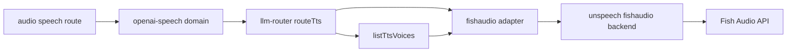
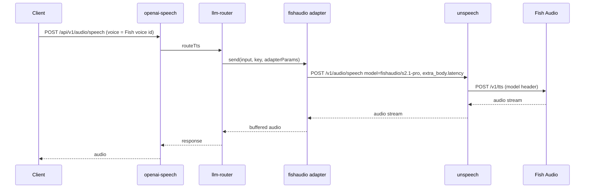

# Fish Audio TTS provider

Status: accepted

## Context

The official TTS uses StepFun through unspeech. On 2026-11-22 we measured these values from the production API container in Singapore:

| Path | First byte | Full audio |
| --- | --- | --- |
| StepFun through the API (`POST /api/v1/audio/speech`) | 2.6 to 2.8 s | same, the API buffers the body |
| Fish Audio REST `s2.1-pro`, `latency=balanced`, direct | 276 ms | 1.36 s |

unspeech has a Fish Audio backend (`fishaudio/*`) since 2026-07. The API has no `fishaudio` adapter, so `LLM_ROUTER_CONFIG` cannot select it.

## Decision

- The API adds the TTS provider `fishaudio`. Its adapter sends `fishaudio/<model>` to unspeech, as the StepFun adapter does.
- The default model is `s2.1-pro`. The adapter always names the model, because unspeech uses `s1` when the model is empty, and `s1` retires on 2026-12-31.
- The default `latency` is `balanced`. The operator can set `low` or `normal`.
- The request `voice` is the Fish Audio voice model id (`reference_id`). `adapterParams.defaultVoice` is used when the request has none.
- Valibot checks `adapterParams`. Invalid params fail the request with 400.
- The router gives the decrypted key to the Fish Audio voice catalog call, as it does for Azure. `voiceSelf: true` lists the voices of the account, which needs the key.

`adapterParams`:

| Key | Values | Default |
| --- | --- | --- |
| `model` | `s2.1-pro`, `s2-pro`, `drama-3`, other Fish models | `s2.1-pro` |
| `defaultVoice` | voice model id | none |
| `latency` | `low`, `balanced`, `normal` | `balanced` |
| `responseFormat` | `mp3`, `wav`, `pcm`, `opus` | `mp3` |
| `sampleRate`, `mp3Bitrate`, `chunkLength`, `normalize`, `temperature`, `topP` | Fish Audio request fields | Fish Audio default |
| `voiceLanguage`, `voiceSelf` | voice catalog filters | none |

## Scope

- The `fishaudio` provider in `LLM_ROUTER_CONFIG.tts`.
- The voice catalog for that provider.

Non-goals:

- Streaming the audio body to the client. The API still buffers the whole body. That is a separate change for every provider.
- The streaming WebSocket TTS route. It supports only Volcengine.
- A `licensed` filter for the voice catalog. unspeech does not forward it yet. Operators enable only licensed voices in the catalog.
- Billing. Flux keeps `FLUX_PER_1K_CHARS_TTS` for every provider. Fish Audio bills per UTF-8 byte, so a Chinese character costs 3 bytes.

## Module dependencies



## Affected files

```text
server/apps/api/src/
  services/adapters/tts/fishaudio.ts           adapter
  services/adapters/tts/index.ts               registry
  services/adapters/tts/types.ts               TtsAdapterId
  services/adapters/tts/index.test.ts
  services/adapters/config-kv/definitions.ts   provider id
  services/domain/llm-router/router.ts         key for the Fish Audio voice catalog
server/docs/ai/adr/2026-11-22-tts-fish-audio-provider.md
```

## Sequence



## Test plan

- Unit tests for the adapter:
  - the default model and latency
  - the voice and tuning from `adapterParams`
  - a missing voice and invalid params give 400
  - the voice catalog query and the auth header
- Before rollout, configure a `fishaudio` model in the dev environment. Then measure the latency from the production region with the latency probe.
