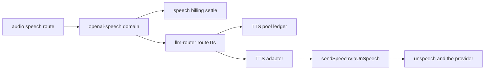
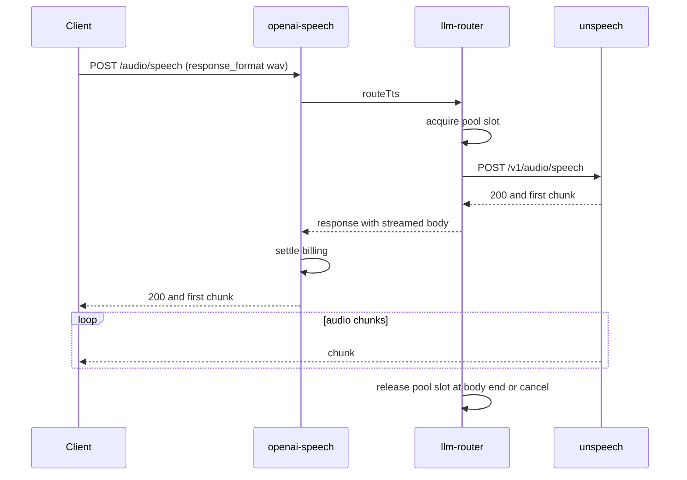

# Stream the audio of `POST /api/v1/audio/speech`

Status: accepted

## Context

On 2026-11-23 we measured these values from the production API container in Singapore, for Fish Audio `s2.1-pro`:

| Path | First byte | Full audio |
| --- | --- | --- |
| Fish Audio direct | 308 ms | 1.82 s |
| unspeech, then Fish Audio | 324 ms | 1.77 s |
| `POST /api/v1/audio/speech` | about 1.5 s | about 1.5 s |

unspeech streams the body. The API did not:

- The unspeech SDK `generateSpeechResponse` reads the body with `arrayBuffer()`.
- The route returned only after the whole file arrived.

So the first byte of the route came after the whole synthesis.

## Decision

- `sendSpeechViaUnSpeech` calls unspeech with `fetch` and returns the response body as a stream. The request body is the same JSON that the SDK sent.
- The route settles billing when unspeech answers with a success status, before the body streams. Billing still uses the input characters, as before.
- A TTS pool slot stays taken until the body ends, the upstream fails, or the client cancels. `releaseWhenBodyEnds` in the router owns this.
- The route forwards the format that the client asks for. The stage client asks for `wav` and plays the PCM while it arrives.

## Scope

- `POST /api/v1/audio/speech` for every TTS adapter that uses unspeech.

Non-goals:

- The streaming WebSocket route `/api/v1/audio/speech/ws`.
- Billing by delivered audio. A stream that fails after the first byte is billed in full, as the providers bill us.
- A timeout for a stalled body after the first byte.

## Effects

- `gen_ai` operation duration and the `durationMs` log field now measure the time to the first byte, not to the last byte.
- The OpenTelemetry span `llm.gateway.tts` ends when the body starts.

## Module dependencies



## Affected files

```text
server/apps/api/src/
  services/adapters/tts/unspeech.ts               streams the unspeech body
  services/adapters/tts/index.test.ts
  services/adapters/tts/dashscope-cosyvoice.test.ts
  services/domain/llm-router/router.ts            releaseWhenBodyEnds, slot kept until the body ends
  services/domain/llm-router/tests/router.test.ts
server/docs/ai/adr/2026-11-23-tts-streamed-response.md
```

## Sequence



## Test plan

- The unspeech adapter returns before the upstream body ends.
- The pool slot stays taken until the body ends, and a client cancel releases it.
- Measure the first byte of the route from the production region after the release.
