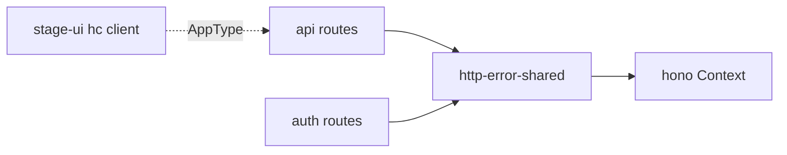
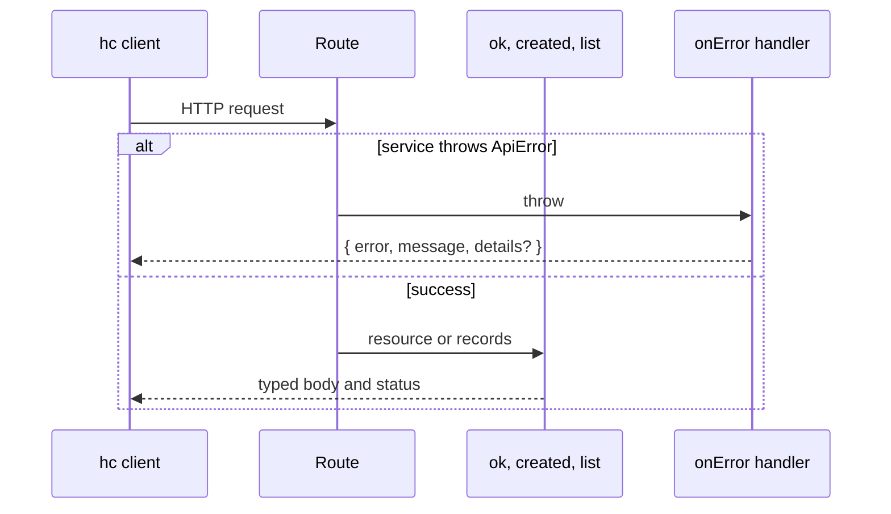

# Typed success responses

Status: proposed

## Context

`2026-10-19-http-response-conventions.md` sets the shape of success bodies, lists, and deletes.
Only documentation enforces it. Hono `c.json(value)` accepts each value, so each route chose its own shape.
The `hc<AppType>` client infers the shape that a route writes, not the shape that the rules require.

On 2026-11-23 the API and Auth services had 50 `c.json` and `context.json` calls in `src`. This table sorts each response.

| Group | Routes | Count |
| --- | --- | --- |
| Follows the rules | Single resource reads and writes in `chats`, `characters`, `character-cards`, `display-models`, `providers`, `flux`, `llm-requests`. Also `POST /stripe/checkout`, `POST /revenuecat/sync`, `POST /apple-iap/account-token`, `POST /apple-iap/transactions`, `/internal/auth/*`, Auth `POST /api/auth/check-email`, the API and Auth `GET /` | 25 |
| Known deviation | The routes in the known deviations table of `2026-10-19-http-response-conventions.md`, and the API 404 | 13 |
| Another protocol owns it | Stripe, RevenueCat, and Apple webhooks. Better Auth `get-session` and `list-sessions`. OIDC and OAuth metadata. `/livez` and `/readyz` of both services | 12 |
| Not `c.json` | The OpenAI gateway and the audio routes. They return a `Response` that the protocol shapes | - |

The counts are calls, not routes. `get-session` has two calls and `GET /stripe/packages` has two. Four `c.body(null, 204)` deletes also move to `noContent`.

## Decision

- Add `ok`, `created`, `noContent`, `list`, and `paginated` to `@proj-airi/http-error-shared`.
- `ok` returns `200` and `created` returns `201`. Each rejects an array at compile time.
- `noContent` returns `204` with no body. `list` returns `{ records }`. `paginated` returns `{ records, hasMore }`.
- Each function returns the Hono typed response, so `hc<AppType>` still infers each body and status.
- ESLint forbids `c.json` and `context.json` in `server/apps/api/src` and `server/apps/auth/src`. Test files are not in the scope. Better Auth plugin endpoints use `ctx.json`, which Better Auth owns, so the rule does not match `ctx`.
- A known deviation or a protocol-owned response keeps `c.json`. It disables the rule on its line and names the reason.
- Each route that follows the rules uses the functions. Its body and status do not change.

The functions go in `http-error-shared`, not in a new package. They serve the same routes and need only `hono`. A new package adds Dockerfile, manifest, and lockfile entries for no gain. The package keeps its name, because a rename changes 93 files.

## Non-goals

- A change to a known deviation. Each one is a breaking change for deployed web, desktop, and mobile clients.
- Runtime validation of response bodies.
- A change to the exceptions.

## Module dependencies



## Affected files

```text
eslint.config.ts                              forbids c.json in server app sources
server/packages/http-error-shared/
  src/response.ts, src/response.test.ts       success responses and tests
  README.md, package.json                     documents the success responses
server/apps/api/
  src/app.ts                                  marks probes and 404
  src/routes/**                               uses the functions, marks deviations
server/apps/auth/
  src/server.ts, src/routes.ts                uses ok, marks protocol responses
server/docs/ai/adr/
  2026-11-23-typed-success-responses.md
```

## Response flow



## Test plan

- `http-error-shared/src/response.test.ts` checks each status and body. A `@ts-expect-error` line proves that `ok` rejects an array.
- Typecheck `@proj-airi/http-error-shared`, `@proj-airi/api-server`, `@proj-airi/auth-server`, and `@proj-airi/stage-ui`. The `stage-ui` typecheck proves that `hc` still infers each body.
- Run the `test:run` script of each changed workspace. The route tests assert the bodies and statuses that did not change.
- Run ESLint on the changed files. It must report no `c.json` call without a reason.
