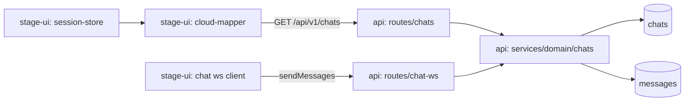
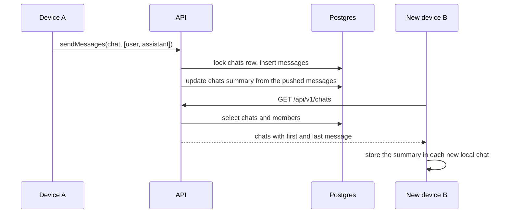

# The chat list includes a summary of each chat

Status: proposed

## Context

The chat list of the desktop and web apps shows two lines for each chat: the title, or else the first message, and the last message.
A client stores this summary with each local chat. It computes the summary from the messages that it holds.
A new device gets the chats from `GET /api/v1/chats` but no messages. It loads the messages of a chat only when the user opens the chat.
Until then, each row shows "New chat" and no last message.

`2026-10-09-chat-list-members.md` added the members to the same list for the same reason: one request for each chat is too slow.

## Decision

- `chats` gets six nullable columns: `first_message_id`, `first_message_text`, `last_message_id`, `last_message_text`, `last_message_role`, and `last_message_at`.
- `GET /api/v1/chats` returns them with each chat, because `listChats` selects all columns of `chats`.
- `pushMessages` updates them in the transaction that writes the messages, under the lock of the chat row. No background task or trigger writes them.
- A pushed new message with text becomes the last message. The first such message becomes the first message when the chat has none.
- An update of the first or the last message replaces its text. An update of another message does not change the summary.
- A message without text does not count, for example a reply that only calls tools.
- A summary text is one line of at most 200 characters. The client cuts it again for its row.
- `last_message_role` is `user` or `assistant`. The client prefixes the words of the user, as a messenger does.
- The migration fills the columns of existing chats from their messages in `seq` order.
- A client gives the summary of the server to a chat that it adopts, and to a mapped chat that has no summary on the device. A local summary wins, because the messages on the device update it.
- The ids have no foreign key. A summary follows the messages, as `messages.sender_id` follows the users.

The update reads only the pushed messages and the two ids on the locked row. It does not sort the messages of the chat.
Message order by `seq` is not enough at runtime, because an update moves an old message to a new `seq`.
Order by `created_at` is not enough either, because the messages of one push share one time.

## Scope

- The `chats` table and its migration.
- `pushMessages` and `listChats` in the chat service.
- The client schema of a listed chat, and the step that adds a remote chat to the local index.

## Non-goals

- A summary that changes when a message is deleted. The API has no message delete. `deleteAllForUser` deletes a solo chat with its messages and keeps shared chats as they are.
- The name of the sender in a group chat.
- A change to `GET /api/v1/chats/:id`, `POST`, or `PATCH`. They return the new columns too, and no client reads them.
- A new response shape. The list keeps its known deviation `{ chats }` of `2026-10-19-http-response-conventions.md`.

## Module dependency graph



## Affected files

```text
server/apps/api/
├── drizzle/0035_chat_summary.sql, meta/  columns and backfill
└── src/
    ├── schemas/chats.ts                summary columns
    ├── services/domain/chats.ts        pushMessages writes the summary
    └── services/domain/chats.test.ts   summary of pushes and the list
server/docs/ai/adr/
└── 2026-11-24-chat-list-summary.md
packages/stage-ui/src/
├── libs/chat-sync/cloud-mapper.ts      the listed chat schema reads the summary
└── stores/chat/session-store.ts        a remote chat gets its summary in the local index
```

## Sequence



## Test plan

- `chats.test.ts` pushes messages and reads the list. It checks the first and the last message, a message without text, an update of the first and of the last message, and a chat without messages.
- `summaryTextOf` tests check one line and a cut that keeps whole characters.
- The API tests push the schema and skip the migrations. A one-time PGlite run applies migrations `0000` to `0034`, inserts chats and messages, applies `0035`, and checks the filled columns.
- The client tests check that a remote chat gets its summary and that local messages win over it.
- Typecheck `@proj-airi/api-server` and `@proj-airi/stage-ui`.
