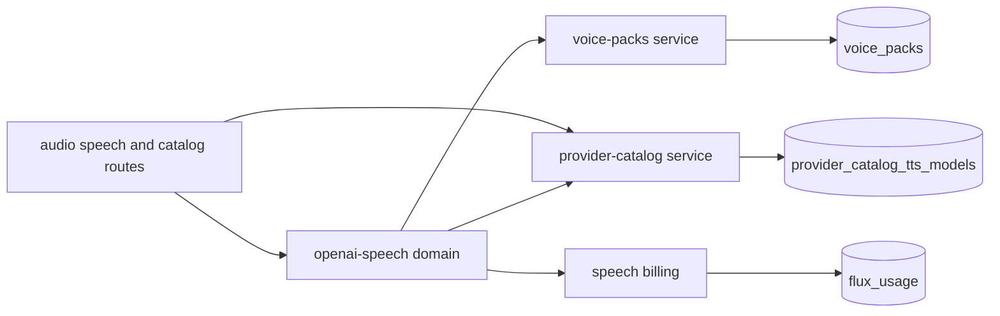
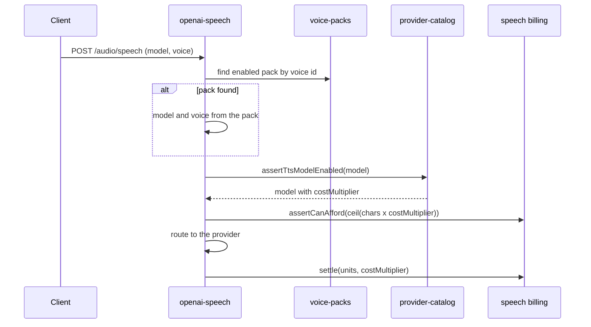

# Price TTS by the catalog model, not by the Voice Pack

Status: accepted

## Context

TTS billing had one global price, `FLUX_PER_1K_CHARS_TTS`. Only a Voice Pack carried a cost multiplier.

Users select a model from `provider_catalog_tts_models`, but that table had no price. To charge more for a costly provider, for example Fish Audio at 5x, the only place was a Voice Pack. The model itself stayed selectable at 1x.

## Decision

- `provider_catalog_tts_models` gets `cost_multiplier real not null default 1` and `description text`.
- `voice_packs.cost_multiplier` is dropped. A Voice Pack bills at the multiplier of the catalog model that it routes to.
- `POST /api/v1/audio/speech` computes billing units as `ceil(input characters x model cost multiplier)`. The multiplier is written to the `flux_usage` detail.
- `GET /api/v1/audio/models` returns `description` and `costMultiplier` for each model. The description names the price only when it is not 1x.
- `GET /api/v1/audio/voices?model=voice-pack` shows each pack with the multiplier of its model. It leaves out a pack whose model is not enabled, because a request for that pack fails.
- `GET /api/v1/voice-packs` no longer returns `costMultiplier`. No client screen reads it.
- The router config sync does not write the two new columns. Operators set them in the admin dashboard.

## Scope

- The TTS catalog model table, the Voice Pack table, and the speech routes of the API.

Non-goals:

- The streaming WebSocket route `/api/v1/audio/speech/ws`. It uses the streaming gateway models, not the catalog.
- The Go admin and the dashboard. They mirror the table and follow in their own repositories.
- A price for each voice.

## Rollout

- The migration copies no data. Production has one Voice Pack, at 1x, so no price is lost.
- The Go admin reads `voice_packs.cost_multiplier` until its own change ships. Deploy the Go admin change right after this API release.

## Module dependencies



## Affected files

```text
server/apps/api/
  drizzle/0035_tts_model_cost_multiplier.sql             adds the model columns, drops the pack column
  src/schemas/provider-catalog.ts                        description, costMultiplier
  src/schemas/voice-packs.ts                             no costMultiplier
  src/services/domain/openai-speech/index.ts             bills by the model multiplier
  src/services/domain/billing/speech-billing.ts          writes the multiplier to the usage detail
  src/services/domain/provider-catalog/index.ts          update input
  src/services/domain/voice-packs/index.ts               no costMultiplier input
  src/routes/openai/v1/operations/speech-catalog/index.ts
  src/routes/voice-packs/index.ts
packages/stage-ui/src/stores/voice-packs.ts              no costMultiplier field
server/docs/ai/adr/2026-11-24-tts-model-cost-multiplier.md
```

## Sequence



## Test plan

- A Voice Pack bills at the multiplier of its catalog model.
- The model list returns the description and the multiplier, and a 1x model has no added description.
- The Voice Pack list shows the model multiplier and leaves out a pack whose model is not enabled.
- The router config sync keeps the operator description and multiplier.
