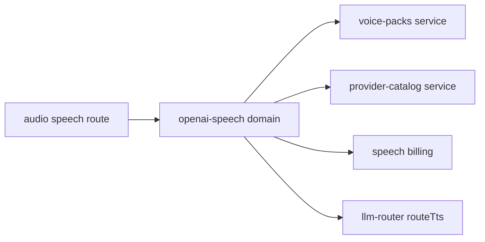
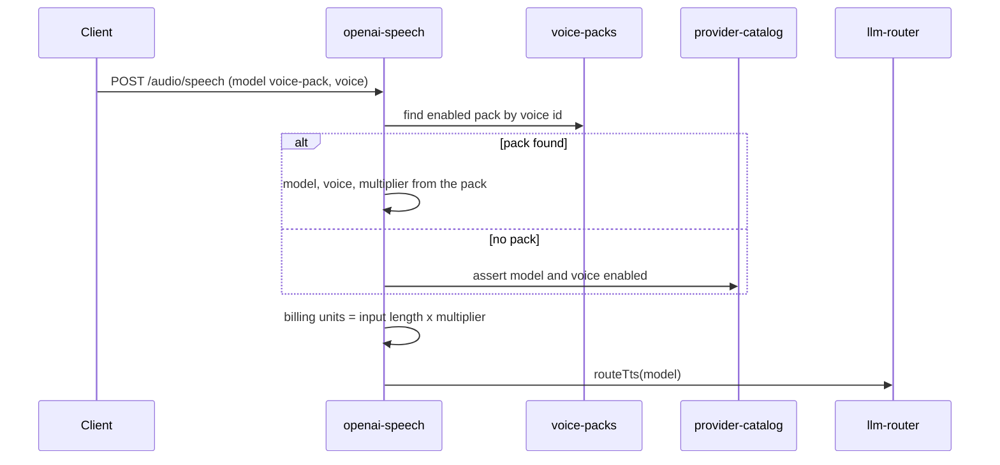

# Route a Voice Pack to a model that the catalog hides

Status: accepted

## Context

TTS billing has one global price, `FLUX_PER_1K_CHARS_TTS`. Only a Voice Pack carries a cost multiplier.

`POST /api/v1/audio/speech` checked that the routed model is enabled in the provider catalog, also for a Voice Pack. So a pack that costs more than 1x needed its model enabled in the catalog. An enabled model shows in the model list, and users can select it directly at 1x.

We want to offer a faster provider at 5x, only through Voice Packs.

## Decision

- When a request resolves to an enabled Voice Pack, the route does not check the catalog model or the catalog voice.
- The enabled Voice Pack is the curated gate for its model, voice, and cost multiplier.
- A direct model request still needs an enabled catalog model and an enabled catalog voice.
- Operators keep the pack model disabled in the catalog. Then users reach it only through the pack.

## Scope

- `POST /api/v1/audio/speech` in `services/domain/openai-speech`.

Non-goals:

- A cost multiplier for each catalog model.
- The streaming WebSocket route `/api/v1/audio/speech/ws`.
- Changes to the Voice Pack admin or the client.

## Module dependencies



## Affected files

```text
server/apps/api/src/
  services/domain/openai-speech/index.ts   skips catalog checks for an enabled Voice Pack
  routes/openai/v1/route.test.ts
server/docs/ai/adr/2026-11-24-voice-pack-hidden-models.md
```

## Sequence



## Test plan

- A Voice Pack request routes to a model that the catalog rejects, and bills with the pack multiplier.
- A direct request for a disabled catalog model still fails with `PROVIDER_CATALOG_TTS_MODEL_DISABLED`.
